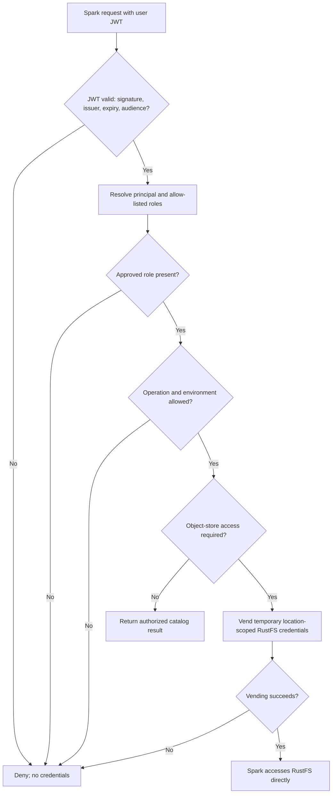

# Unit 3 Business Logic Model — Polaris Authorization and RustFS Credential Vending

## Actors and outcomes

- **Developer or analyst:** operates Spark under their own Keycloak identity.
- **Spark/Iceberg client:** submits catalog requests to Polaris and accesses RustFS directly only with temporary credentials returned through Polaris credential vending.
- **Keycloak:** issues the access JWT with the canonical issuer, subject/username, `polaris` audience, and approved role claims.
- **Polaris:** validates the JWT, resolves the existing principal and product roles, applies the authorization matrix, and vends location-scoped temporary storage credentials only after authorization.
- **RustFS:** serves the authorized object operation using the temporary credential scope.

The successful outcome is an authorized Spark operation whose catalog action and object-store location are both within the user's grants. Invalid identity, missing authorization, or credential vending/storage failure does not grant access or trigger a shared-identity fallback.

## Authorization and data-access workflow

1. Unit 2 obtains a current user access JWT before Spark session creation. Spark uses that exact JWT for Polaris REST requests; no writer or bootstrap identity is substituted.
2. Polaris validates signature, canonical issuer, expiry, and explicit `polaris` audience. It resolves the existing principal from `preferred_username` and extracts only the explicitly allow-listed `resource_access/polaris/roles` values.
3. Polaris rejects missing, malformed, invalid, or unrecognized authorization claims. If the user has both approved developer and analyst roles, both are retained and the effective grants are their union.
4. Polaris evaluates the requested catalog operation and target environment/location. Catalog and namespace discovery follows the same read visibility: developers can discover production, UAT, and dev; analysts can discover production only.
5. If denied, Polaris returns an authorization failure without vending credentials or revealing unauthorized names/locations.
6. If allowed, Polaris returns catalog metadata and, for object access, temporary credentials scoped to the authorized storage location. Spark uses those credentials directly against RustFS; the credential values remain in process memory and are not copied into notebooks or persistent configuration.
7. For subsequent object requests, the supported Iceberg/Polaris vending refresh path may obtain current scoped credentials. If the active client/protocol cannot renew or Polaris denies renewal, the affected operation fails; the user starts a new Spark session to obtain a fresh JWT. Static RustFS keys are never a fallback.

## Authorization decision sequence

## Role outcomes

| Effective roles | Metadata discovery | Data reads | Mutations | Credential scope |
|---|---|---|---|---|
| Developer | All approved environments | Production, UAT, dev | All supported mutations in dev only | Only the operation's authorized dev object locations for writes; authorized locations for reads |
| Analyst | Production only | Production only | None | Only authorized production object locations for reads |
| Developer + analyst | All approved environments | Production, UAT, dev | All supported mutations in dev only | Union of role grants, constrained to each authorized operation/location |
| None or unrecognized only | None | None | None | No credentials |

## Failure paths

| Condition | Functional result |
|---|---|
| Invalid signature, issuer, audience, or expiry | Reject the request; no principal/role authorization or credential vending. |
| Principal cannot be resolved or role claim is absent/malformed/unrecognized | Deny; do not infer a role from username or shared service identity. |
| Operation is outside role or environment grants | Deny before vending; do not disclose unauthorized catalog/namespace names. |
| Requested location is malformed or does not map to the authorized catalog scope | Deny; do not broaden or rewrite the location to another environment. |
| Polaris credential vending fails | Fail the object operation; do not use persistent RustFS keys. |
| Temporary credentials expire and renewal is unavailable/denied | Fail the affected operation; obtain a fresh user JWT in a new Spark session as required. |
| RustFS rejects the temporary credential or operation | Surface a bounded storage-access failure; do not retry under another identity. |
| Keycloak/Polaris service dependency is unavailable | Fail closed; no new authorization or storage credential is created. |

## Audit and scope handoff

Record correlation ID, validated principal, catalog/environment, operation class, decision, and failure category where available. Never record JWTs, RustFS access/secret/session credentials, bootstrap credentials, or notebook data. Unit 3 owns focused role, operation, location, and vending checks. Unit 4 owns complete login-to-RustFS journeys, live revocation, isolation, and cross-component acceptance.

## Testable Properties

The following properties are carried into Unit 3 Code Generation. PBT validates pure decision/path/configuration logic; external Polaris, Keycloak, and RustFS behavior remains covered by focused examples and separately scheduled integration validation.

| Component | Property category | Property to verify |
|---|---|---|
| Role and operation authorization | Oracle, invariant | For every generated approved role set, environment, and operation, the decision equals the approved access matrix. Dual developer/analyst membership is the union of grants; no role or an unrecognized role grants nothing. Analyst mutations are always denied. |
| Catalog and table-location resolution | Invariant | Every accepted table location resolves to exactly one approved bucket/catalog/environment mapping and the `bucket/catalog/db/table` layout. Malformed paths, duplicated database segments, traversal components, and cross-environment mappings are rejected; resolution never broadens scope. |
| Credential/cache runtime settings | Invariant, range constraint | Generated duration and cache values are positive, the cache target is strictly less than the credential duration, and emitted non-secret values preserve the configured targets. Secret material is never included in generated diagnostic output. |
| Credential vending scope | Easy verification | Where a pure request/response model is available, the returned scope is no broader than the authorized catalog, location, and operation. Actual RustFS STS behavior is an integration property and is not claimed by a pure unit property. |
| Stateful credential refresh/cache | No PBT properties identified in Unit 3 code | The cache and refresh state are owned by pinned Polaris/Iceberg components, not a new Unit 3 stateful algorithm. Validate observable refresh, expiry, and denial behavior with explicit examples/integration checks; do not model external provider internals as local state. |
| Serialization/round-trip and recursive algorithms | No PBT properties identified | Unit 3 introduces no domain serialization/decoding pair or recursive algorithm with a logical inverse. Reassess if implementation introduces one. |
