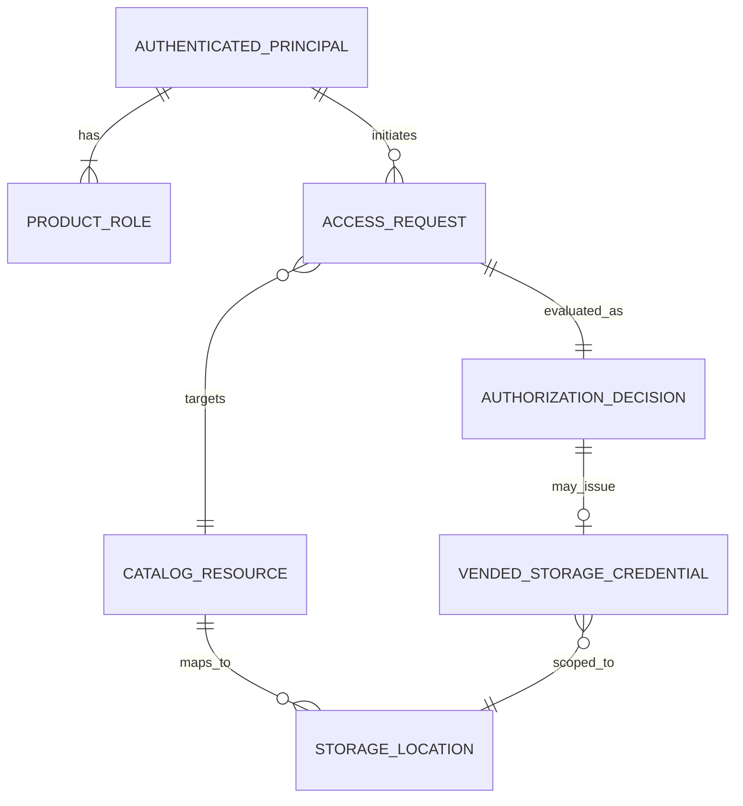

# Unit 3 Domain Entities — Polaris Authorization and RustFS Credential Vending

## Entities

### AuthenticatedPrincipal

Represents the identity established by a validated Keycloak JWT and mapped to a pre-provisioned Polaris principal.

- **Identity key:** verified `preferred_username`, matched to the existing Polaris principal.
- **Trust inputs:** signature, canonical issuer, expiry, explicit `polaris` audience, and verified token claims.
- **Contains:** stable username/principal reference and the approved roles resolved from the token.
- **Must not contain:** an identity accepted solely from Spark request parameters or an implicit shared writer identity.

### ProductRole

An allow-listed role associated with the `polaris` audience.

- **Values in this journey:** `role-default-developer`, `role-default-analyst`.
- **Semantics:** developer reads all approved environments and mutates dev only; analyst reads production only and has no mutations.
- **Combination:** multiple approved roles are combined by union; the effective permission set cannot exceed the union of the approved role grants.

### CatalogResource

An environment-scoped Polaris catalog and its namespaces/tables.

- **Approved catalogs:** `lakehouse`, `lakehouse_uat`, `lakehouse_dev`.
- **Environment:** production, UAT, or dev.
- **Contains:** catalog identifier, environment mapping, namespace/table identity, and associated storage base location.
- **Rule:** discovery and operations are evaluated against the effective principal grants.

### StorageLocation

The RustFS object location associated with a catalog resource or table.

- **Contains:** RustFS endpoint/bucket and the authorized object prefix for the catalog operation.
- **Rule:** resolve from trusted Polaris/catalog metadata; do not treat an arbitrary client-supplied location as authorization proof.
- **Scope:** a request is constrained to the authorized catalog and environment path.

### AuthorizationDecision

The result of evaluating a verified principal's operation against a catalog resource and, when relevant, a storage location.

- **Inputs:** principal, role set, operation class, catalog/environment, namespace/table, and resolved location.
- **Outcomes:** allow or deny, reason category, and correlation ID.
- **Invariant:** credential vending is reachable only after an allow decision.

### VendedStorageCredential

Temporary credential material returned by Polaris for direct Spark-to-RustFS access after authorization.

- **Contains:** temporary access key, secret key, session token if provided, expiration, and scoped storage configuration.
- **Lifecycle:** used in the Spark process for the authorized operation; refreshed only through the supported Polaris/Iceberg vending path.
- **Security invariant:** not persisted, logged, rendered in notebook output, shared across users, or replaced by root/bootstrap keys.

### AccessRequest

An Iceberg REST or direct object-store operation initiated by a Spark session.

- **Contains:** user JWT reference (never its logged value), operation class, catalog resource, and request correlation ID.
- **Flow:** Polaris validates and authorizes catalog requests; RustFS receives only the temporary credentials and scoped object request.
- **Failure:** invalid identity, denied operation/location, unavailable vending, expired credential, or storage denial is explicit and fail-closed.

## Relationships

## Invariants

1. Only a cryptographically validated JWT can establish an `AuthenticatedPrincipal`.
2. A `ProductRole` is effective only if it is allow-listed and present in the verified token claims.
3. An `AuthorizationDecision` is evaluated for both the requested Polaris operation and the resolved environment/location.
4. A denied decision cannot create a `VendedStorageCredential`.
5. A `VendedStorageCredential` is temporary, scoped, and isolated to the requesting Spark session/user.
6. Neither access JWTs nor storage credential values are part of persistent domain records, audit events, or user-visible diagnostics.
