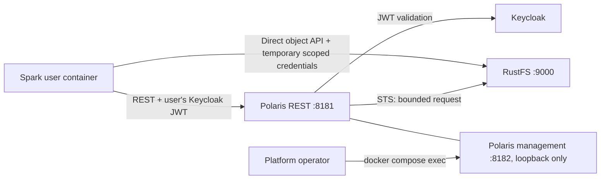

# Unit 3 Deployment Architecture — Polaris and RustFS

## Existing local deployment boundary

The drawing describes the approved target state for the management listener. Existing Compose already leaves port 8182 unpublished and has an in-container health check. Binding management to container loopback and confirming user-container isolation are implementation and verification gates, not completed runtime changes.

## Service and network mapping

| Flow | Network/configuration boundary | Requirement |
|---|---|---|
| Spark to Polaris REST | Existing Polaris REST endpoint on port 8181; host publication remains loopback-bound. | User JWT is the only user identity; no service credential substitutes for it. |
| Polaris to Keycloak | Existing OIDC/JWKS resolution over approved service routing. | Validate canonical issuer, signature, expiry, explicit audience, and role claims. |
| Polaris to RustFS STS | Existing shared `data-access` network; `http://rustfs:9000`. | Bound request/pool behavior; fail closed within the approved deadline. |
| Spark to RustFS object API | Existing `data-access` network after Polaris authorization. | Temporary credential is limited to authorized table/object scope and operation. |
| Operator to Polaris management | Container loopback port 8182, accessed with `docker compose exec`. | No host publication and no reachability from Spark user containers. |

## Existing catalog mapping to preserve

| Polaris catalog | Database/namespace | RustFS bucket | Catalog base location |
|---|---|---|---|
| `lakehouse` | `default_lh` | `bucket-default` | `s3://bucket-default/lakehouse/` |
| `lakehouse_uat` | `default_lhuat` | `bucket-default-uat` | `s3://bucket-default-uat/lakehouse_uat/` |
| `lakehouse_dev` | `default_lhdev` | `bucket-default-dev` | `s3://bucket-default-dev/lakehouse_dev/` |

Namespace/table location checks must confirm exactly one database segment after the catalog segment. Example: `s3://bucket-default/lakehouse/default_lh/<table>`. Any observed duplicate database segment or cross-environment path is a verification failure; this design does not authorize repairing it by resetting data or changing existing catalog metadata.

## Operator diagnostics

- Readiness remains the existing in-container check at `http://127.0.0.1:8182/q/health/ready`.
- Metrics and diagnostic commands run inside Polaris with `docker compose exec polaris ...`.
- Verify the actual management host-binding property, port isolation from Spark containers, effective duration/cache settings, STS timeout behavior, and metric support during implementation.
- Do not expose an additional management port, add a monitoring service, or print tokens or temporary credentials.

## Rollout and rollback boundary

This document is a deployment design only. Code Generation may prepare the approved non-secret Polaris settings and focused tests after the user approves this design. Any Polaris restart, live provider check, or runtime setting change belongs to the later approved build/test stage. Preserve catalogs, grants, buckets, objects, and user state; no reset is part of Unit 3 Infrastructure Design.
