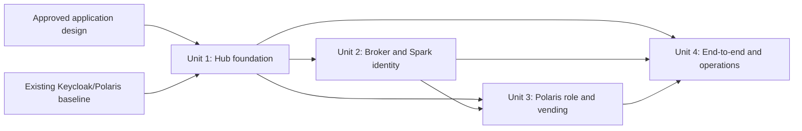

# Unit of Work Dependency Matrix

## Dependency matrix

| Unit | Depends on | Dependency supplied | Blocks |
|---|---|---|---|
| Unit 1 — JupyterHub foundation and OIDC admission | Approved application design; existing Keycloak realm and Compose platform | Pinned Hub/Spawner/API versions, OIDC claims and callback contract, encrypted Hub auth state, per-user container/network/volume boundary | Unit 2 and Unit 4 |
| Unit 2 — Hub token broker and Spark session identity | Unit 1 | Verified own-server Hub token semantics, accessible Hub route, stable user identity and single-user Spark launcher contract | Unit 3 and Unit 4 |
| Unit 3 — Polaris role authorization and RustFS credential vending | Units 1 and 2 | Actual user JWT shape and audience/role claims delivered by Spark; selected Polaris REST client configuration | Unit 4 |
| Unit 4 — End-to-end verification and operations | Units 1, 2, and 3 | Running local stack and completed component-level checks | Construction completion and deploy handoff |

## Sequencing

Unit 1 and the current provider baseline establish the supported Hub, OIDC, and user-server contract. Unit 2 relies on the selected Hub token/server APIs. Unit 3 consumes the actual JWT and Spark REST-client behavior established in Unit 2. Unit 4 verifies all integrated outcomes. Focused component tests and reviews occur inside each unit rather than being deferred to Unit 4.

## Cross-unit interface checkpoints

| Checkpoint | Producer | Consumer | Must be agreed before consumer work |
|---|---|---|---|
| Hub user/server identity and Hub API token scope | Unit 1 | Unit 2 | How the token identifies only its own user/server, and how the selected Hub release validates it. |
| Auth-state shape and refresh ownership | Unit 1 | Unit 2 | Auth state remains Hub-side/encrypted; the broker can refresh only that user's Keycloak session. |
| Broker request/response and error contract | Unit 2 | Spark launcher and Unit 3 | Authenticated request, current access JWT plus expiry only, no refresh token, fail-closed errors. |
| Keycloak JWT claims | Unit 1 and Unit 3 | Polaris in Unit 3 | Canonical issuer, explicit `polaris` audience, preferred username, role-claim namespace and exact developer/analyst values. |
| Polaris and S3 endpoints/configuration | Unit 3 | Spark runtime and Unit 4 | User runtime reaches REST/S3 endpoints without provider administration credentials. |
| Role matrix and cleanup boundary | Units 1–3 | Unit 4 | Existing grants preserved; tests isolate their data and remove only test-created identities/data. |

## Change control

A discovered dependency that requires a new deployable service, changes a user's role grants, changes the approved storage topology, or grants user containers Docker/provider administrative access is a unit-scope change. Update this matrix and obtain approval before implementation expands into that boundary.
