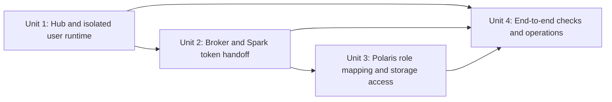

# Unit of Work Plan — JupyterHub Developer and Analyst Access

## Purpose

Decompose the approved requirements, six user stories, and application design into sequenced construction units. This is planning only; unit definition and story-map artifacts are generated after this plan is approved.

## Inputs and canonical design inventory

| Input | Current canonical or approved location | Treatment |
|---|---|---|
| Platform component baseline | `aidlc-docs/knowledge/opensource-lakehouse-infra-v2/application-design.md` | Retain Keycloak, Polaris, RustFS, PostgreSQL, and Spark bootstrap responsibilities. Add the approved JupyterHub OIDC and token-broker journey without modifying the canonical file until intent closure. |
| Approved functional and NFR requirements | `aidlc-docs/current/inception/requirements/requirements.md` | Map FR-1–FR-7 and token/security lifecycle constraints to the units below. |
| Approved user stories | `aidlc-docs/current/inception/user-stories/stories.md` | Map US-01–US-06 to implementation and verification ownership. |
| Approved component and interface design | `aidlc-docs/current/inception/application-design/` | Use the Hub, broker, per-user runtime, Polaris, and RustFS boundaries as unit inputs. |
| Existing Keycloak/Polaris role configuration | `infra/keycloak/realm-contract.json`, `infra/polaris/oidc.properties`, and existing Polaris grant/reconciliation scripts | Preserve existing principals, role names, grants, issuer, audience contract, and mixed/internal authorization model. Modify only as required for this intent. |

The repository currently has no separately defined canonical functional designs for JupyterHub or its token broker. They are new runtime responsibilities introduced by this intent. The user runtime is not a new shared service; Spark remains local to each single-user container.

## Proposed decomposition

This retains the four construction units already listed in the approved workflow plan. Units are sequenced because each depends on the identity/runtime contract established by the previous unit; feature code should include focused checks within its owning unit, with cross-journey acceptance in Unit 4.

| Unit | Responsibility | Component boundary | Candidate stories / requirements |
|---|---|---|---|
| Unit 1 — JupyterHub foundation | Add pinned Hub and single-user runtime, browser OIDC, approved-group admission, encrypted Hub state, per-user containers and persistent homes, and safe network/secret boundaries. | New Hub/authenticator, Spawner, single-user image, and home-volume configuration. | US-01, US-02, US-06; FR-1, FR-2, FR-7. |
| Unit 2 — Hub token broker and Spark session identity | Implement per-server broker authentication and same-user refresh; request a fresh JWT before Spark sessions and pass it to the Polaris REST client without persisting or logging it. | Hub broker handler and Spark launcher/client interface. | US-03, US-06; FR-3, FR-4 and token lifecycle NFRs. |
| Unit 3 — Polaris role authorization and credential vending | Align Keycloak audience/role claims and Polaris validation/principal mapping; preserve role grants and verify direct RustFS access uses scoped vended credentials. | Keycloak claim contract, Polaris OIDC/RBAC configuration, and Spark catalog/storage configuration. | US-04, US-05; FR-4, FR-5, FR-6. |
| Unit 4 — End-to-end verification and operations | Verify both role journeys, negative boundaries, token lifecycle, per-user isolation, failure diagnostics, cleanup, and operator runbook/rollback. | Cross-component integration checks, operational docs, and test evidence. | US-01–US-06; all FRs/NFRs. |

## Dependency order

## Category review and context answers

### Story grouping

Question: Should stories be decomposed by the shared platform journey and its technical dependency boundaries, or by separate developer and analyst stacks?

**[Answer]:** Use the shared journey and four-unit grouping already recorded in the user-approved `workflow-plan.md`. Developer and analyst differences are policy outcomes in Unit 3 and verified separately in Unit 4; they do not need duplicated Hub or broker implementations.

### Dependencies and shared resources

Question: Should Hub foundation, broker/Spark handoff, Polaris claim alignment, and integrated verification be sequenced, or built in parallel against provisional contracts?

**[Answer]:** Sequence Units 1–4 as proposed above. The Hub server-token APIs and user-container contracts are version-dependent, so Unit 1 must establish them before Unit 2. Unit 3 then validates the existing Polaris contract with the Spark handoff; Unit 4 depends on all three.

### Team alignment

No multi-team ownership information appears in the approved workflow, personas, or application design. The Platform Operator persona owns configuration and the stories have shared component boundaries; no team-specific unit split is indicated.

### Technical/deployment considerations

Question: Should the first implementation target the already approved local Docker Compose profile and per-user containers, or introduce a separate deployment topology?

**[Answer]:** Use the local Compose profile and per-user container model from the approved requirements and workflow plan. Do not add a shared Spark cluster or production rollout in this intent.

### Business-domain boundaries

Question: Should developer and analyst authorization be isolated into separate application domains, or remain role-specific journeys over the shared identity, Hub, and Polaris path?

**[Answer]:** Keep one shared identity and data-access journey. Polaris developer and analyst grants remain distinct; tests and story ownership preserve the role-specific outcomes.

### Code organization

Not applicable as a greenfield question. This is a brownfield project with existing Compose, Keycloak, Polaris, RustFS, and Spark bootstrap directories. Construction plans will identify precise additions and ownership within the repository after the unit definitions are approved.

## Unit artifact generation checklist — after plan approval

- [x] Generate `aidlc-docs/current/inception/application-design/unit-of-work.md` with unit definitions, responsibilities, and brownfield code organization implications.
- [x] Generate `aidlc-docs/current/inception/application-design/unit-of-work-dependency.md` with the dependency matrix and sequence.
- [x] Generate `aidlc-docs/current/inception/application-design/unit-of-work-story-map.md` mapping every story and requirement to owning units and verification.
- [x] Validate unit boundaries, dependencies, and complete story coverage.
- [x] Record the approval prompt and response in the audit and update lifecycle state.

## Approval gate

The proposed four-unit decomposition follows the previously approved workflow and the approved component boundaries. Review the unit boundaries and category answers above. Approve this plan to generate the three unit artifacts, or request changes.

**Approval prompt recorded 2026-10-28T18:35:51Z:** “Review `aidlc-docs/current/inception/plans/unit-of-work-plan.md`. It preserves the four construction units from the approved workflow, sequences Hub foundation → broker/Spark identity → Polaris authorization → end-to-end verification, and maps shared developer/analyst journeys to those boundaries. Approve the plan to generate the unit definitions, dependency matrix, and story map, or request changes.”

**Plan approval received 2026-10-28:** “approve and continue.” Classified as approval and continuation.

## Generation result

Generated the unit definitions, dependency matrix, and story map. All six stories and seven functional requirements have primary owners and verification owners; all NFR themes have explicit unit ownership. The artifacts await user review.

**Units approval prompt recorded 2026-10-28T18:37:25Z:** “Review the generated Units Generation artifacts in `aidlc-docs/current/inception/application-design/`: `unit-of-work.md`, `unit-of-work-dependency.md`, and `unit-of-work-story-map.md`. The set defines the four approved construction units, their sequence and interfaces, brownfield code ownership, and story/requirement coverage. Approve the unit decomposition to continue to Construction, or request changes.”
