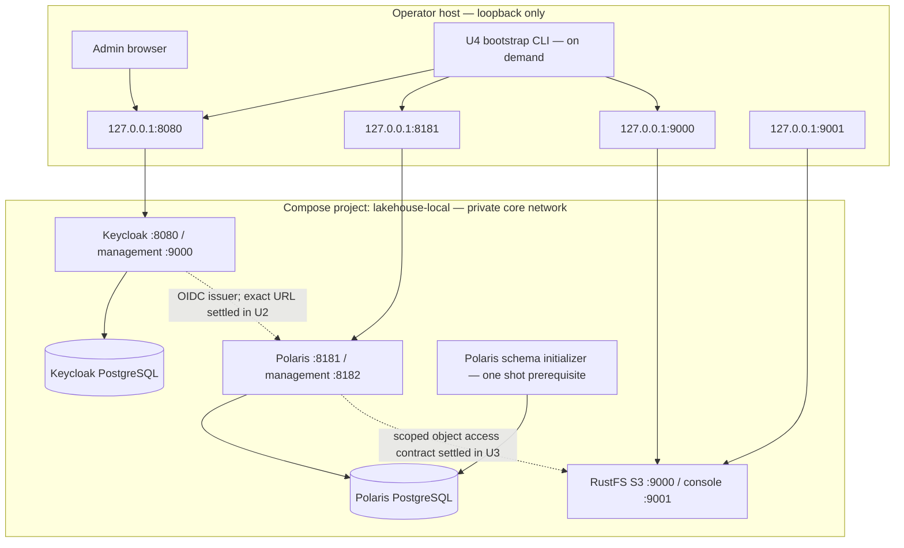
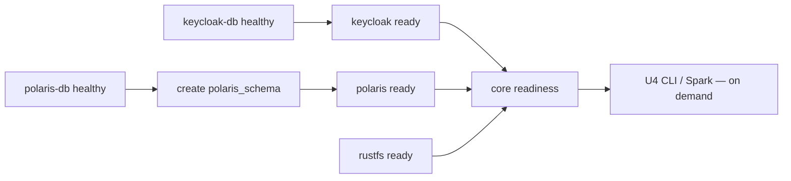

# U1 Deployment Architecture — Keycloak, Polaris, and RustFS

## Runtime topology

Only Keycloak, Polaris API, RustFS S3, and RustFS console publish host ports. Every published host binding is loopback-only. Both databases and both management endpoints stay private. Host CLI and provider-to-provider connectivity use an issuer configuration that U2 must make consistent across host and container clients.

## Service and startup graph

Keycloak DB, Polaris DB, and RustFS can start concurrently. Keycloak waits only for its DB. Polaris waits for its separate DB and the schema-init job. The schema initializer is idempotent and limited to the new Polaris database/schema. The readiness coordinator reports all core services separately and reaches a terminal result within 600 seconds by default. The CLI and Spark are never long-running default Compose services.

## Service matrix

| Service | Internal DNS | Internal port(s) | Published host port | Persistence |
|---|---|---:|---:|---|
| `keycloak-db` | `keycloak-db` | 5432 | None | `lakehouse-local_keycloak-db-data` |
| `keycloak` | `keycloak` | 8080, 9000 management | `127.0.0.1:${KEYCLOAK_HOST_PORT:-8080}:8080` | Database only; `lakehouse-local_keycloak-db-data` |
| `polaris-db` | `polaris-db` | 5432 | None | `lakehouse-local_polaris-db-data` |
| `polaris` | `polaris` | 8181, 8182 management | `127.0.0.1:${POLARIS_HOST_PORT:-8181}:8181` | Database only; `lakehouse-local_polaris-db-data` |
| `rustfs` | `rustfs` | 9000 S3, 9001 console | `127.0.0.1:${RUSTFS_S3_HOST_PORT:-9000}:9000`; `127.0.0.1:${RUSTFS_CONSOLE_HOST_PORT:-9001}:9001` | `lakehouse-local_rustfs-data` |

Exact volume names are subject to Compose normalization and may include a configured project prefix. No service sets `container_name`. Existing project volumes remain unmounted.

## Configuration and state boundaries

- One private network named `core`; no static IPs are required.
- PostgreSQL containers use independent databases, users, passwords, and volumes. PostgreSQL itself is not exposed to the host.
- Polaris persistence is relational JDBC backed by PostgreSQL. Fresh bootstrap creates the `polaris_schema` before the Polaris Admin Tool initializes the realm; Polaris 1.8.0 does not create this schema itself.
- Keycloak persists identity data in its own PostgreSQL service. It does not mount/import FreeIPA data.
- RustFS uses a new named data volume and file-based root credentials. Product buckets and scoped IAM policies are later bootstrap responsibilities.
- Local protected credentials live under `.runtime/credentials/`. PostgreSQL `_FILE`, RustFS `_FILE`, and read-only application config files carry file paths/content into the corresponding containers without placing secret values in Compose interpolation. During the new-runtime setup, remove existing credential/secret files in this project copy’s `.runtime/credentials/` and generate only the new runtime’s required files; leave other runtime files, volumes, and objects untouched.
- Manual backups stop the owning service before copying its state; RustFS state is preserved separately from provider databases.

## Deferred and retired resources

The primary Compose file excludes FreeIPA, Hive schema/metastore, KDC, keytabs, Spark, JupyterHub, Airflow, Jenkins, and StarRocks. Deferred integrations may be listed in a separate opt-in file but are unsupported until migrated; that file must not reintroduce retired providers as dependencies. The cleanup workflow is never part of this topology and may target only exact reviewed legacy FreeIPA/Hive/KDC volume names. RustFS and unrelated volumes are explicitly ineligible.

## Operational behavior

`scripts/lakehouse.sh start` validates prerequisites, creates only missing protected secret inputs, starts core providers, initializes the Polaris schema prerequisite, and waits for provider-specific readiness. `status` is read-only. `stop` stops containers while preserving volumes. Compose process-exit recovery is bounded to three retries; an alive unhealthy container is reported unavailable and is not automatically restarted. All status output redacts secrets.

The precise browser/host/container Keycloak issuer address and Polaris OIDC discovery configuration must be fixed in U2 before implementation is accepted. This is a cross-unit contract, not a reason to publish more host interfaces.
