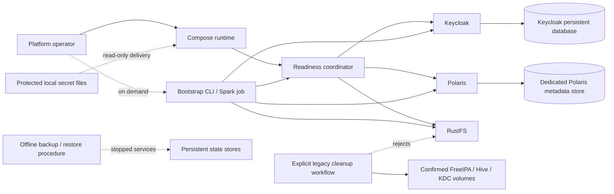

# U1 Logical Components — Runtime Composition and Legacy Removal

## Component view

The diagram is logical. Concrete service names, network aliases, ports, Compose health checks, image versions, volume names, and the physical Keycloak database topology are specified in Infrastructure Design.

## Components and responsibilities

| Component | Responsibility | Failure behavior / boundary |
|---|---|---|
| Compose runtime | Starts and stops the approved default core providers and their declared prerequisites. | Starts independent providers concurrently; does not delete persistent resources on failure or shutdown. |
| Readiness coordinator | Collects provider health/readiness observations and dependency state under one configurable overall deadline. | Reports each provider; returns failure by the 10-minute bound; does not restart a live unhealthy process. |
| Core provider: Keycloak | Provides identity/OIDC service for the new platform. | Owns separate persistent identity state through a supported database configuration; must not import FreeIPA state. Realm and group behavior belongs to U2. |
| Core provider: Polaris | Provides the Iceberg catalog and catalog authorization integration. | Requires its metadata store; catalog and grant bootstrap behavior belongs to U2. |
| Polaris metadata store | Persists Polaris catalog metadata in dedicated PostgreSQL. | Isolated from Keycloak identity state and the retired Hive schema; preserves data across ordinary restarts. |
| Keycloak persistent database | Persists Keycloak state using a supported production-mode database configuration. | Logically separate from Polaris metadata; exact physical topology and image choice belong to Infrastructure Design. |
| Core provider: RustFS | Provides S3-compatible object storage for the data-product buckets. | Owns persistent object data; ordinary startup, restart, and legacy cleanup must preserve it. Bucket and credential policy configuration belongs to U3. |
| Protected secret source | Stores local file-backed credentials outside version control with owner-only permissions. | Read-only delivery to services; Compose secrets preferred when supported, otherwise read-only file mounts; values are not emitted in logs. |
| Private core network | Carries provider-to-provider APIs within the Compose environment. | No internal API is bound to non-loopback host interfaces; operator-required endpoints are exposed only on loopback. |
| Bootstrap CLI / Spark job | On-demand clients that use ready providers for product bootstrap and smoke verification. | Not a default long-running provider; readiness and bootstrap implementation are owned by U4. |
| Offline backup/restore procedure | Gives the operator consistent manual commands for persistent stores. | Relevant service is stopped during each state copy; procedure preserves RustFS objects and does not add a scheduled backup service. |
| Legacy cleanup workflow | Separately invoked tool for removing only confirmed retired FreeIPA, Hive/metastore, and MIT KDC volumes. | Requires dry-run inventory and a second exact-name invocation; rejects RustFS, unrelated, or ambiguous volumes; never runs from startup/bootstrap. |

## Startup and dependency behavior

1. Compose starts independent providers concurrently while honoring declared prerequisites.
2. Readiness coordinator observes each provider and reports status to the operator.
3. Dependent work is released only after all providers it requires are ready.
4. A process exit may trigger up to three container restart attempts. A health-check failure on a still-running process marks the provider unavailable but does not trigger an automatic watchdog restart.
5. At the configurable overall 10-minute deadline, unresolved providers and blocked dependent work are reported; healthy providers and their stores remain intact.

## Data and security boundaries

- Keycloak identity, Polaris metadata, and RustFS object data have separate logical owners and persistent stores.
- Polaris metadata does not use the retired Hive schema; new Keycloak state does not import FreeIPA data; no component requires KDC state or keytabs.
- Provider APIs communicate on one private network. Only necessary operator endpoints are published on loopback.
- Secret source files are local and protected; services receive read-only file paths. Exact mount definitions are implementation details for Infrastructure Design.
- Legacy cleanup receives explicit exact resource names and rejects ambiguous ownership. RustFS and unrelated service state are never eligible.

## Deferred integrations

Airflow, JupyterHub, Jenkins, and StarRocks are not components in the supported default runtime graph. If retained in opt-in contexts, they remain unsupported until separately migrated from retired Hive/Kerberos dependencies and tested with Keycloak/Polaris.
