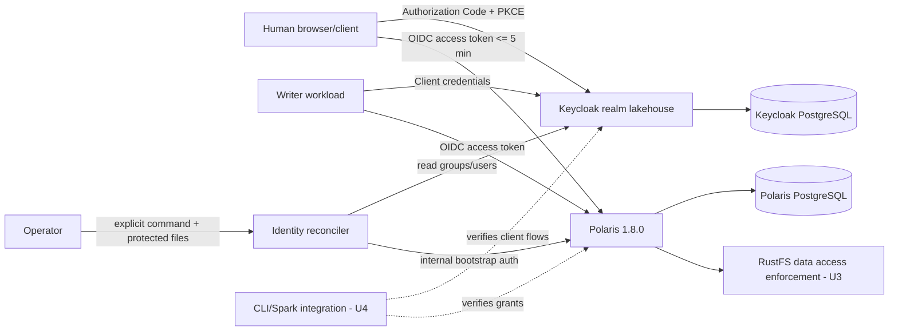

# U2 Deployment Architecture — Keycloak and Polaris Authorization

## Deployment context

U2 extends the U1 `lakehouse-local` Compose deployment. Keycloak and Polaris persist to their separate PostgreSQL stores and share the approved private core network. Existing provider health/readiness and loopback host-publication rules remain in force. This logical deployment view does not declare new containers; the reconciler is a short-lived operator-invoked command/container, and its exact Compose invocation is settled during Code Generation.

## Logical service graph

Polaris uses `mixed` authentication with internal credential mode and the built-in authorizer. Normal product identities authenticate through Keycloak. Polaris internal credentials are restricted to the operator bootstrap/reconciliation path and are never supplied to product users or Spark workloads.

## Identity configuration

| Item | Design value | Notes |
|---|---|---|
| Keycloak realm | `lakehouse` | Secret-free realm template; additive import/validation. |
| Canonical issuer | `http://keycloak.localhost:8080/realms/lakehouse` | Keycloak's fixed frontend hostname; exact token `iss`; host-side OIDC discovery. |
| Polaris JWKS route | `http://keycloak:8080/realms/lakehouse/protocol/openid-connect/certs` | Private Docker service DNS; Polaris disables discovery and validates the canonical issuer explicitly. |
| Human client | Public OIDC client, Authorization Code + PKCE | Exact local redirect URIs; implicit and password grants disabled; token lifetime <= 5 min. |
| Writer client | Confidential OIDC client with service account/client credentials | Dedicated writer identity is a member only of `role-default-writer`. |
| Polaris groups | `role-default-developer`, `role-default-analyst`, `role-default-owner`, `role-default-writer` | Only these memberships map to Polaris product-role claims. |
| Principal-name claim | Stable Keycloak username, configured as `preferred_username` unless an exact supported claim requires a named alternative | Reconciler uses the same normalized value; immutable `sub` retained for correlation. |
| Product-role claim | Dedicated Polaris client-role claim | Polaris role mapper yields matching `PRINCIPAL_ROLE:<name>` values; unrelated claims are filtered. |

## Polaris authorization configuration

1. Enable the external OIDC tenant with metadata discovery disabled, an explicit canonical token issuer, and a private absolute JWKS endpoint over Docker service DNS; validate exact issuer/signature/audience/time claims.
2. Set the Polaris realm to `mixed` authentication and internal credential mode, retaining the built-in metastore authorizer.
3. Map principal names using the stable Keycloak username claim. Avoid a Polaris ID claim because the metastore owns Polaris principal IDs.
4. Map only the dedicated product-role claim to the four pre-created Polaris principal roles.
5. Create three environment catalogs and per-catalog catalog roles/grants as specified by the approved role matrix. A product-user operation succeeds only if the token, metastore principal, principal role, and catalog grant all validate.
6. Keep the privileged internal bootstrap token and credential out of ordinary user/Spark access paths. Only the explicit operator process receives it.

## Membership reconciliation topology

- Trigger: explicit operator action after a Keycloak group membership change; no event listener or periodic service.
- Inputs: current Keycloak principal username/subject and membership in the four approved groups.
- Credential separation: Keycloak read permission and Polaris bootstrap credential are distinct protected inputs with least-privilege mounts.
- Writes: ensure/verify the matching Polaris principal and only the required principal-role assignments. Preserve unrelated assignments and catalog state.
- Completion: read back Polaris assignments and return success only when desired/current state matches; otherwise report a safe non-converged result.
- Readiness: wait for Keycloak and Polaris health, the private JWKS endpoint, and authentication readiness within U1's bounded window before any changes.

## Logical role bindings

| Principal role | Catalog `lakehouse` | Catalog `lakehouse-dev` | Catalog `lakehouse-uat` |
|---|---|---|---|
| Developer | Read | Read/write | Read |
| Analyst | Read | No grant | No grant |
| Owner | Product content and access-management grants | Product content and access-management grants | Product content and access-management grants |
| Writer | Read/write | Read/write | Read/write |

Catalog role definitions are distinct and scoped to each catalog. Content write does not imply drop or grant-management access. Owner access management is product-catalog scoped and does not confer provider administration or RustFS policy rights.

## Secret and network boundaries

- Keycloak writer secret, Polaris bootstrap credential, and reconciler Keycloak credential are distinct protected files under `.runtime/credentials/`.
- Follow U1's owner-only host source and service-specific read-only staged-mount convention. Only the operator reconciliation process receives the Polaris bootstrap credential; no normal application service does.
- Keep Keycloak and Polaris management APIs on the private network except their approved loopback-published endpoints. PostgreSQL remains unpublished.
- Do not add another host port, sidecar, background service, or volume for reconciliation.

## Startup and failure order

1. U1 starts databases, Keycloak, Polaris, and RustFS under its bounded readiness coordinator.
2. Keycloak realm import and Polaris external-auth settings are validated after service health; conflicts stop the dependent U2 operation.
3. Provisioning/reconciliation waits for Keycloak health, private JWKS reachability through service DNS, and Polaris API/auth readiness.
4. If Keycloak or Polaris is unavailable, do not mutate grants and deny product-user authorization per U2-NFR-06.
5. After recovery, rerun explicit idempotent reconciliation and verify effective assignments. Never clear unrelated state as recovery.

## Implementation boundary

This document defines the U2 deployment contracts, not executable realm JSON, application properties, Admin API scripts, or live Polaris grants. Those files are produced only after Infrastructure Design approval. U4 later tests real user/writer tokens and catalog/table operations; U3 separately tests object-store enforcement.
