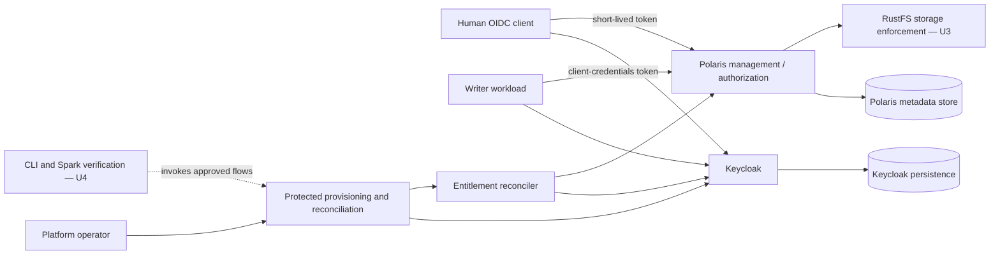

# U2 Logical Components — Keycloak Identity and Polaris Authorization

## Component view

This is a logical view. The concrete Polaris auth mode, API routes, claim paths, Compose aliases, service dependencies, and secret mounts are defined in later Infrastructure Design and Code Generation.

## Components and responsibilities

| Component | Responsibility | Failure behavior / boundary |
|---|---|---|
| Keycloak | Authenticates human users and the writer client; owns product-group membership and issues OIDC tokens. | Product authorization fails closed while unavailable. It does not own Polaris grants or RustFS policies. |
| Human OIDC client | Uses Authorization Code with PKCE and presents a short-lived token to Polaris. | Does not use password grant or bootstrap credentials; token lifetime is at most five minutes. |
| Writer client | Uses OAuth client credentials as the dedicated writer service identity. | Secret is file-protected and rotated at least every 90 days; no human login or grant-management right. |
| Protected operator flow | Performs explicit first-time provisioning and invokes membership reconciliation. | Uses a separate protected bootstrap identity/credential; unavailable to product users and workload containers. |
| Entitlement reconciler | Reads Keycloak membership, aligns Polaris principal-role assignments, and verifies convergence. | Additive and idempotent; preserves unrelated state; partial failure is visible and never reported as success. |
| Polaris OIDC validator | Validates issuer, signature, audience, and time claims and resolves the configured stable Keycloak username to a Polaris principal. | Exact issuer only; unknown principal, invalid token, unavailable Keycloak, or claim mismatch denies authorization. |
| Polaris authorization engine | Evaluates Polaris principal roles, catalog roles, and grants for catalog operations. | Applies least privilege per environment. It does not decide RustFS direct-object access. |
| Polaris metadata store | Persists principals, roles, grants, and catalog metadata. | Kept separate from Keycloak state and the retired Hive store; recovery preserves unrelated assignments. |
| Keycloak persistence | Persists realms, clients, identities, and groups. | Separate logical owner from Polaris metadata. No FreeIPA state import. |
| Diagnostics/correlation | Connects provider and reconciler operations using a generated operation ID. | Records safe identifiers/outcomes; excludes tokens, secrets, passwords, and authorization headers. |
| RustFS enforcement (U3) | Enforces S3 bucket/object policies and credential vending independently of Polaris catalog RBAC. | A Polaris grant does not imply S3 access; direct and vended access are verified in U3. |
| CLI/Spark verification (U4) | Invokes approved setup flows and tests real catalog/table operations with human or writer identities. | On-demand client, not a U2 authorization authority; no bootstrap credential is passed to Spark. |

## Identity and authorization flow

1. A human authenticates through Keycloak with Authorization Code plus PKCE, or the writer obtains a token through client credentials.
2. The client presents its token to Polaris. Polaris validates the exact issuer, signature, audience, and time bounds, then resolves the configured Keycloak username to a known Polaris principal.
3. Polaris evaluates the principal's reconciled product principal roles and the catalog-scoped grants for the requested catalog/namespace/table operation.
4. A successful Polaris decision authorizes catalog metadata/data operations only. Any S3 operation must separately pass RustFS enforcement.
5. If Keycloak is unavailable, or any required identity/principal/grant check fails, the product operation is denied. There is no fallback user or bootstrap identity.

## Membership reconciliation flow

1. Operator changes a product group's membership in Keycloak.
2. Operator invokes the explicit reconciliation workflow using protected bootstrap authority.
3. Reconciler reads the complete desired membership, validates stable identity mapping, and computes the minimal principal-role changes.
4. Reconciler applies only required assignments in Polaris and reads them back.
5. The operation reports success only when Polaris matches the current desired membership. Otherwise it returns a correlated, redacted non-converged result; retry is safe.

Keycloak membership is the source of truth. Polaris role assignments are derived state, not a second independent entitlement source.

## Logical role and catalog grant matrix

| Keycloak group / Polaris principal role | `lakehouse` production | `lakehouse-dev` | `lakehouse-uat` |
|---|---|---|---|
| `role-default-developer` | Read | Read/write | Read |
| `role-default-analyst` | Read | No access | No access |
| `role-default-owner` | Product content and grant management | Product content and grant management | Product content and grant management |
| `role-default-writer` | Read/write | Read/write | Read/write |

Catalog roles are scoped per catalog. Developer/writer write privileges do not imply drop, namespace deletion, catalog configuration, or grant management. Owner grant-management authority remains limited to the product catalogs and does not imply Keycloak realm, Polaris platform, or RustFS administration.

## Failure and recovery boundaries

- Invalid/expired tokens, invalid issuer/audience, unavailable Keycloak, unknown principal, missing role assignment, insufficient grant, or unavailable Polaris all deny the requested product operation.
- Reconciliation failure is visible and non-converged. Recovery waits for provider readiness and reruns the same idempotent reconciliation; it does not clear all assignments.
- Writer rotation uses controlled replacement-client overlap if a single Keycloak client cannot hold overlapping secrets. The old identity is disabled only after replacement authentication and an approved writer operation are verified.
- Logs and command output carry correlation IDs and safe provider/principal/role/catalog identifiers, never credential material.

## Unit boundaries

- U2 owns Keycloak-to-Polaris identity resolution, principals, product principal roles, catalog roles/grants, and reconciliation design.
- U3 owns RustFS buckets, policies, and storage credential/vending enforcement.
- U4 owns operator CLI sequencing, Spark/Iceberg table operations, and end-to-end positive/negative tests.
- U1 owns core Compose runtime, persistence, networks, and protected local secret delivery.
