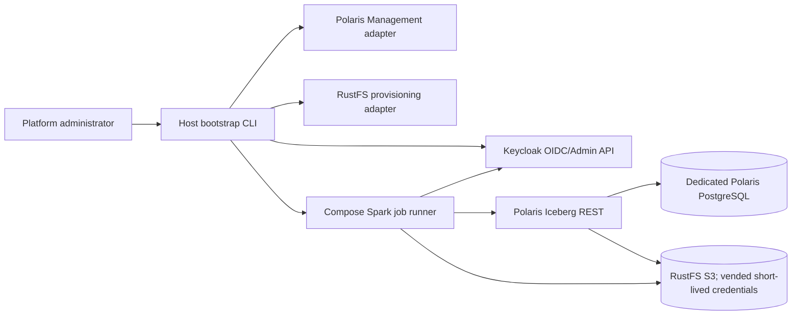

# Application Design — Keycloak + Polaris `default` Data Product Bootstrap

## Purpose and approved decisions

This design defines the high-level application structure for the first `default` data product journey. It follows the approved Application Design plan and requirements. The operator invokes a host CLI. A thin coordinator calls separate Keycloak, Polaris, and RustFS adapters, then launches a short-lived Spark smoke job. Provider steps are ordered and idempotent; partial state is retained on failure and validated on rerun.

Keycloak groups map through OIDC claims to Polaris principal roles. Polaris principals, principal roles, catalog roles, and grants are explicitly provisioned because identity claims alone do not establish Polaris RBAC. Human and writer data access uses Polaris-aware Iceberg clients and Polaris-vended short-lived RustFS credentials. Ordinary users do not get direct S3 credentials. The platform administrator uses a separate protected bootstrap credential to provision buckets and provider configuration.

The design includes Keycloak, Polaris, dedicated Polaris PostgreSQL, RustFS, the CLI/coordinator, and Spark smoke job. Airflow, JupyterHub, Jenkins, and StarRocks are deferred.

## Target topology



## Product resource mapping

| Environment | Catalog | Namespace | Storage base path | Smoke table |
|---|---|---|---|---|
| Production | `lakehouse` | `default_lh` | `s3://bucket-default/default_lh/` | `bootstrap_smoke_test` |
| Dev | `lakehouse-dev` | `default_lhdev` | `s3://bucket-default-dev/default_lhdev/` | `bootstrap_smoke_test` |
| UAT | `lakehouse-uat` | `default_lhuat` | `s3://bucket-default-uat/default_lhuat/` | `bootstrap_smoke_test` |

Buckets are `bucket-default`, `bucket-default-dev`, and `bucket-default-uat`. Catalogs carry the corresponding storage integration/base location.

## Components and responsibilities

| Component | Responsibility |
|---|---|
| Host CLI | Operator entry point; accepts the product operation; returns safe progress, results, and exit status. |
| Bootstrap coordinator | Orders setup, delegates to adapters, launches smoke verification, aggregates results, and preserves partial state for safe reruns. |
| Keycloak adapter | Ensures four role groups, writer OAuth identity, and initial owner membership; human users are separately managed in Keycloak. |
| Polaris adapter | Configures OIDC claim mapping and ensures catalogs, namespaces, Polaris principals/roles/grants, and access verification. |
| RustFS adapter | Ensures buckets and validates storage-side setup using protected platform bootstrap credentials. Does not issue end-user keys. |
| Spark runner/job | Launches a one-shot workload under writer OAuth credentials and creates/validates the three deterministic Iceberg smoke tables. |
| Credential source | Provides protected bootstrap and writer secret handles without placing values in source-controlled config or logs. |
| Readiness/report services | Check dependencies, summarize per-step state, redact secrets, and provide actionable errors. |

## Identity and role mapping

Keycloak contains `role-default-developer`, `role-default-analyst`, `role-default-owner`, and `role-default-writer`. The creator is placed in the owner group. The writer is a non-interactive service identity. Human user provisioning remains separate from product bootstrap.

OIDC tokens carry group/role claims mapped to Polaris principal roles. Polaris catalog roles/grants define resource privileges for each principal role. Proposed role behavior is: developer reads all three catalogs and writes dev; analyst reads production only; owner manages product-level Polaris objects/grants in all three; writer reads/writes all three. All table data operations use Polaris-aware Iceberg clients. Polaris authorizes metadata requests and vends short-lived storage credentials for the authorized location and operation. Direct S3 calls without such a vended credential fail.

Owner authorization is managed through Polaris grants. RustFS policy administration remains platform-managed; owner changes to Polaris grants alter what data Polaris authorizes and can vend but do not grant RustFS administrative API access. This is the approved interpretation of product-level owner grant management for the initial journey.

## Main operation contracts

```text
bootstrap_default(options) -> BootstrapReport
verify_default(options) -> VerificationReport
run_bootstrap(product, options, adapters, spark_runner) -> BootstrapReport
ensure_product_groups(product) -> GroupSet
ensure_writer_identity(product) -> ServiceIdentityRef
assign_owner(user_ref, product) -> MembershipResult
ensure_catalogs(product) -> CatalogSet
ensure_namespaces(product) -> NamespaceSet
ensure_principals_and_roles(product) -> PolarisRoleBindings
verify_grants(product) -> GrantVerification
ensure_buckets(product, credential_handle) -> BucketSet
run_smoke_job(job_spec, writer_credential_handle) -> JobResult
```

Provider-specific payloads, exact Polaris Management calls, OIDC claim paths, RustFS credential vending settings, and detailed result/error schemas are deferred to Functional and Infrastructure Design.

## Service orchestration and failure behavior

1. Load protected bootstrap credentials and verify readiness.
2. Ensure Keycloak groups, writer identity, and creator owner membership.
3. Ensure RustFS buckets and Polaris storage integration.
4. Ensure Polaris catalogs, namespaces, principals, roles, and grants.
5. Launch Spark smoke job using writer OAuth credentials and Polaris vended credential delegation.
6. Verify table/schema/sample row and environment-specific object location.
7. Return a redacted report.

The coordinator stops on the first failed dependency step, reports completed and failed actions, and leaves created resources in place. A rerun validates existing matching resources and proceeds; conflicting state fails safely. No resource or bucket data is automatically deleted.

## Dependencies and unresolved implementation validation

- Keycloak OIDC issuer, audience, token roles/groups claim, and service-account flow.
- Polaris external authentication, principal resolution, principal-role claim transformation, Management API RBAC, and S3 credential vending.
- RustFS support for the storage integration/STS flow used by the selected Polaris release.
- Spark/Iceberg client compatibility and credential refresh behavior.
- Compose health, network, secret, persistent volume, and profile choices.

These are version-sensitive integration constraints, not claims of runtime verification. Pin versions and prove them during NFR/Infrastructure Design and Build and Test.

## Traceability and verification intent

US-01–US-03 map to CLI, coordinator, provider bootstrap, and initial owner membership. US-04–US-07 map to Keycloak claims, Polaris RBAC, and vended storage access. US-08 maps to Spark smoke table creation, verification, and safe reruns. Build and Test must demonstrate each positive/negative role operation, raw S3 denial without vended credentials, correct environment locations, and non-destructive second-run behavior.
