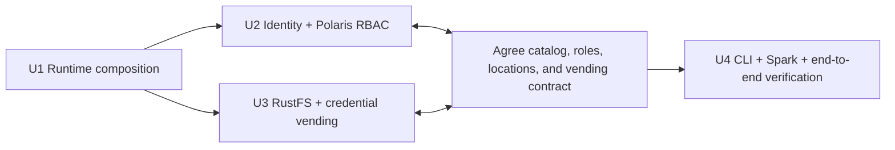

# Unit of Work Dependency Matrix

## Dependency matrix

| Unit | U1 Runtime | U2 Identity/catalog | U3 Storage/vending | U4 CLI/Spark |
|---|---:|---:|---:|---:|
| U1 Runtime composition and legacy removal | — | prerequisite | prerequisite | prerequisite |
| U2 Identity and catalog authorization | depends | — | interface coordination | prerequisite |
| U3 Object storage and credential vending | depends | interface coordination | — | prerequisite |
| U4 Bootstrap CLI and Spark verification | depends | depends | depends | — |

## Recommended delivery order

U1 must complete first. U2 and U3 can be implemented concurrently by the single owner using the approved component interfaces, but neither is considered integration-ready until their shared contracts are verified. U4 follows both. This expresses task parallelism, not a requirement for parallel contributors.

## Integration checkpoints

1. **Runtime checkpoint (U1):** Compose validation, readiness, internal DNS, persistence, default-versus-opt-in service selection, and absence of active FreeIPA/Hive/Kerberos dependencies.
2. **Identity/catalog checkpoint (U2):** Keycloak token claims resolve to Polaris principals/principal roles, explicit catalog roles/grants apply, and role-specific metadata actions are checked.
3. **Storage checkpoint (U3):** RustFS bucket/location config matches Polaris catalogs; credential vending is scoped; direct unauthenticated S3 access fails.
4. **Contract checkpoint (U2 + U3):** Verify role → catalog grant → vended location/operation consistency for each of production/dev/UAT.
5. **End-to-end checkpoint (U4):** CLI provisions in order, Spark creates/verifies all smoke tables, role matrix probes run, and rerun/conflict behavior is non-destructive.

## Shared state and coordination

- One Compose project, shared network, named persistent volumes, and one set of service endpoint/secret naming conventions.
- U2 owns canonical role and catalog privilege definitions; U3 owns storage location and vending configuration; both agree how an authorized Polaris request translates into object-store scope.
- U4 consumes provider contracts and must not duplicate provider-specific policy logic.
- No unit may delete existing bucket data or persistent volumes automatically.
- Deferred services remain opt-in and are not acceptance dependencies.
