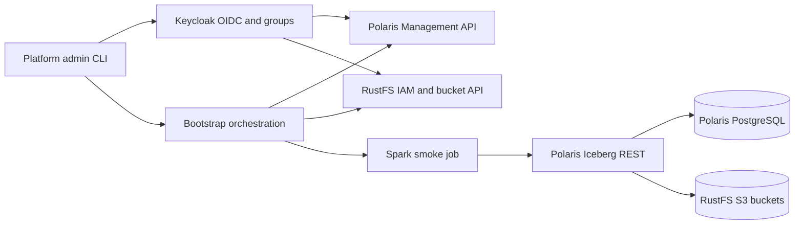
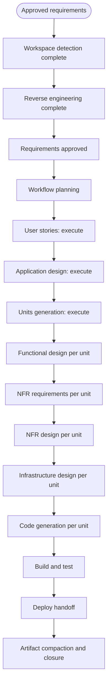
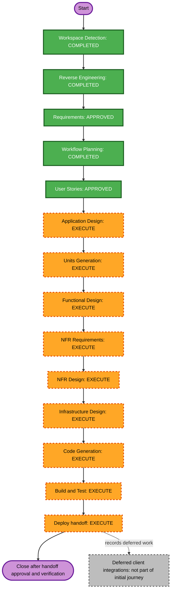

# Execution Plan — Keycloak and Polaris `default` Data Product Bootstrap

## Detailed analysis summary

### Transformation scope

- **Transformation type:** Architectural and infrastructure transformation across identity, Iceberg catalog, object storage, client bootstrap, and deployment composition.
- **Primary changes:** Replace FreeIPA with Keycloak for OIDC identity; replace Hive Metastore with Apache Polaris Iceberg REST; remove MIT Kerberos from the target stack; create an initial `default` data product across production/dev/UAT; create role groups, Polaris grants, RustFS policies, and smoke tables.
- **Related components:** Compose services and networks, PostgreSQL persistence, RustFS bucket setup, Polaris configuration and bootstrap, Keycloak realm/client/groups, Spark/Iceberg configuration, test tooling, docs and operational scripts.
- **Deferred components:** Airflow, JupyterHub, Jenkins, and StarRocks are outside the initial Compose journey and are not claimed to be migrated or verified by this intent.

### Change impact assessment

- **User-facing changes:** Yes. Platform admin receives a documented CLI flow to create the initial data product; four access roles have environment-scoped behavior.
- **Structural changes:** Yes. Current Hive/FreeIPA/Kerberos path becomes Keycloak + Polaris + RustFS + Spark OAuth bootstrap.
- **Data model changes:** Yes. Three catalogs and namespaces are provisioned, with namespace-scoped S3 base locations and a smoke table in each.
- **API changes:** Yes. Clients use Polaris Management and Iceberg REST APIs; Keycloak OIDC/OAuth and RustFS S3/STS interfaces are configured.
- **NFR impact:** Yes. Authentication, authorization, secret handling, persistence, safe reruns, loopback binding, and fail-closed behavior are requirements.

### Component relationships

Text equivalent: the admin CLI coordinates Keycloak identity/group setup, Polaris catalog/namespace/role grants, RustFS buckets/policies, and a short-lived Spark job. Spark uses Keycloak OAuth to access Polaris REST; Polaris persists metadata in dedicated PostgreSQL and coordinates scoped object storage in RustFS.

- **Change type:** Major for identity, catalog, Spark configuration, Compose and bootstrap; retained but scoped for RustFS; no initial migration for Airflow/JupyterHub/StarRocks.
- **Priority:** Critical path is Keycloak and Polaris persistence/readiness, followed by bucket/policy bootstrap, Polaris grant mapping, then Spark OAuth/Iceberg table verification.

### Risk assessment

- **Risk level:** High. Multiple authorization systems must enforce the same environment boundary; Keycloak group claims, Polaris principal/grant lookup, RustFS policy mapping/STS, and Spark credential vending interact.
- **Rollback complexity:** Moderate. The intent targets a fresh local setup, but Compose volume deletion can destroy identity/catalog/object data. Rollback will be documented and must not silently remove volumes.
- **Testing complexity:** Complex. Requires clean startup, authentication/token checks, allowed/denied catalog operations, direct S3 tests, table writes, and idempotent rerun validation.

## Workflow visualization

Text equivalent: the approved requirements move through user stories, application design, and units generation before unit-level functional/NFR/infrastructure design, code generation, integrated testing, deploy handoff, and intent closure. Each artifact stage has its own approval gate.

## Phases to execute

### Inception

- [x] Workspace Detection — brownfield project confirmed.
- [x] Reverse Engineering — current Compose and component dependencies documented.
- [x] Requirements Analysis — user approved; answers and extension opt-ins recorded.
- [x] User Stories — **APPROVED**. Five personas and eight stories (US-01–US-08) cover the platform-admin journey, role access, writer identity, smoke tests, and safe reruns.
- [x] Workflow Planning — **APPROVED**. User approved the execution plan and the generated story set.
- [x] Application Design — **APPROVED**. Five high-level architecture artifacts define bootstrap orchestration and Keycloak/Polaris/RustFS/Spark component boundaries and contracts.
- [x] Units Generation — **APPROVED**. Four implementation units cover runtime, identity/catalog authorization, storage/vending, and CLI/Spark verification; all stories and requirements are mapped.

### Construction

- [x] Functional Design — **EXECUTE per unit**. U1–U2 artifacts are approved. U3 storage boundaries are documented in `construction/unit-3/infrastructure-design/storage-architecture.md`; U4 integration design remains pending.
- [ ] NFR Requirements — **EXECUTE per unit**. U1–U2 artifacts are approved; record U3's 15-minute STS minimum and U4 integration limits before closure.
- [ ] NFR Design — **EXECUTE per unit**. U1–U2 artifacts are approved; U3/U4 verification remains open.
- [x] Infrastructure Design — **EXECUTE per unit**. U1/U2 artifacts are approved; U3 storage topology is documented and implemented. U4 catalog/Spark integration remains pending.
- [x] Code Generation — **EXECUTE (always)**. U1–U3 generated code remains. U4 added catalog/namespace bootstrap, owner identity, authorization orchestration, and Spark smoke-table code.
- [x] Build and Test — **COMPLETED WITH VERIFICATION WAIVER**. U1 passed; U2 writer, negative-token, membership revocation, and Keycloak outage checks passed; human callback and some reconciliation diagnostics remain unverified under the user's accepted waiver. U3 buckets and scoped STS passed. U4 end-to-end bootstrap, Spark smoke-table read/write and scoped vended-credential access for all three environments, safe rerun, and four-role positive/negative access matrix passed. Single-realm default behavior is approved; revisit before adding realms.

### Deploy

- [x] Deploy handoff — **PREPARED** at `aidlc-docs/current/deploy/deploy-handoff.md`. Includes the PR draft, ordered local start/bootstrap/stop steps, test evidence, open U2 limitations, and production boundaries. No deployment or PR was executed.

### Conditional stages not selected

- **Security Baseline extension:** Disabled by user choice. Explicit security requirements in the approved requirements remain binding.
- **Property-Based Testing:** Partially enabled for pure functions and serialization round-trips; design and code stages should apply only to relevant logic.
- **Resiliency Baseline extension:** Disabled by user choice. Functional readiness, error handling, and persistence requirements remain binding.
- **Separate Ranger work:** Not in scope; the target is Keycloak + Polaris grants + RustFS policies.

## Story coverage recorded

The approved story set is in `aidlc-docs/current/inception/user-stories/stories.md`; personas are in `personas.md`. IDs US-01–US-08 cover CLI initiation, environment resources, group/owner provisioning, developer and analyst access, product owner access, writer service access, and safe verification/reruns. These stories do not authorize implementation changes before design and construction approvals.

## Canonical knowledge impact inventory

| Canonical path | Action | Requirement and owning component | Reason |
|---|---|---|---|
| `aidlc-docs/knowledge/hive-dremio-rustfs/application-design.md` | UPDATE | FR-02–FR-14; platform architecture | Replace the active Hive/FreeIPA/Kerberos target description with Keycloak/Polaris and the new staged Compose scope. Preserve prior implementation history in the immutable archive, not as active architecture. |
| `aidlc-docs/knowledge/hive-dremio-rustfs/functional-design/lakehouse-workload-and-access.md` | UPDATE | FR-06–FR-12; identity/access and data layout | Replace legacy identities, bucket names and Hive boundaries with the approved `default` role matrix and Keycloak/Polaris/RustFS authorization responsibilities. |
| `aidlc-docs/knowledge/opensource-lakehouse-infra-v2/application-design.md` | CREATE at closure | Whole project | Establish one canonical architecture under the copied project identity; do not create until intent closure unless workflow evidence requires earlier canonical docs. |
| `aidlc-docs/knowledge/opensource-lakehouse-infra-v2/functional-design/` | CREATE at closure only if justified | New bootstrap component responsibilities | Create component docs only for stable component behavior that warrants separate canonical design; do not make a new knowledge area solely for this cross-cutting task. |
| `aidlc-docs/archive/20261027-central-identity-environment-roles/` | RETAIN immutable | Previous intent history | Historical evidence remains unchanged and is not an active baseline. |

No separate workload repository canonical docs were found in this project copy. Airflow/JupyterHub/StarRocks behavior is deferred and must not be rewritten as if migrated.

## Module update strategy

- **Approach:** Hybrid, dependency ordered.
- **Critical path:** PostgreSQL persistence and Keycloak/Polaris services → RustFS buckets/credentials/policies → bootstrap orchestration and Polaris role mapping → Spark OAuth/Iceberg client → access and rerun tests → Compose/docs cleanup.
- **Parallelizable design:** Keycloak realm/group behavior, Polaris RBAC/catalog behavior, and RustFS IAM policy behavior can be designed separately, then integrated at bootstrap and test stages.
- **Coordination points:** OIDC issuer/audience/claims, Polaris principal and catalog role names, RustFS identity claim-to-policy mapping, S3 endpoint and warehouse paths, secret names/mounts, and Compose health dependencies.
- **Rollback:** Preserve named volumes by default. Provide explicit, separately documented local reset instructions for fresh test runs. No destructive reset runs implicitly.
- **Test checkpoints:** Each service healthy; each provider bootstrap idempotent; three catalog+namespace+bucket combinations created; Spark smoke table read/write; role matrix allowed/denied operations; second bootstrap no-op/validation.

## Estimated effort

- **Planned stages:** 14 major stages, plus per-unit design and approval gates.
- **Duration:** Not estimated in calendar time because runtime access, image builds, and integration findings are not yet known.

## Success criteria

- **Primary goal:** An operator can bootstrap the `default` data product in a clean local Compose environment without migration and without manual service-by-service setup.
- **Key deliverables:** Minimal journey Compose configuration; Keycloak realm/groups and service identity; Polaris with persistent PostgreSQL; three catalogs and namespaces; three RustFS buckets and scoped policies; Spark smoke tables; idempotent CLI and documented verification.
- **Quality gates:** Approved per-unit designs; pinned compatible versions; safe secret handling; positive and negative role tests in both Polaris and RustFS; no Kerberos use by the bootstrap; no implicit data deletion; verified second run.
- **Integration testing:** Verify only components in the initial journey. Deferred Airflow, JupyterHub, Jenkins, and StarRocks integrations are explicitly out of this intent’s acceptance scope.
- **Release handoff:** PR request and ordered startup/bootstrap instructions prepared after Build and Test; handoff does not execute deployment.
