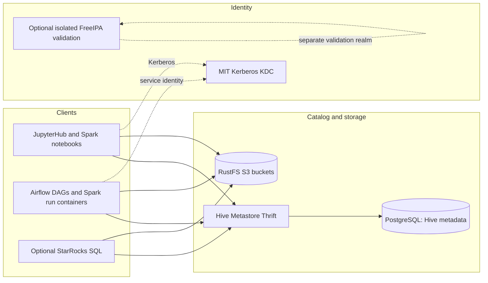

# Existing Architecture

## Overview
The current Compose stack has an internal lakehouse network, optional isolated identity/test networks, persistent named volumes, and several local service images. Hive is the active Iceberg catalog; FreeIPA is an optional validation service and is not the active Kerberos KDC.

Text equivalent: Jupyter/Spark, Airflow-launched Spark, and optional StarRocks use Hive Metastore for Iceberg metadata and RustFS for object data. Hive metadata persists in a dedicated PostgreSQL service. MIT Kerberos is a separate identity service; the FreeIPA validation profile is isolated and does not replace it.

## New intent target (proposed, not yet designed/approved)
Replace the Hive Thrift catalog with Polaris Iceberg REST and replace FreeIPA-backed directory/authentication functions with Keycloak. RustFS remains the object store. Spark and StarRocks need Polaris REST integration; JupyterHub login and service-to-service authentication need separate design. Polaris needs its own persistent metadata store. It is not yet decided whether MIT Kerberos remains.

## Important integration boundary
Keycloak OIDC does not by itself provide Kerberos tickets, S3 access keys, or Polaris catalog grants. Polaris authorization and RustFS IAM/STS policy enforcement remain separate controls unless a specific integration is verified and configured.
