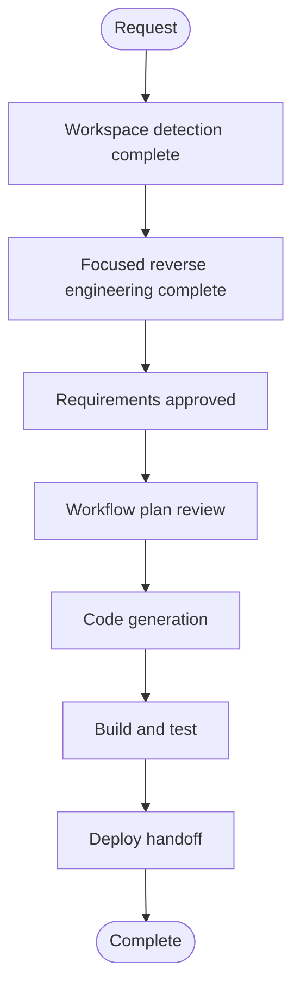

# Execution Plan — Polaris Database Path Layout

## Detailed Analysis Summary

### Transformation Scope
- **Type**: Brownfield configuration and bootstrap behavior change within the existing Polaris/RustFS/Spark platform.
- **Primary changes**: Rename UAT/dev catalogs; set catalog base locations to include the catalog path but not the database; preserve database namespaces; assert the complete resolved table path; provide a separate one-time local reset for the authorized bucket purge and catalog recreation.
- **Related components**: Polaris catalog bootstrap, Polaris grants bootstrap, Spark smoke-table bootstrap and role-matrix verification, operator bootstrap/reset scripts, README, canonical application design.
- **No new service, API, storage provider, or dependency is proposed.**

### Change Impact Assessment
- **User-facing changes**: No UI change; operator-visible catalog names and table paths change.
- **Structural changes**: No service topology change.
- **Data model changes**: Catalog names change; existing database namespaces remain.
- **API changes**: None; existing Polaris management and Iceberg REST APIs remain in use.
- **NFR impact**: Data safety and access boundaries matter. Bucket purge must be an explicitly separate one-time operation and must not enter the normal idempotent bootstrap path.

### Component Relationships
- **Primary component**: `infra/polaris` catalog and authorization bootstrap.
- **Dependent component**: `infra/spark-bootstrap` smoke-table job and role-matrix verification consume catalog/database names and resolve object locations.
- **Operational component**: `scripts` starts services and sequences bootstrap; add a distinct local reset step before normal bootstrap.
- **Documentation**: README and canonical application design describe the supported product mapping.

### Risk Assessment
- **Risk level**: Medium because the approved one-time action empties all three configured buckets.
- **Rollback complexity**: Difficult for removed bucket objects without a separate backup; no automatic backup is in scope. Existing service volumes and configuration remain intact.
- **Testing complexity**: Moderate; exact resolved locations, role matrix, safe rerun, and recreated smoke-table contents must agree.

## Workflow Visualization

Text alternative: workspace detection, focused reverse engineering, requirements, implementation, and verification are complete; the operator deploy handoff records the local reset/bootstrap procedure and limitations. User stories, application design, unit decomposition, functional design, NFR stages, and infrastructure design were skipped as planned.

## Phases to Execute

### INCEPTION
- [x] Workspace Detection — brownfield project; prior intent remains archived.
- [x] Focused Reverse Engineering — traced catalog bootstrap, Spark table creation, role matrix, operator sequence, and canonical design.
- [x] Requirements Analysis — approved requirements define catalog names, database mapping, target path, destructive one-time reset, and non-destructive reruns.
- [ ] User Stories — **SKIP**; this is an operator-facing infrastructure fix with no user journey change.
- [ ] Application Design — **SKIP**; no new component, service, API, or dependency.
- [ ] Units Generation — **SKIP**; one cohesive unit within the existing bootstrap components.
- [x] Workflow Planning — approved; one cohesive unit followed by Build and Test and Deploy Handoff.

### CONSTRUCTION
- [ ] Unit 1 Functional Design — **SKIP**; no new business behavior or data model.
- [ ] Unit 1 NFR Requirements — **SKIP**; existing access controls remain; data-safety constraints are already in the approved requirements.
- [ ] Unit 1 NFR Design — **SKIP**; no new NFR pattern.
- [ ] Unit 1 Infrastructure Design — **SKIP**; existing Docker services, networking, volumes, and resource types do not change. The storage mapping and reset behavior will be specified in Code Generation artifacts. The Infrastructure Design stage requires a completed Functional Design, which this isolated fix does not need.
- [x] Unit 1 Code Generation — completed; consistent catalog map, exact path validation, separate guarded reset, and operator/canonical documentation updated.
- [x] Build and Test — passed; configuration and scripts validated, approved local reset executed, resources recreated, exact table locations and role access verified, normal rerun data preservation proven.

### DEPLOY
- [x] Deploy Handoff — completed at `aidlc-docs/current/deploy/deploy-handoff.md`; includes ordered local reset/bootstrap instructions, data-loss boundary, verification evidence, and rollback limitations. No deployment or PR creation was performed.

## Canonical Knowledge Impact Inventory

| Canonical path | Action | Requirement and owning component | Reason |
|---|---|---|---|
| `aidlc-docs/knowledge/opensource-lakehouse-infra-v2/application-design.md` | UPDATE | FR-1–FR-4; platform bootstrap ownership | Update environment catalog names and layout while preserving bucket and database mapping; document the one-time reset boundary and non-destructive normal reruns. |
| `aidlc-docs/knowledge/hive-dremio-rustfs/functional-design/lakehouse-workload-and-access.md` | RETAIN | Role/access behavior; legacy knowledge namespace | This retained file documents the earlier Hive/FreeIPA workload and says current architecture lives in the v2 application design. It is not authoritative for the present path fix. |
| `aidlc-docs/knowledge/opensource-lakehouse-infra-v2/functional-design/polaris-bootstrap.md` | RETAIN (absent; no creation planned) | FR-3–FR-5; existing Polaris bootstrap behavior | This isolated path correction does not add a new durable component behavior requiring a separate canonical functional-design file. |
| Project-level workload index / summary | RETAIN / ABSENT | No relevant workload index found | No separate workload summary exists for this component; do not add a cross-cutting summary. |

## Package Change Sequence

1. `infra/polaris/bootstrap-default-catalogs.py` — canonical environment mapping, renamed catalogs, and base location `<bucket>/<catalog>/` so the namespace adds the database once.
2. `infra/polaris/bootstrap-product-authorization.py` — use the renamed catalog identifiers for role grants.
3. `infra/spark-bootstrap/create_smoke_tables.py` and `infra/spark-bootstrap/verify_role_matrix.py` — use the new catalog identifiers and verify or consume the expected full locations.
4. Add a standalone one-time local reset command for the three bucket contents and only the known default-product catalog objects; keep it out of `scripts/bootstrap-default-product.sh`'s normal rerun path.
5. Update README operator instructions and the canonical application/component knowledge documents.

## Estimated Timeline
- **Total stages**: 3 remaining execution stages after this revised plan is approved.
- **Estimated duration**: One focused implementation and local verification session, subject to service startup and Spark job duration.

## Success Criteria
- Production catalog is `lakehouse`; UAT is `lakehouse_uat`; dev is `lakehouse_dev`.
- Database namespaces remain `default_lh`, `default_lhuat`, and `default_lhdev`.
- Smoke table locations resolve exactly to `<bucket>/<catalog>/<database>/<table>` with no repeated database segment.
- The one-time reset touches only the three named buckets and the known default-product Polaris catalogs; it is not invoked by normal bootstrap.
- A regular bootstrap rerun preserves bucket objects and does not duplicate smoke-table rows.
- Existing role-matrix behavior remains unchanged across environments.
- No secret values are emitted in logs or documentation.
