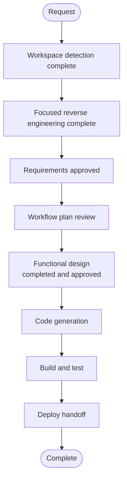

# Execution Plan — Airflow Keycloak SSO

## Detailed Analysis Summary

### Transformation Scope
- **Type**: Brownfield identity integration between an existing Airflow 3.3.2 FAB deployment and the existing Keycloak `lakehouse` realm.
- **Primary changes**: add a dedicated OIDC client for Airflow UI login, configure Airflow to trust the Keycloak Issuer/OIDC flow for browser login, map allowed Keycloak groups to Airflow roles, retain the local FAB admin as a documented break-glass fallback, and keep API authentication behavior unchanged.
- **Related components**: Airflow API/UI auth manager, Airflow initialization/bootstrap, Keycloak realm client definition, Airflow metadata DB, loopback Compose service wiring, and validation scripts.
- **No new service or authentication product is proposed.** This remains an integration layer change within the current platform architecture.

### Change Impact Assessment
- **User-facing changes**: Human users gain Keycloak-based browser login to Airflow. Existing local Airflow password login remains available as a protected fallback and does not replace the SSO flow.
- **Structural changes**: No new service topology or deployment model is introduced; the same Compose stack is adapted to authenticate via Keycloak.
- **Data model changes**: Airflow users and permissions are provisioned from Keycloak identity claims and group mapping, while metadata database tables continue to store the Airflow auth state.
- **API changes**: None for the current scope. Airflow API auth behavior remains the same; only the browser UI login path is extended.
- **NFR impact**: Security, role mapping accuracy, logout semantics, and local break-glass fallback must be explicitly controlled. There is no requirement to redesign service or machine-to-machine auth.

### Component Relationships
- **Primary component**: Airflow web UI and auth manager (`docker-compose.airflow.yml`, Airflow config, and FAB auth manager).
- **Identity provider**: Keycloak `lakehouse` realm with a dedicated Airflow OIDC client and configured callback root.
- **Dependent trust boundary**: Airflow metadata database persists user/role state; local admin bootstrap continues to function as a fallback.
- **Supporting component**: JupyterHub remains an independent OIDC consumer; its existing realm/client configuration is not repurposed for Airflow.
- **Operational component**: Compose startup, bootstrap scripts, secret mounting, and local validation scripts will be updated to reflect the required OIDC and role-mapping flow.

### Risk Assessment
- **Risk level**: Medium. The change affects browser auth and authorization mapping, which can cause access regressions if role mapping or client callback configuration is wrong.
- **Rollback complexity**: Low to medium. The local FAB admin fallback remains available, and the OIDC client can be disabled or removed without changing the overall platform topology.
- **Testing complexity**: Moderate. Local verification must ensure the callback and role mapping work without introducing regressions to the existing admin bootstrap or JupyterHub identity integration.

## Workflow Visualization

Text alternative: workspace detection, focused reverse engineering, requirements approval, workflow planning, implementation, local verification, and deploy handoff are all in scope. User stories, application design, and infrastructure design are intentionally skipped because this is a focused identity-integration adaptation of the existing Airflow and Keycloak setup, not a new service or topology change.

## Phases to Execute

### INCEPTION
- [x] Workspace Detection — brownfield project; prior Airflow writer-intent artifacts are archived and out of scope.
- [x] Focused Reverse Engineering — traced Airflow FAB auth, local admin bootstrap, Keycloak realm layout, JupyterHub OIDC usage, and the Airflow writer-token broker boundary.
- [x] Requirements Analysis — approved requirements define the browser-only web UI SSO scope, `lakehouse` realm, dedicated OIDC client, explicit group-to-role mapping, local admin fallback, and local verification boundary.
- [ ] User Stories — **SKIP**; the change is an enforcement of an existing requirement for authenticated airflow-browser access, not a new user journey or product feature.
- [ ] Application Design — **SKIP**; no new domain model or service API is being introduced.
- [ ] Units Generation — **SKIP**; a single cohesive integration change is sufficient across the existing Airflow and Keycloak configuration.
- [x] Workflow Planning — approved; the sequence and scope are recorded in this plan.

### CONSTRUCTION
- [x] Unit 1 Functional Design — **EXECUTE / COMPLETED**; original artifacts and the combined Keycloak/local-admin login revision were approved on 2026-10-30.
- [ ] Unit 1 NFR Requirements — **SKIP**; security and resiliency baselines are recorded in the approved requirements and remain design-time guidance rather than new architecture commitments.
- [ ] Unit 1 NFR Design — **SKIP**; the local deployment and auth boundary already define the constraints to satisfy.
- [ ] Unit 1 Infrastructure Design — **SKIP**; no topology, network, or service model changes are required beyond OIDC client configuration and URL-binding updates.
- [x] Unit 1 Code Generation — completed after approval of the revised generation plan and generated code.
- [x] Build and Test — completed within the approved non-mutating verification boundary: Docker image built, full repository unit-test suite passed, Compose config validated, and custom auth modules imported against the pinned Airflow/FAB runtime. Live browser/Keycloak verification remains unverified.

### DEPLOY
- [ ] Deploy Handoff — pending; records the final runtime configuration, local verification steps, and cleanup/rollback boundary before any production-facing use is recommended.

## Canonical Knowledge Impact Inventory

| Canonical path | Action | Requirement and owning component | Reason |
|---|---|---|---|
| `aidlc-docs/knowledge/opensource-lakehouse-infra-v2/application-design.md` | UPDATE | Airflow browser SSO, local admin fallback, Keycloak group mapping, loopback deployment | The live platform architecture already documents the Airflow and Keycloak boundary; this intent adds the approved SSO integration without altering the overall deployment topology. |
| `aidlc-docs/knowledge/opensource-lakehouse-infra-v2/functional-design/airflow-authentication.md` | CREATE only if a dedicated component design is justified | Airflow auth integration and role mapping | If the project already has no dedicated functional design for Airflow auth, a targeted auth-flow document is justified to preserve the approved Keycloak-to-Airflow contract. Otherwise retain the existing architecture doc and avoid creating extra canonical material. |
| JupyterHub-specific functional design | RETAIN | Existing OIDC consumer pattern | The JupyterHub client is a separate integration; do not repurpose it for Airflow browser login. |
| Airflow writer-token broker design | RETAIN | Separate machine identity flow | The broker issues run-scoped writer tokens and is not part of the browser-login SSO design. |
| Project workload index / summary | RETAIN / ABSENT | No relevant workload index exists | The current scope is a focused authentication integration and does not establish a new cross-cutting workload boundary. |

## Package Change Sequence

1. `docker-compose.airflow.yml` and related Airflow env/base config — add OIDC provider, callback, client-id/client-secret, and auth-manager wiring for the Airflow web UI.
2. `docker-compose.yml` / Keycloak bootstrap realm manifest — add a dedicated Airflow OIDC client under the existing `lakehouse` realm, with allowed redirect URI and client type consistent with the configured loopback URL.
3. Airflow bootstrap/init scripts — preserve the protected local admin fallback while enabling automatic creation of SSO-backed users from approved Keycloak groups.
4. Role and login validation scripts/tests — verify group-to-role mapping, Airflow user provisioning, and the fallback path without changing API behavior.
5. Documentation and operational notes — record the approved local loopback URL, group-to-role mapping, local admin break-glass policy, and the verification boundary.

## Estimated Timeline
- **Total stages after plan approval**: 3 remaining execution stages (code generation, build and test, deploy handoff).
- **Estimated duration**: One focused implementation session plus local verification, subject to Compose startup time and any Keycloak client provisioning delay.

## Success Criteria
- Airflow browser login succeeds via the existing Keycloak `lakehouse` realm using a dedicated OIDC client.
- Only approved Keycloak groups map to Airflow roles; no non-approved group gains Airflow access.
- First-time authenticated users are created automatically with the approved Airflow role mapping.
- The local Airflow FAB admin remains available as a documented break-glass fallback.
- Airflow API authentication behavior is preserved without broadening the SSO scope.
- All verification remains within the authorized local Compose/Keycloak boundary and does not mutate any non-approved deployment target.
- No secrets are emitted in logs or documentation.
