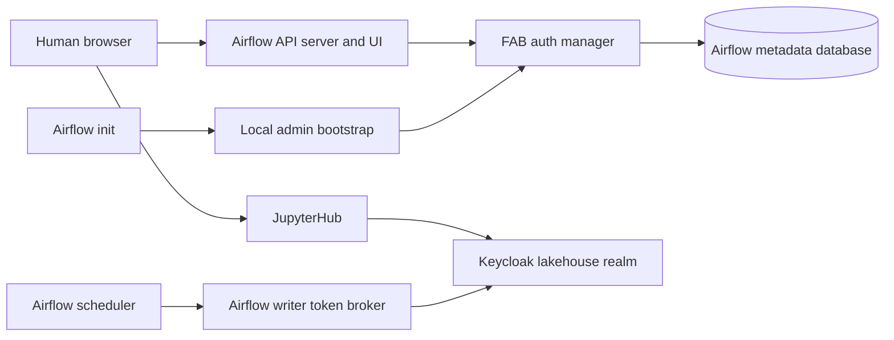

# System Architecture — Airflow / Keycloak Authentication

## Relevant components

- **Airflow 3.3.2 control plane:** API server, scheduler, DAG processor, triggerer, and initialization service in `docker-compose.airflow.yml`. FAB is configured as the Airflow auth manager.
- **Airflow FAB user store:** Airflow metadata database stores local users/roles; initialization bootstraps an admin user using a protected password file.
- **Keycloak 26.8.1:** `lakehouse` realm and OIDC issuer. Existing human OIDC client is for JupyterHub; separate confidential client-credentials clients serve platform APIs/workloads.
- **Airflow writer token broker:** Separate service for run-scoped DAG writer tokens. It does not implement browser SSO and should not be conflated with Airflow UI authentication.
- **JupyterHub:** Existing Keycloak Authorization Code/PKCE integration demonstrates the platform's human-login pattern but is a separate application and admission policy.
- **Airflow PostgreSQL:** Persists Airflow metadata, including FAB authentication state.

## Current architecture diagram

Text alternative: Airflow UI authentication currently goes through FAB and Airflow's local metadata database; initialization bootstraps a local admin. JupyterHub, independently, redirects human login to Keycloak. The Airflow scheduler uses a separate Keycloak-backed writer token broker for DAG execution.

## Integration boundary

Airflow's UI is published on loopback at configurable host port `AIRFLOW_HOST_PORT` (default 8085). Keycloak is published on loopback at configurable host port `KEYCLOAK_HOST_PORT` (default 8080); service-to-service traffic uses Compose networking. Both systems are in the same Compose project but use separate databases and responsibilities.

## Current authentication observations

- `AIRFLOW__CORE__AUTH_MANAGER` points to `airflow.providers.fab.auth_manager.fab_auth_manager.FabAuthManager`.
- Airflow initialization runs `airflow db migrate`, `bootstrap-airflow-admin.py`, and `ensure-git-connection.py`.
- The admin bootstrap reads `airflow_admin_password` from a mounted secret and creates username `AIRFLOW_ADMIN_USERNAME` (default `admin`) with Airflow `Admin` role if missing.
- Keycloak's realm contract declares the `jupyterhub` confidential Authorization Code client with PKCE S256 and a `/hub/oauth_callback` URI. It does not declare an Airflow UI client.
- The Airflow writer token broker uses `write-service-account` client credentials for DAG execution; it is not an interactive client.

## Unknowns for Requirements Analysis

Required behavior is not yet decided for Airflow access roles, role/group mapping, account provisioning, local admin fallback, logout/session behavior, MFA, public-vs-loopback exposure, API authentication, and acceptance/deployment scope.
