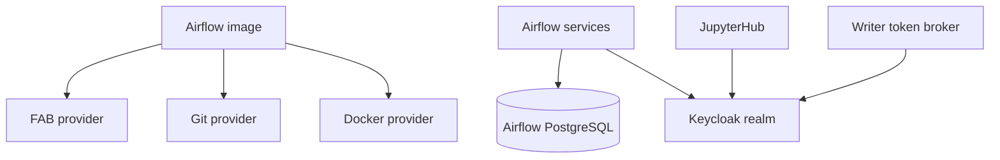

# Dependencies — Airflow / Keycloak Authentication

## Runtime relationships

Text alternative: Airflow runs the FAB provider and persists users/roles in its PostgreSQL metadata database. Keycloak is already used by JupyterHub and the writer token broker, but the Airflow UI is not currently an OIDC client.

## External and project dependencies

- Airflow image version 3.3.2 and Python 3.10 pinned to Apache constraints.
- FAB provider supplied by `apache-airflow-providers-fab`.
- Keycloak OIDC issuer at the lakehouse realm.
- PostgreSQL 17.11 for Airflow metadata.
- Existing `jupyterhub` OIDC client is not reusable as-is because its redirect URI and admission policy are Hub-specific.

## Dependency implication

An Airflow SSO change must choose an authentication integration compatible with Airflow 3.3.2 and the installed FAB provider, then configure a distinct Keycloak client/callback and an explicit policy for translating authenticated identities and claims into Airflow user/role permissions.
