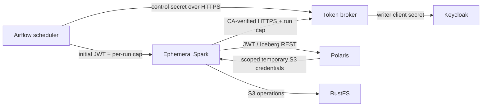
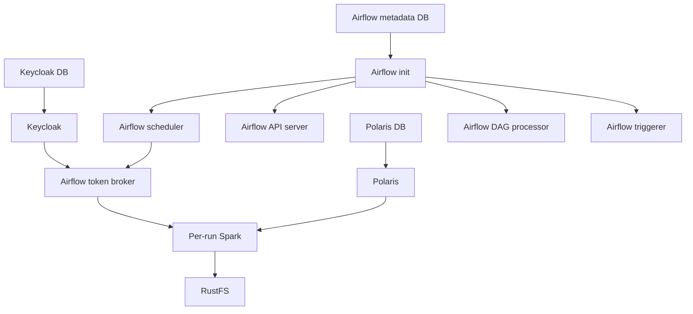

# Service Topology — Unit 1 Airflow Writer Identity and Broker

**Status:** Approved by the user on 2026-10-29.

## Services and network membership

| Service | Compose profile | Networks | Exposed ports | Credential mounts / role |
|---|---|---|---|---|
| Keycloak | default | `core` | Existing loopback-published admin/OIDC port | Existing Keycloak configuration; issues the writer token and human tokens |
| Polaris | default | `core`, `data-access` | Existing loopback-published Polaris port | Existing OIDC validation and writer role; no grant changes |
| RustFS | default | `core`, `data-access` | Existing loopback-published S3/console ports | Existing storage service credentials; Spark uses Polaris-vended scoped credentials |
| `airflow-postgres` | `airflow` | `airflow-internal` | None | Airflow metadata database only |
| `airflow-api-server` | `airflow` | `airflow-internal` | Loopback-published UI/API port | Airflow admin/bootstrap secrets only; no Docker socket or writer secret |
| `airflow-scheduler` | `airflow` | `airflow-internal`, `core` | None | Broker-control secret; Docker socket; no writer client secret |
| `airflow-dag-processor` | `airflow` | `airflow-internal` | None | Bundle source/config only; no broker control or writer secret |
| `airflow-triggerer` | `airflow` | `airflow-internal` | None | Airflow metadata/config only; no broker control or writer secret |
| `airflow-token-broker` | `airflow` | `core`, `airflow-spark` | Internal HTTPS 8443, private only | Writer client secret, broker control secret, server cert/key; one Uvicorn worker |
| Per-run Spark container | Docker-launched by scheduler | `airflow-spark`, `data-access` | None | JWT and run capability in environment; public broker CA certificate; no long-lived client/storage secret |

The broker's registration/revocation API and Spark renewal API share one internal HTTPS service but use distinct credentials and authorization rules. Control endpoints require the Airflow control secret. Renewal requires the capability for the exact active DAG run. No broker port is published to the host.

## Trust flow

The control secret never enters Spark. The writer client secret never leaves the broker. The JWT and run capability are visible to the Spark container and trusted Docker daemon administrators, and are absent from XCom, logs, CLI arguments, and persistent files.

## Startup dependencies

The operational `start-airflow` path waits for existing core dependencies, provisions protected runtime-only material, initializes Airflow metadata, and confirms Bundle DAG registration. It does not execute DAGs as part of startup.

## Preserved boundary

- Bundle definitions and refs do not change.
- Polaris roles/catalog grants and RustFS policies do not change.
- Human Jupyter credentials and token lifetime do not change.
- UAT runtime, concurrent workload, and resilience checks remain excluded.
