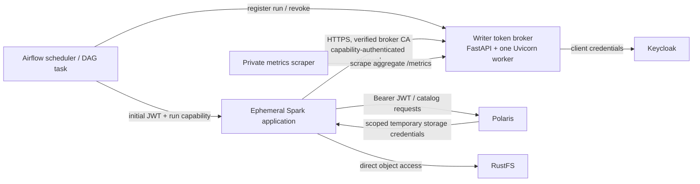

# NFR Architecture — Unit 1 Airflow Writer Identity and Broker

**Status:** Approved by user on 2026-10-29.

## Runtime boundaries

The writer client secret and broker TLS server private key are available only to the broker. Spark receives the initial writer JWT and its run-scoped capability, plus the broker CA public certificate. Polaris continues to authorize the writer role and vend scoped RustFS credentials.

## State ownership and lifecycle

The broker process owns a bounded in-memory registration map. A record is keyed by the stable DAG/run idempotency identity and contains the capability verifier, run expiry/revocation status, and (only during the replay window) an encrypted capability replay value. A process-ephemeral AES-GCM key encrypts replay values. Neither the map nor its key is persisted.

Only one broker worker is deployed, so all operations reach the same state owner. A process restart loses state and causes renewal/replay operations for lost registrations to fail closed. Airflow is responsible for run cleanup and Spark container removal on terminal outcomes as specified by the functional rules.

## TLS material flow

The local bootstrap provisions the internal CA and broker server certificate into ignored runtime storage. The CA private key remains host-side after issuance. The broker receives its server key/certificate read-only; Spark receives only the public CA certificate read-only. Spark connects using the broker Docker service DNS name listed in the certificate SAN, with normal chain and hostname validation.

## Health and telemetry flow

Liveness checks process responsiveness. Readiness checks local configuration, TLS material, and in-memory initialization; transient Keycloak/Polaris failures do not make the process unhealthy. Requests that require an unavailable dependency return sanitized failures.

Metrics are scraped over a private Docker network and use only bounded labels. Logs, health responses, metric labels, and error responses exclude bearer tokens, run capabilities, client secrets, run IDs, user/client identifiers, and sensitive bodies.

## Architecture limits

- One broker process and in-memory state; no multi-replica availability or restart recovery.
- Ten-active-run design target without load certification.
- Local CA bootstrap for this environment; production certificate issuance is deployment-specific.
- Main production workflow is the only runtime E2E target; UAT, concurrent-load, and resilience tests remain out of scope.
