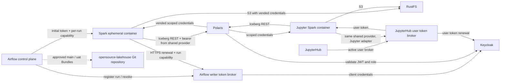

# Component Dependencies and Data Flow — Airflow Polaris Writer Identity

## Dependency rules

- Airflow and Jupyter Spark share the pinned Spark/Iceberg runtime definition and token-provider implementation; they do not share a token broker identity or secret.
- Airflow Spark depends on the Airflow broker only for writer-token renewal. Jupyter Spark depends on the JupyterHub broker only for the active user's token.
- The common token provider depends on an identity-adapter interface, not on Airflow, JupyterHub, or Keycloak internals.
- Both Spark paths depend on Polaris for catalog authorization and vended storage credentials, then access RustFS directly for object I/O.
- Airflow does not mutate Polaris grants or RustFS root credentials. It uses the existing `role-default-writer` assignment.
- The Git Bundle names, refs, selection logic, and workload entry points remain unchanged.

## Credential/data boundaries

| Value | Producer | Consumer | Lifetime / restriction |
|---|---|---|---|
| Writer client secret | Airflow secret store/broker boundary | Token broker only | Long-lived; never enters Spark or logs. |
| Writer access JWT | Keycloak via writer broker path | One Airflow Spark run and Polaris | One-hour Keycloak lifespan; held in process memory or protected per-run storage; renewed before expiry. |
| Airflow run capability | Airflow run orchestrator | That run's Spark container and broker verifier | Random, single-run scoped, expires at maximum run duration, revoked during cleanup. |
| Jupyter Hub API token | JupyterHub | That user's Spark container and user broker | Bound to an active user server; never reused as a writer capability. |
| Jupyter access JWT | Keycloak via user broker | That user's Spark application and Polaris | User identity and policy remain unchanged; refreshed through the user broker. |
| Polaris-vended S3 credentials | Polaris | Spark's S3 client and RustFS | Scoped and independently expiring; separate from OAuth token lifecycle. |
