# Execution Plan

## Detailed Analysis Summary

### Transformation Scope

- **Transformation type:** Cross-repository integration and infrastructure reactivation.
- **Primary changes:** Re-enable Airflow in v2 Compose; connect Airflow to the writer Keycloak client; pass per-run Polaris tokens to Spark and renew them through a private Airflow-owned endpoint; preserve the approved two-Bundle contract.
- **Related components:** Airflow Compose/services and secret provisioning in `opensource-lakehouse-infra-v2`; DAG factory, Spark startup/runtime in `opensource-lakehouse`; Keycloak writer-client token policy; Polaris role authorization; RustFS credentials vended by Polaris.

### Change Impact Assessment

- **User-facing changes:** No new end-user interface. Platform operators gain an Airflow-managed writer execution path.
- **Structural changes:** Airflow control-plane services are reintroduced into the active Compose deployment; a private token-renewal interface is added to the Airflow/Spark runtime path.
- **Data model changes:** None planned.
- **API changes:** A private token renewal contract is needed between Spark and Airflow. Polaris REST usage remains its existing API contract.
- **NFR impact:** High sensitivity around client-secret custody, token delivery, renewal endpoint access, and production overwrite verification. Security extension is disabled, but explicit requirements remain binding. Partial PBT applies only to its configured enforced rule set; resiliency extension is disabled.

### Component Relationships

- **Primary component:** Airflow workload execution (DAG factory, ephemeral Spark lifecycle, and token renewal).
- **Infrastructure components:** v2 Docker Compose, Airflow connections/secrets, Keycloak writer client, and Docker networking.
- **Shared interfaces:** Per-run token handoff and private renewal endpoint; Polaris Iceberg REST authorization; Polaris-vended RustFS credentials.
- **Dependent components:** Existing `main-init_environment` and UAT workloads in the pinned Git Bundles.
- **Supporting components:** Bundle validator and verification scripts in v2; sibling repository CI and Git remote.

### Risk Assessment

- **Risk level:** High, due to writer-capable production access, a new token renewal path, and the explicitly accepted overwrite of the configured production sample table.
- **Rollback complexity:** Moderate. Revert the source commit and disable/revert Airflow Compose integration; existing Polaris roles and storage data are not to be changed.
- **Testing complexity:** Complex. Requires service integration and one end-to-end main/production run. UAT runtime, concurrent workloads, and resiliency checks are excluded.

## Workflow Visualization

```mermaid
flowchart TD
    Start(["Approved requirements"])
    WD["Workspace detection<br/>COMPLETED"]
    RE["Reverse engineering<br/>COMPLETED"]
    RA["Requirements analysis<br/>COMPLETED"]
    US["User stories<br/>SKIP"]
    WP["Workflow planning<br/>IN PROGRESS"]
    AD["Application design<br/>EXECUTE"]
    UG["Units generation<br/>EXECUTE"]
    FD["Functional design<br/>EXECUTE"]
    NR["NFR requirements and design<br/>EXECUTE"]
    ID["Infrastructure design<br/>EXECUTE"]
    CG["Code generation<br/>EXECUTE"]
    BT["Build and test<br/>EXECUTE"]
    DP["Deploy handoff<br/>EXECUTE"]
    End(["Intent closure"])
    Start --> WD --> RE --> RA --> US --> WP --> AD --> UG --> FD --> NR --> ID --> CG --> BT --> DP --> End
    style WD fill:#4CAF50,stroke:#1B5E20,stroke-width:3px,color:#fff
    style RE fill:#4CAF50,stroke:#1B5E20,stroke-width:3px,color:#fff
    style RA fill:#4CAF50,stroke:#1B5E20,stroke-width:3px,color:#fff
    style WP fill:#FFA726,stroke:#E65100,stroke-width:3px,stroke-dasharray:5 5,color:#000
    style US fill:#BDBDBD,stroke:#424242,stroke-width:2px,stroke-dasharray:5 5,color:#000
    style AD fill:#FFA726,stroke:#E65100,stroke-width:3px,stroke-dasharray:5 5,color:#000
    style UG fill:#FFA726,stroke:#E65100,stroke-width:3px,stroke-dasharray:5 5,color:#000
    style FD fill:#FFA726,stroke:#E65100,stroke-width:3px,stroke-dasharray:5 5,color:#000
    style NR fill:#FFA726,stroke:#E65100,stroke-width:3px,stroke-dasharray:5 5,color:#000
    style ID fill:#FFA726,stroke:#E65100,stroke-width:3px,stroke-dasharray:5 5,color:#000
    style CG fill:#FFA726,stroke:#E65100,stroke-width:3px,stroke-dasharray:5 5,color:#000
    style BT fill:#FFA726,stroke:#E65100,stroke-width:3px,stroke-dasharray:5 5,color:#000
    style DP fill:#FFA726,stroke:#E65100,stroke-width:3px,stroke-dasharray:5 5,color:#000
    style Start fill:#CE93D8,stroke:#6A1B9A,stroke-width:3px,color:#000
    style End fill:#CE93D8,stroke:#6A1B9A,stroke-width:3px,color:#000
    linkStyle default stroke:#333,stroke-width:2px
```

### Text alternative

Inception: Workspace Detection, Reverse Engineering, and Requirements Analysis are complete; User Stories are skipped; Workflow Planning is awaiting approval. Then execute Application Design, Units Generation, Functional Design, NFR Requirements and Design, Infrastructure Design, Code Generation, Build and Test, and Deploy handoff before closure.

## Phases to Execute

### Inception

- [x] Workspace Detection.
- [x] Reverse Engineering.
- [x] Requirements Analysis; requirements approved by the user.
- [x] User Stories — **SKIP**. This is an infrastructure/runtime integration with no new end-user journey; operational and integration acceptance criteria are captured in requirements and the plan.
- [x] Workflow Planning — approved by the user on 2026-10-29.
- [ ] Application Design — **EXECUTE**. Define ownership and the API/security boundary for Airflow-owned token renewal across Airflow and Spark.
- [ ] Units Generation — **EXECUTE**. Multiple repositories and infrastructure/workload packages change and must be coordinated.

### Construction

- [ ] Functional Design — **EXECUTE**. Specify token acquisition, renewal, expiration, Spark handoff, and failure behavior.
- [ ] NFR Requirements — **EXECUTE**. Secret custody, token confidentiality, endpoint access, and production impact need explicit requirements; the disabled security extension does not remove the explicit requirements.
- [ ] NFR Design — **EXECUTE**. Define protected token transport, renewal endpoint exposure, logging redaction, and safe operational configuration.
- [ ] Infrastructure Design — **EXECUTE**. Re-enable Airflow Compose services, connections/secrets, network reachability, and writer-client token lifespan configuration.
- [ ] Code Generation — **EXECUTE**. Implement in the approved repositories; preserve Bundle contract. Prepare the source changes for commit and push to `main`.
- [x] Build and Test — **COMPLETED**. Builds and automated checks passed; the approved main/production end-to-end job succeeded. Do not run UAT runtime, concurrent-workload, or resilience tests.

### Deploy

- [ ] Deploy — **EXECUTE HANDOFF**. Prepare PR/release and ordered deployment handoff documents. Per workflow, this stage prepares documentation and does not itself deploy. The requirements record the requested commit/push to `main`; the exact release mechanics will be documented after implementation and verification.

## Canonical Knowledge Impact Inventory

| Canonical path | Action | Requirement and owning component | Reason |
|---|---|---|---|
| `aidlc-docs/knowledge/opensource-lakehouse-infra-v2/application-design.md` | UPDATE | FR-1, FR-4–FR-6; v2 platform/operations | Current baseline describes Airflow as deferred. After the approved change, update durable architecture and supported runtime flow. |
| `aidlc-docs/knowledge/opensource-lakehouse/application-design.md` | CREATE | FR-2–FR-8; sibling workload repository | No canonical design exists for this repository. Record the durable two-Bundle Airflow/Spark writer execution contract now entering the platform scope. |
| `aidlc-docs/knowledge/opensource-lakehouse/functional-design/airflow-workload-execution.md` | CREATE | FR-3–FR-6; Airflow workload execution component | Document the newly supported service-token handoff and renewal behavior as a durable component contract; this is a distinct runtime capability, not a generic cross-cutting summary. |
| `aidlc-docs/knowledge/hive-dremio-rustfs/application-design.md` | RETAIN | No requirement; unrelated legacy project | This intent does not modify the legacy project design. |
| `aidlc-docs/knowledge/hive-dremio-rustfs/functional-design/lakehouse-workload-and-access.md` | RETAIN | No requirement; unrelated legacy project | This intent does not modify the legacy workload/access design. |

No canonical opensource-lakehouse component designs existed at planning time. Archived intent documents remain immutable.

## Module Update Strategy

- **Update approach:** Hybrid, coordinated across the infrastructure and workload repositories.
- **Critical path:** Agree the token renewal contract in Application/Functional/NFR Design; configure Airflow/Keycloak and Spark to the same contract; then validate on main.
- **Coordination points:** Bundle revision and mount paths, Airflow-to-Docker reachability, Spark-to-Airflow renewal connectivity, Keycloak client credentials and writer-only one-hour lifetime, Polaris token validation, and RustFS credential vending.
- **Testing checkpoints:** (1) config and bundle contract checks; (2) token endpoint and Spark unit/integration checks; (3) Airflow DAG parse/registration; (4) main/production end-to-end run and audit of output/identity; (5) UAT source/config contract check only.
- **Rollback:** Revert the workload commit and disable or revert the Airflow Compose integration. Do not alter Polaris grants or delete existing provider data as a rollback step.

## Estimated Timeline

- **Total stages:** 10 remaining stage gates, including planning approval, design, units, construction, build/test, and deploy handoff.
- **Estimated duration:** Several focused implementation and verification sessions; timing depends on main-branch Airflow and provider readiness.

## Success Criteria

- **Primary goal:** Production/main Airflow job executes Spark as Keycloak `write-service-account`, authorized by Polaris as `role-default-writer`.
- **Key deliverables:** Re-enabled Airflow runtime, protected writer-token acquisition and renewal flow, minimal DAG/Spark changes, preserved two-Bundle contract, updated canonical documentation, and release handoff.
- **Quality gates:** No writer client secret or token in logs; Spark never receives the client secret; production job completes its configured sample-table overwrite and uses Polaris-vended RustFS credentials; changes are committed and pushed to `main`.
- **Limitations recorded:** UAT runtime is unverified; concurrent-workload and resilience checks are deferred.
