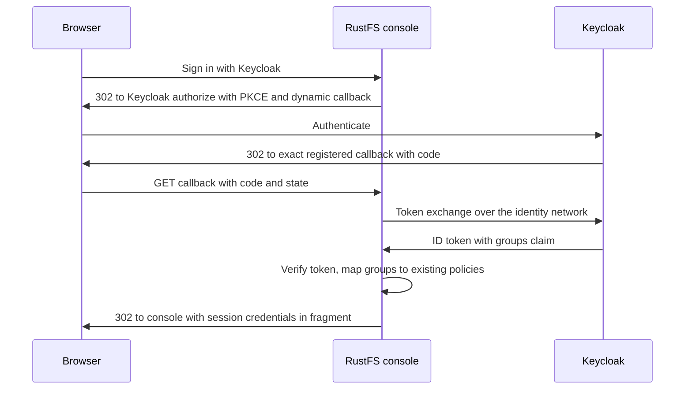

# Business Logic Model — rustfs-keycloak-oidc

## Console login flow

Text alternative:
1. The user picks "Keycloak" on the RustFS console login page.
2. RustFS redirects to Keycloak's authorize endpoint with PKCE S256 and a callback derived from the browser's host (`localhost` or `127.0.0.1` on the console port).
3. Keycloak authenticates the user and redirects to the callback, which must exactly match a registered URI.
4. RustFS exchanges the code for tokens via `keycloak.localhost:8080` over the internal identity network, then verifies the ID token's signature (JWKS from the same origin), issuer, audience, expiry, and nonce.
5. RustFS maps `groups` to existing policies (BR-1–BR-3) and issues a 3600 s console session.

## Known upstream limitation (2026-10-30, clarification Q3: A)
RustFS 1.0.4 embeds console v0.1.37. Its bucket-list page loops for non-admin users, which includes every OIDC user (rustfs/console#271; fixed in console v0.1.38). Users open a specific bucket (`/rustfs/console/browser?bucket=<name>`) instead. Follow-up: adopt the first RustFS release that bundles console v0.1.38 or later.

## Denial flows
- **No product group**: step 5 resolves no policy, so RustFS refuses the session (BR-2). The user sees an error and gets no credentials.
- **Unregistered callback** (for example, a login started on the S3 port): Keycloak rejects the redirect URI at step 3 (BR-7).
- **Wrong client secret**: the token exchange fails at step 4; no session.

## Logout flow
The console calls the RustFS logout endpoint with its logout token. RustFS redirects to Keycloak's end-session endpoint with the post-logout URI `<host>/rustfs/console/auth/login`, which must be registered (BR-7). If federated logout is unavailable, RustFS falls back to the console login page.

## Keycloak outage
Discovery fails at startup or later; RustFS keeps root login working and retries discovery in the background. Login attempts fail until Keycloak is back. Issued sessions run until expiry (BR-18).

## Startup integration (FD Q6: always in core start)
1. `scripts/lakehouse.sh start` → runtime preparation creates the missing `rustfs-oidc-client-secret` and refreshes its read-only mount copy.
2. Compose starts `keycloak` (on `core` and the identity network, alias `keycloak.localhost`) and `rustfs` (on `core`, `data-access`, and the identity network).
3. The RustFS wrapper exports the client secret and runs the stock entrypoint; RustFS discovers the provider, or retries if the realm/client is not ready yet.

## Operator bootstrap sequence
1. `infra/keycloak/bootstrap-realm.py` ensures the `rustfs` client (secret from the protected file), its exact URIs, and the `groups` mapper (BR-7–BR-9).
2. `infra/rustfs/bootstrap-buckets.py` (existing) ensures the buckets.
3. A new `infra/rustfs/bootstrap-policies.py` ensures the four policies (BR-10–BR-12).
4. Both bootstrap steps are wired into `scripts/bootstrap-default-product.sh` and stay safe to rerun.

## Secret rotation (operator procedure)
Generate a new value into the protected file, update the Keycloak client to the same value (a deliberate operation, since bootstrap refuses mismatches), then restart RustFS so the wrapper re-reads the file.

## Retirement (FR-10)
Delete `infra/identity-provisioner/reconcile-rustfs-roles.py`, `provision-rustfs-identities.py`, and `rustfs-role-policy.json`, and remove their `COPY` and `chmod` references from `infra/identity-provisioner/Dockerfile`. The rest of that directory is untouched and remains outside the supported runtime.

## Verification hooks (for Build and Test)
- Provider listed at `/rustfs/admin/v3/oidc/providers`.
- The authorize redirect from both console hosts contains the exact registered callback.
- The four policies are present and canonically equal to their definitions.
- `scripts/verify-rustfs-sts.py` passes.
- `docker inspect rustfs` shows no client secret.
- The user confirms an interactive login (Q10: B).
- To check if possible: whether the console needs read actions beyond the AccessLevel sets to render bucket views; any gap returns as a change request. **Result (2026-10-30):** the gap was confirmed (`GetBucketPolicyStatus` loop) and resolved via the console metadata reads and BR-10a.
