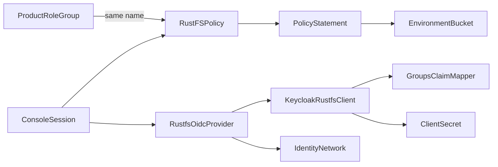

# Domain Entities — rustfs-keycloak-oidc

## Entity overview

Text alternative: each Keycloak product role group has a RustFS policy with the same name; policies contain statements over the three environment buckets. The RustFS OIDC provider uses the Keycloak `rustfs` client (with a groups mapper and a protected secret) and reaches Keycloak over a dedicated identity network. A console session carries the policies resolved at login.

## ProductRoleGroup (existing, Keycloak)
- **Values**: `role-default-owner`, `role-default-developer`, `role-default-analyst`, `role-default-writer`.
- **Source of truth**: `infra/keycloak/realm-contract.json` `groups`.
- **Relationship**: one-to-one, by exact name, with RustFSPolicy.

## EnvironmentBucket (existing, RustFS)
| Environment | Bucket | Resource ARNs |
|---|---|---|
| Production | `bucket-default` | `arn:aws:s3:::bucket-default`, `arn:aws:s3:::bucket-default/*` |
| UAT | `bucket-default-uat` | `arn:aws:s3:::bucket-default-uat`, `arn:aws:s3:::bucket-default-uat/*` |
| Dev | `bucket-default-dev` | `arn:aws:s3:::bucket-default-dev`, `arn:aws:s3:::bucket-default-dev/*` |

## AccessLevel (value object)
| Level | Bucket-ARN actions | Object-ARN actions |
|---|---|---|
| `read` | `s3:ListBucket`, `s3:GetBucketLocation`, plus console metadata reads `s3:GetBucketPolicyStatus`, `s3:GetBucketVersioning`, `s3:GetBucketObjectLockConfiguration`, `s3:GetBucketTagging`, `s3:ListBucketVersions` | `s3:GetObject`, plus `s3:GetObjectTagging`, `s3:GetObjectVersion`, `s3:GetObjectRetention`, `s3:GetObjectLegalHold` |
| `read_write` | `read` + `s3:ListBucketMultipartUploads` | `read` + `s3:PutObject`, `s3:DeleteObject`, `s3:AbortMultipartUpload`, `s3:ListMultipartUploadParts` |
| `manage` | `s3:*` | `s3:*` |

> **Change 2026-10-30 (Build and Test, `console-access-clarification-questions.md` Q1: A)**: `read` (and therefore `read_write`) gained read-only console metadata actions after the console bucket list looped on a denied `GetBucketPolicyStatus`. No configuration-write action was added.

## RustFSPolicy (new, RustFS IAM)
- **Name**: exactly the ProductRoleGroup name.
- **Document**: IAM JSON, `Version: 2012-10-17`, `Effect: Allow` statements only.
- **Access matrix** (FR-3, FD Q3):

| Policy | `bucket-default` | `bucket-default-uat` | `bucket-default-dev` |
|---|---|---|---|
| `role-default-owner` | manage | manage | manage |
| `role-default-developer` | read | read | read_write |
| `role-default-analyst` | read | — | — |
| `role-default-writer` | read_write | read_write | read_write |

- **Common statement** (FD Q4): `s3:ListAllMyBuckets` on `arn:aws:s3:::*` in every policy (bucket names only).
- **Excluded**: any `admin:*` action, any resource outside the ARNs above.

## PolicyStatement (value object)
- **Fields**: `Effect` (always `Allow`), `Action` (non-empty set), `Resource` (non-empty set).
- **Canonical form**: actions and resources sorted and de-duplicated; statements sorted by (resources, actions). Used for equality when the bootstrap compares a desired policy with an existing one.

## KeycloakRustfsClient (new, Keycloak)
- **clientId**: `rustfs`; confidential (`publicClient=false`, `clientAuthenticatorType=client-secret`); `standardFlowEnabled=true`; `directAccessGrantsEnabled=false`; `serviceAccountsEnabled=false`; `webOrigins=[]`.
- **redirectUris** (exact, FR-5 / Q6): `http://localhost:<console-port>/rustfs/admin/v3/oidc/callback/default`, `http://127.0.0.1:<console-port>/rustfs/admin/v3/oidc/callback/default`; `<console-port>` = `RUSTFS_CONSOLE_HOST_PORT` (default 9001).
- **post.logout.redirect.uris** (FD Q5): `http://localhost:<console-port>/rustfs/console/auth/login`, `http://127.0.0.1:<console-port>/rustfs/console/auth/login`.
- **PKCE**: `pkce.code.challenge.method=S256` (RustFS always sends S256, F5).

## GroupsClaimMapper (new, Keycloak)
- **name**: `lakehouse-rustfs-groups`; `oidc-group-membership-mapper`.
- **config**: `claim.name=groups`, `full.path=false`, `id.token.claim=true`, `access.token.claim=true`, `userinfo.token.claim=true`.
- **Note**: RustFS reads claims from the **ID token**, so `id.token.claim` must be `true` (unlike the Airflow mapper).

## ClientSecret (new, protected file)
- **Path**: `.runtime/credentials/rustfs-oidc-client-secret` (0600), plus a read-only container mount copy under `.runtime/container-mounts/`.
- **Lifecycle**: created once if missing; never regenerated automatically; rotation is a coordinated operator action (Keycloak client + file + RustFS restart).

## RustfsOidcProvider (new, RustFS environment configuration)
| Setting | Value |
|---|---|
| `RUSTFS_IDENTITY_OPENID_ENABLE` | `on` |
| `RUSTFS_IDENTITY_OPENID_CONFIG_URL` | `http://keycloak.localhost:8080/realms/lakehouse/.well-known/openid-configuration` |
| `RUSTFS_IDENTITY_OPENID_CLIENT_ID` | `rustfs` |
| `RUSTFS_IDENTITY_OPENID_CLIENT_SECRET` | exported at process start from the mounted ClientSecret (FD Q2); never in Compose |
| `RUSTFS_IDENTITY_OPENID_CLAIM_NAME` | `groups` (explicit; equals default) |
| `RUSTFS_IDENTITY_OPENID_REDIRECT_URI_DYNAMIC` | `on` (explicit; required by F4) |
| `RUSTFS_IDENTITY_OPENID_DISPLAY_NAME` | `Keycloak` |
| `RUSTFS_OUTBOUND_ALLOW_ORIGINS` | `http://keycloak.localhost:8080` (exact origin only) |
- **Provider id**: `default`.
- **Not set**: `ROLE_POLICY` (would override claim mapping), `CLAIM_PREFIX`, static `REDIRECT_URI`, `ISSUER` (discovery issuer already equals the canonical issuer).

## IdentityNetwork (new, Compose)
- **Name**: `lakehouse-local_rustfs-identity`; `internal: true`.
- **Members**: `rustfs`, and `keycloak` with alias `keycloak.localhost` (FD Q1). No other service joins it, so no other service's resolution changes.

## ConsoleSession (RustFS, runtime)
- **Contents**: temporary access key, secret key, and session token; policy claim listing the resolved policies; expires after 3600 s (F9).
- **Delivery**: URL fragment to `/rustfs/console/auth/oidc-callback/`.
