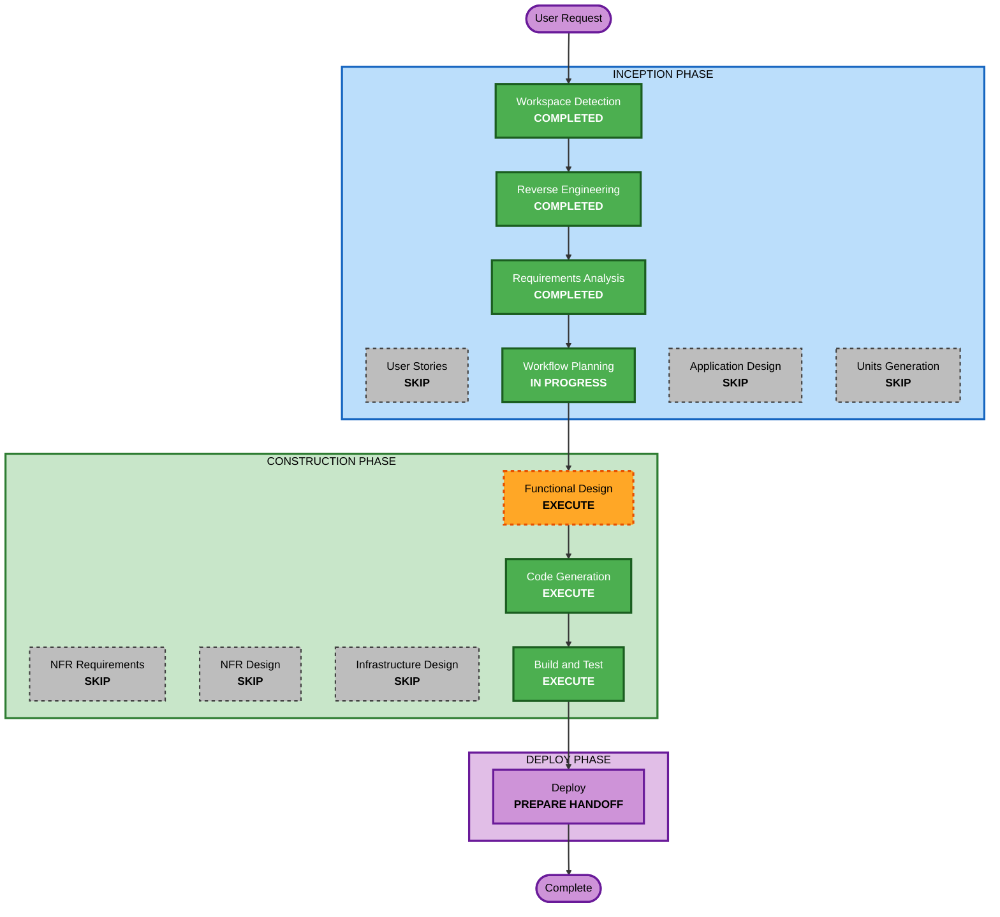

# Execution Plan — RustFS Keycloak OIDC Login

## Detailed Analysis Summary

### Transformation Scope
- **Transformation Type**: Infrastructure/configuration integration across existing components; no architectural transformation.
- **Primary Changes**: Enable RustFS 1.0.4 native OpenID login against the Keycloak `lakehouse` realm; add a `rustfs` Keycloak client and `groups` mapper; provision four group-named RustFS policies; deliver a protected client secret.
- **Related Components**: `rustfs` Compose service, `infra/keycloak/` bootstrap and contract, runtime credential preparation, operator entry points, legacy `infra/identity-provisioner/` RustFS files, README, canonical knowledge.

### Change Impact Assessment
- **User-facing changes**: Yes — the RustFS console gains Keycloak sign-in; root key login remains as break-glass.
- **Structural changes**: Minor — a new runtime dependency from RustFS to Keycloak; no new service.
- **Data model changes**: Yes (configuration data) — four new RustFS IAM policies; no object data changes.
- **API changes**: Yes — a new Keycloak client and RustFS OIDC provider configuration; no change to S3, STS, Polaris, or other client contracts.
- **NFR impact**: Yes — authentication surface and secret handling; covered by project conventions (Security Baseline not enabled) and PBT Partial.

### Component Relationships
- **Primary Component**: `rustfs` service (`docker-compose.yml`) — Configuration change — Critical.
- **Infrastructure Components**: `infra/keycloak/bootstrap-realm.py`, `infra/keycloak/realm-contract.json` — Minor (additive client and mapper) — Critical.
- **Shared Components**: `scripts/prepare-lakehouse-runtime.py` (protected secret and mount copy) — Minor — Critical.
- **New supporting script**: RustFS policy bootstrap, owned by the existing RustFS storage component (`infra/rustfs/`), alongside `bootstrap-buckets.py` — Minor — Critical.
- **Dependent Components**: Polaris STS vending, `bootstrap-buckets.py`, `scripts/verify-rustfs-sts.py` — no change; regression-checked — Important.
- **Supporting Components**: `scripts/lakehouse.sh` / `scripts/bootstrap-default-product.sh` (operator sequence), `README.md`, tests — Minor — Important.
- **Retired**: `infra/identity-provisioner/reconcile-rustfs-roles.py`, `provision-rustfs-identities.py`, `rustfs-role-policy.json`, and their `COPY`/`chmod` lines in `infra/identity-provisioner/Dockerfile` — Optional.

**Finding for review**: the `identity-provisioner` image is already unbuildable (its Dockerfile copies the removed `provision-kerberos-identities.sh`) and nothing in the Compose files references it. This plan retires only the three RustFS files approved in Q8 and their Dockerfile lines; the rest of that directory stays untouched and out of scope.

### Risk Assessment
- **Risk Level**: Medium — several components; key RustFS behaviors (claim-to-policy mapping, JWKS fetch, callback path, secret delivery) are unverified.
- **Rollback Complexity**: Easy — remove the OIDC environment and restart RustFS; the Keycloak client, mapper, and policies are additive and inert without the provider. Root login is unaffected throughout.
- **Testing Complexity**: Moderate — contract and property tests plus live local checks; interactive login is confirmed by the user.

## Workflow Visualization



### Text Alternative
```
Phase 1: INCEPTION
- Workspace Detection (COMPLETED)
- Reverse Engineering (COMPLETED)
- Requirements Analysis (COMPLETED)
- User Stories (SKIP)
- Workflow Planning (IN PROGRESS)
- Application Design (SKIP)
- Units Generation (SKIP)
Phase 2: CONSTRUCTION (single unit: rustfs-keycloak-oidc)
- Functional Design (EXECUTE)
- NFR Requirements (SKIP)
- NFR Design (SKIP)
- Infrastructure Design (SKIP)
- Code Generation (EXECUTE)
- Build and Test (EXECUTE)
Phase 3: DEPLOY
- Deploy handoff (EXECUTE)
Then: Artifact Compaction / Intent Closure
```

## Phases to Execute

### INCEPTION PHASE
- [x] Workspace Detection (COMPLETED)
- [x] Reverse Engineering (COMPLETED)
- [x] Requirements Analysis (COMPLETED)
- [x] User Stories (SKIPPED) — one feature with four access levels; the role table and verification criteria in requirements.md cover acceptance.
- [x] Execution Plan (IN PROGRESS)
- [ ] Application Design - SKIP
  - **Rationale**: All changes sit within existing component boundaries: RustFS storage (policy bootstrap beside bucket bootstrap), the Keycloak realm bootstrap (one more client, following the JupyterHub/Airflow pattern), and runtime credential preparation. No new service or component interface.
- [ ] Units Generation - SKIP
  - **Rationale**: A single cohesive unit, `rustfs-keycloak-oidc`; the pieces are only useful together and are verified together.

### CONSTRUCTION PHASE
- [ ] Functional Design - EXECUTE
  - **Rationale**: Resolve the unverified RustFS behaviors against the pinned image before code: claim-to-policy mapping (multi-valued `groups`, plain names), callback path and port, discovery/JWKS reachability for `keycloak.localhost`, and client-secret delivery without a `_FILE` setting. Define the four policy documents and their invariants (PBT-01 property identification, PBT-02/-03 targets). Spikes are read-only or reversible and use a throwaway configuration; any finding that contradicts an approved answer (notably Q5) returns as a change request.
- [ ] NFR Requirements - SKIP
  - **Rationale**: NFRs are fixed in requirements.md and the stack is pinned. The PBT framework (PBT-09) is the existing Hypothesis setup (`tests/requirements-pbt.txt`); this is recorded in Functional Design and the code generation plan.
- [ ] NFR Design - SKIP
  - **Rationale**: No NFR Requirements stage; the security patterns used (protected files, exact callbacks, fail-closed bootstrap) are established project patterns.
- [ ] Infrastructure Design - SKIP
  - **Rationale**: No new infrastructure. The Compose-level decisions (environment, secret injection at start, in-container Keycloak name resolution) are part of the Functional Design runtime-integration section, as in the Airflow SSO intent.
- [ ] Code Generation - EXECUTE (ALWAYS)
  - **Rationale**: Implementation planning and code generation needed.
- [ ] Build and Test - EXECUTE (ALWAYS)
  - **Rationale**: Contract/property tests, local runtime checks, Polaris STS regression, and user-confirmed interactive login.

### DEPLOY PHASE
- [ ] Deploy - EXECUTE (ALWAYS)
  - **Rationale**: Prepare `pr_request.md` and `deploy_instructions.md` (ordered local steps: secret provisioning, Keycloak client bootstrap, policy bootstrap, RustFS restart, verification). This stage does not execute deployment.

## Canonical Knowledge Impact Inventory (MANDATORY)
| Canonical path | Action | Requirement and owning component | Reason / new-boundary justification |
|---|---|---|---|
| `aidlc-docs/knowledge/opensource-lakehouse-infra-v2/application-design.md` | UPDATE | FR-1–FR-9, FR-11; RustFS and Keycloak components | Add RustFS console OIDC login, the `rustfs` client and callbacks, the RustFS→Keycloak runtime dependency, group-named RustFS policies, root break-glass, and verification status. |
| `aidlc-docs/knowledge/opensource-lakehouse-infra-v2/functional-design/lakehouse-product-access.md` | CREATE (relocation) | FR-3, FR-11; product access model across Keycloak, Polaris, and RustFS | Does not exist yet. Receives the still-current product access table now held under the retired namespace, extended with the RustFS console policy mapping. No new component boundary: this is the existing product-access component's functional design moving to the correct project namespace. |
| `aidlc-docs/knowledge/hive-dremio-rustfs/application-design.md` | RETIRE | FR-11 (Q9: A) | Continuity pointer only; content is superseded by the infra-v2 application design. Preserved in the intent archive at closure. |
| `aidlc-docs/knowledge/hive-dremio-rustfs/functional-design/lakehouse-workload-and-access.md` | RETIRE | FR-11 (Q9: A) | Content is current, so it is relocated to the CREATE entry above before retirement; the original is preserved in the archive. |
| `aidlc-docs/knowledge/opensource-lakehouse/application-design.md` | RETAIN | None | Sibling workload repository's Airflow contract; unaffected. |
| `aidlc-docs/knowledge/opensource-lakehouse/functional-design/airflow-workload-execution.md` | RETAIN | None | Airflow workload execution; unaffected. |

Archived intent artifacts stay immutable.

## Package Change Sequence
1. Runtime credential preparation — create the protected RustFS client secret (prerequisite for both sides).
2. Keycloak realm bootstrap and contract — `rustfs` client, exact callbacks, `groups` mapper.
3. RustFS policy bootstrap — four group-named policies (needs RustFS running; independent of Keycloak).
4. RustFS Compose service — OIDC environment, secret injection at start, in-container Keycloak reachability (needs 1–3 to be meaningful).
5. Legacy retirement — the three identity-provisioner files and their Dockerfile lines (independent).
6. Operator entry points, README, and tests.

Testing checkpoints: contract/property tests after each of steps 1–5; live checks after step 4; Polaris STS regression after step 4.

## Estimated Timeline
- **Total Phases**: 5 remaining stages (Functional Design, Code Generation, Build and Test, Deploy, then closure)
- **Estimated Duration**: Several working sessions; Functional Design spikes carry the most uncertainty.

## Success Criteria
- **Primary Goal**: Authorized Keycloak users sign in to the RustFS console and receive exactly their group's bucket permissions; unauthorized users get no access; root break-glass still works.
- **Key Deliverables**: Keycloak `rustfs` client and mapper, RustFS policy bootstrap, RustFS OIDC Compose configuration with protected secret delivery, legacy retirement, tests, README, canonical knowledge updates.
- **Quality Gates**: Contract and Hypothesis property tests pass; RustFS lists the provider and redirects to Keycloak with an exact registered callback; policies match their definitions; `scripts/verify-rustfs-sts.py` still passes; user confirms interactive login.
- **Integration Testing**: All components working together on the local Compose stack.
- **Release Handoff**: PR request prepared and ordered deployment instructions included.
