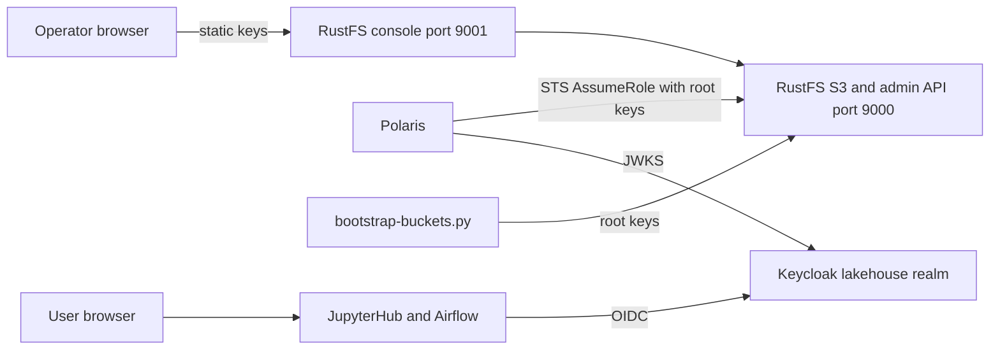

# System Architecture — RustFS / Keycloak Authentication

## Relevant components

- **RustFS 1.0.4** (`rustfs` service, `docker-compose.yml`): single node, data volume `lakehouse-local_rustfs-data`, networks `core` and `data-access`. Root credentials are supplied through `RUSTFS_ACCESS_KEY_FILE` / `RUSTFS_SECRET_KEY_FILE` from `.runtime/container-mounts/`. S3 API is published on `127.0.0.1:9000`; the console on `127.0.0.1:9001`, served at `/rustfs/console/`.
- **Keycloak 26.8.1** (`keycloak` service, network `core`): `lakehouse` realm; issuer `http://keycloak.localhost:8080/realms/lakehouse`. Browsers use `keycloak.localhost`; containers must use the `keycloak` service name.
- **Keycloak realm bootstrap** (`infra/keycloak/bootstrap-realm.py`): idempotently ensures groups, clients, and protocol mappers; refuses conflicting existing configuration.
- **Polaris 1.8.0**: uses the RustFS root keys server-side for STS credential vending (`stsEndpoint: http://rustfs:9000`).
- **Runtime preparation** (`scripts/prepare-lakehouse-runtime.py`, `scripts/lakehouse.sh`): creates missing protected credentials and read-only container mount copies.

## Current architecture diagram

Text alternative: the RustFS console and S3 API are reached only with root static credentials (operator, bucket bootstrap, Polaris STS). Keycloak OIDC is used by JupyterHub, Airflow, and Polaris token validation, but RustFS has no relationship with Keycloak today.

## Current authentication observations (live, read-only)

- `GET /rustfs/admin/v3/oidc/providers` returns `[]` — no OIDC provider is configured.
- No `RUSTFS_IDENTITY_OPENID_*` variables are set on the running container.
- The image sets `RUSTFS_CONSOLE_CORS_ALLOWED_ORIGINS=*` by default.
- The RustFS binary includes native OpenID support (see `api-documentation.md`), including `AssumeRoleWithWebIdentity`.

## Integration boundary and known pitfall

The realm issuer uses `keycloak.localhost`, which resolves to container loopback inside containers. The Airflow SSO intent hit exactly this: the discovery document advertised a JWKS URI that the container could not reach, and an explicit internal JWKS URI was required. RustFS exposes `CONFIG_URL` and `ISSUER` as separate settings, but whether it fetches keys from the discovery-advertised `jwks_uri` (and so needs a resolvable `keycloak.localhost` inside its container) is **unverified**.

## Unknowns for Requirements Analysis

Which groups may sign in to the console and with which RustFS permissions; whether root static-key console login is retained as break-glass; console callback host(s) and port; client-secret delivery (no `_FILE` variant for the client secret was observed); whether programmatic `AssumeRoleWithWebIdentity` is in scope; logout behavior; and acceptance/verification scope.
