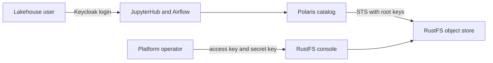

# Business Overview — RustFS / Keycloak Authentication

## Business Context Diagram

Text alternative: today only the platform operator reaches the RustFS console, using the root access key and secret key. Lakehouse users sign in through Keycloak to JupyterHub or Airflow and reach object data only through Polaris-vended, scoped temporary credentials.

## Business Description
- **Business Description**: A local single-node lakehouse platform. RustFS stores the three environment buckets for the `default` data product; Keycloak is the platform identity provider; Polaris governs table access and vends scoped S3 credentials.
- **Business Transactions**:
  - *Operator console login*: the operator signs in to the RustFS console with root static credentials.
  - *Bucket bootstrap*: an operator script creates missing environment buckets with root credentials.
  - *Credential vending*: Polaris calls RustFS STS (root keys plus a session policy) to issue table-prefix-scoped temporary credentials to Spark.
  - *Human SSO elsewhere*: JupyterHub and Airflow already authenticate humans through Keycloak OIDC with group-based admission.
- **Business Dictionary**:
  - *Product role groups*: `role-default-owner`, `role-default-developer`, `role-default-analyst`, `role-default-writer` in the Keycloak `lakehouse` realm.
  - *Environment buckets*: `bucket-default` (production), `bucket-default-uat`, `bucket-default-dev`.
  - *Root credentials*: the RustFS bootstrap access/secret key pair under `.runtime/credentials/`.

## Component Level Business Descriptions
### RustFS
- **Purpose**: S3-compatible object storage for all environments.
- **Responsibilities**: Store data; serve the S3 and STS APIs; host the administrative web console.
### Keycloak
- **Purpose**: Single platform identity provider.
- **Responsibilities**: Authenticate humans; carry group membership in tokens; host per-application OIDC clients.
