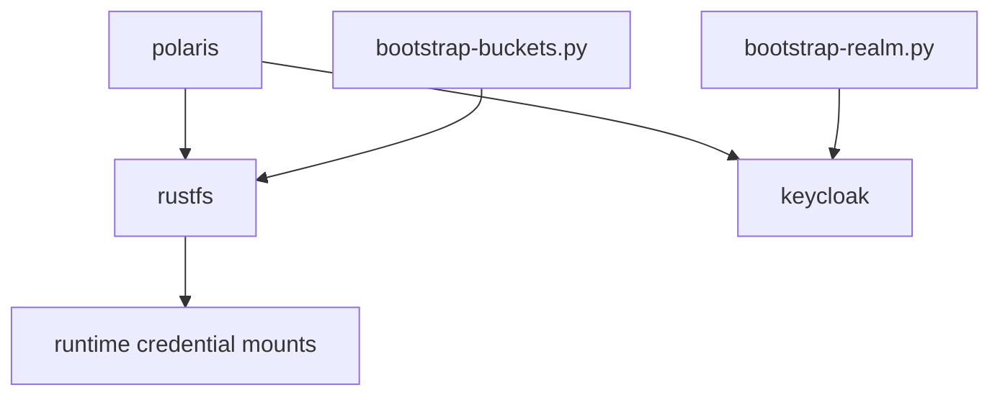

# Dependencies — RustFS / Keycloak Authentication

## Internal Dependencies

Text alternative: RustFS depends only on its mounted root credentials today. Polaris depends on RustFS (STS) and Keycloak (JWKS). OIDC login would add a new runtime dependency from RustFS to Keycloak and a new Keycloak client created by `bootstrap-realm.py`.

### Polaris depends on RustFS
- **Type**: Runtime
- **Reason**: STS credential vending with root keys; must not regress.
### RustFS would depend on Keycloak (proposed)
- **Type**: Runtime
- **Reason**: OIDC discovery, token exchange, and key validation for console login.

## External Dependencies
### rustfs/rustfs
- **Version**: 1.0.4
- **Purpose**: Object storage
- **License**: Apache-2.0
### quay.io/keycloak/keycloak
- **Version**: 26.8.1
- **Purpose**: Identity provider
- **License**: Apache-2.0
