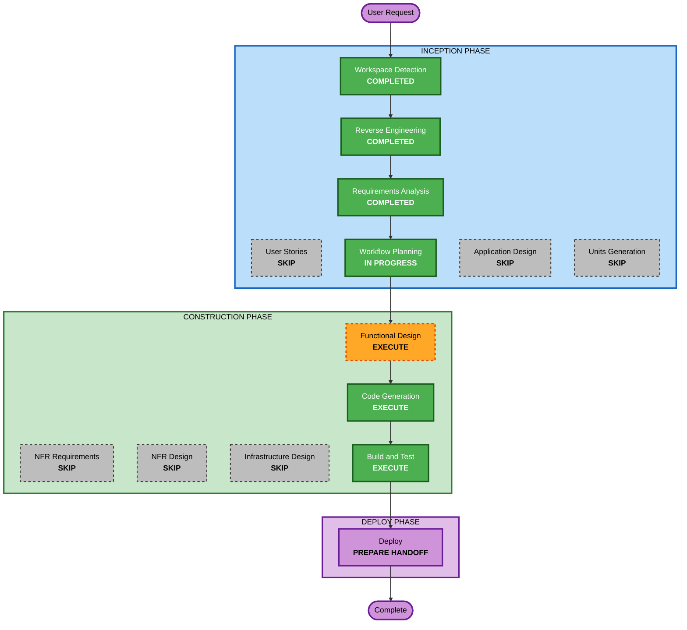

# Execution Plan — Environment Reset and Bootstrap Users

## Detailed Analysis Summary

### Transformation Scope
- **Transformation Type**: Operations tooling, identity bootstrap, and a workload identity migration. There is no new service.
- **Primary Changes**:
  - full reset command
  - bootstrap users and an enforcing user bootstrap
  - `role-platform-admin` mapped in every service
  - writer workload identity moved from `write-service-account` to `srv-default-writer` (password grant)
  - Airflow Bundles moved into this repository
  - README start and reset documentation
- **Related Components**:
  - `scripts/lakehouse.sh`
  - `infra/keycloak/`
  - the Polaris reconciler and authorization
  - `infra/rustfs/bootstrap-policies.py`
  - `infra/airflow/` (SSO roles, Bundle validation)
  - `infra/airflow-token-broker/`
  - `infra/jenkins/casc/`
  - the JupyterHub policy
  - `infra/spark-bootstrap/`
  - the verifier scripts
  - `scripts/prepare-lakehouse-runtime.py`, `scripts/provision-airflow-secrets.sh`
  - Compose files, README, and tests

### Change Impact Assessment
- **User-facing**: Yes. A new reset command, five named users with a shared default password, and a platform admin.
- **Structural**: Minor. A new writer Keycloak client replaces the service-account client, and the Bundle path moves.
- **Data**: Yes. The reset deletes all v2 data. User and group state becomes enforced by the user bootstrap.
- **API**: Yes. The broker and Spark switch from the client-credentials grant to the password grant, and the Polaris writer principal is renamed.
- **NFR**: Yes. Destructive operations, and a weaker writer credential (accepted for local use).

### Risk Assessment
- **Risk Level**: High.
  - The reset is irreversible.
  - The writer identity migration crosses Keycloak, Polaris, the Airflow broker, and Spark.
  - The `role-platform-admin` mappings touch every service.
- **Rollback Complexity**: Difficult once a reset has run, because data is gone. The code changes themselves can be reverted.
- **Testing Complexity**: Complex. A full reset, start, and bootstrap cycle, user logins, verifiers, and the Airflow broker token.

## Workflow Visualization



### Text Alternative
```
INCEPTION: Workspace Detection, Reverse Engineering, Requirements Analysis (COMPLETED); User Stories, Application Design, Units Generation (SKIP); Workflow Planning (IN PROGRESS)
CONSTRUCTION (single unit: environment-reset-bootstrap-users): Functional Design (EXECUTE); NFR Requirements, NFR Design, Infrastructure Design (SKIP); Code Generation, Build and Test (EXECUTE)
DEPLOY: Deploy handoff (EXECUTE), then Artifact Compaction / Intent Closure
```

## Phases to Execute

### INCEPTION
- [x] Workspace Detection, Reverse Engineering, Requirements Analysis (COMPLETED)
- [x] User Stories (SKIPPED). The users table and the verification cycle define acceptance.
- [ ] Application Design - SKIP
  - **Rationale**: The changes stay within existing component boundaries: operator scripts, the realm bootstrap, the service group consumers, the broker, and the smoke job. The new writer client follows the established client pattern.
- [ ] Units Generation - SKIP
  - **Rationale**: One unit, `environment-reset-bootstrap-users`. The reset, users, writer migration, and Bundle move are verified together by one reset, start, and bootstrap cycle.

### CONSTRUCTION
- [ ] Functional Design - EXECUTE
  - **Rationale**: Define the exact reset inventory and its safety rules. Define the user enforcement rules. Decide how `role-platform-admin` maps per service:
    - Polaris: owner-equivalent principal role or a new role
    - RustFS: a policy
    - Airflow, Jenkins, and JupyterHub: their mappings
  - **Writer migration design**: the new client name and configuration, the password-grant token flow in the broker and Spark, the broker's `azp` check, the secret files, and the Polaris principal rename.
  - **Bundle move**: the path change and the one-time cleanup.
  - Read-only checks only.
- [ ] NFR Requirements, NFR Design - SKIP
  - **Rationale**: NFRs are fixed in the requirements; no extensions are enabled.
- [ ] Infrastructure Design - SKIP
  - **Rationale**: Compose and path changes are covered in Functional Design.
- [ ] Code Generation - EXECUTE (ALWAYS)
- [ ] Build and Test - EXECUTE (ALWAYS)
  - **Rationale**: The full local cycle, which includes the real reset. It runs only after you approve Build and Test start, and only after a reminder to back up.

### DEPLOY
- [ ] Deploy - EXECUTE (ALWAYS)

## Canonical Knowledge Impact Inventory (MANDATORY)
All paths below are files in **this repository** (`opensource-lakehouse-infra-v2/aidlc-docs/knowledge/`). The two projects are independent, so infra-v2's knowledge base keeps no documents about the workload repository; those are retired, and the archive preserves them.

| Canonical path | Action | Requirement and owning component | Reason |
|---|---|---|---|
| `knowledge/opensource-lakehouse-infra-v2/application-design.md` | UPDATE | FR-1–FR-9; operator scripts, Keycloak, broker | Reset command, startup, bootstrap users, `role-platform-admin`, writer identity migration, Bundle location. |
| `knowledge/opensource-lakehouse-infra-v2/functional-design/lakehouse-product-access.md` | UPDATE | FR-3–FR-5; product access | New group `role-platform-admin` (owner-equivalent); writer principal `srv-default-writer`; bootstrap users. |
| `knowledge/opensource-lakehouse-infra-v2/functional-design/jenkins-ci-access.md` | UPDATE | FR-4; Jenkins | `role-platform-admin` gains Administer; the job and history are gone after a reset. |
| `knowledge/opensource-lakehouse/application-design.md` | RETIRE | FR-9 | Describes the independent workload repository. The infra-relevant facts (Bundle contract `lakehouse-main`→`main`, `lakehouse-uat`→`uat`; writer identity) are kept in infra-v2's own application design. |
| `knowledge/opensource-lakehouse/functional-design/airflow-workload-execution.md` | RETIRE | FR-9 | Same reason. Airflow workload execution from the infra-v2 side stays documented in infra-v2's application design. |

## Package Change Sequence
1. Keycloak: `role-platform-admin`, the bootstrap users, the new writer client, retirement of `write-service-account`, and the contract.
2. Enforcing user bootstrap (`scripts/bootstrap-users.sh`) and the product-bootstrap wiring.
3. Service mappings for `role-platform-admin`: Polaris reconciler and authorization, RustFS policy, Airflow roles, Jenkins configuration as code, JupyterHub policy.
4. Writer migration: broker, Spark smoke job and script, verifiers, runtime secrets, Compose.
5. Bundle move and independence: Bundle root in infra-v2 `.runtime`; remove `LAKEHOUSE_PROJECT_ROOT` from `lakehouse.sh`, `provision-airflow-secrets.sh`, `validate-bundle-config.py`, and `docker-compose.airflow.yml`; one-time removal of the sibling's entire `.runtime` folder (Git-ignored; only old Bundle checkouts).
6. Reset command (`lakehouse.sh reset` with the prompt, `--yes`, and `--dry-run`).
7. Tests and README.

Checkpoints: contract tests after each package; then, in Build and Test, the full cycle.

## Estimated Timeline
- 4 remaining stages, then closure. Several working sessions. The writer migration carries the most risk.

## Success Criteria
- `reset` deletes exactly the v2 inventory and nothing else.
- `start` and the product bootstrap succeed on a clean environment.
- All five users log in with `ChangeM3!` and have exactly their group. Rerunning the user bootstrap re-applies the defaults.
- `platform-admin` has owner-equivalent access everywhere.
- Writer tokens and the Spark smoke job work as `srv-default-writer`.
- The Bundles live in this repository and the sibling folder is removed.
- The README documents start and reset.
- The existing verifiers pass.
