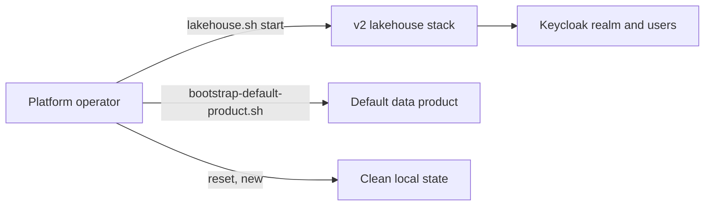

# Business Overview — Environment Reset and Bootstrap Users

## Business Context Diagram

Text alternative: the operator starts the stack and bootstraps the default product. The new capability resets everything to a clean local state and then re-creates a known set of users.

## Business Description
- **Business Description**: a local, single-host lakehouse platform used for development and demonstration. Operators need a repeatable way to wipe it and rebuild it, plus predictable named users for each product role.
- **Business Transactions**: start the platform; bootstrap the default product; start Airflow; reset the platform (new); log in as role users.
- **Business Dictionary**:
  - product groups `role-default-{owner,developer,analyst,writer}`
  - proposed new group `role-platform-admin`
  - bootstrap users `joe-developer`, `peter-analyst`, `maria-owner`, `srv-default-writer`, `platform-admin`

## Component Level Business Descriptions
- **Keycloak**: identities, groups, clients.
- **Polaris**: catalogs and grants; it needs principals reconciled for users.
- **RustFS**: buckets, console policies.
- **JupyterHub**, **Airflow**, **Jenkins**: user-facing services with their own state.
