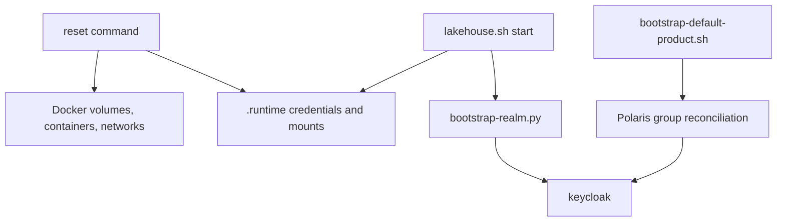

# Dependencies — Reset and Identity Bootstrap

Text alternative: the reset touches Docker state and runtime files. Start recreates the runtime files and runs the realm bootstrap, where the users would be created. Product bootstrap reconciles Polaris principals from Keycloak groups.
