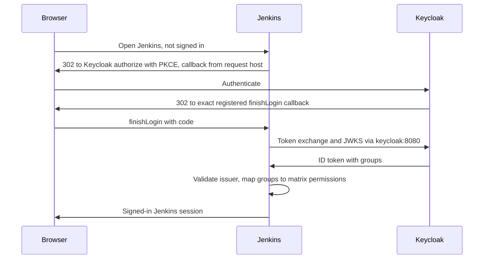

# Business Logic Model — jenkins-keycloak-sso

## Login flow

Text alternative:
1. Jenkins redirects the browser to Keycloak with PKCE. The callback is built from the request host.
2. Keycloak authenticates the user and returns to the exact `finishLogin` callback.
3. Jenkins exchanges the code and validates the token over the internal Keycloak name.
4. Jenkins maps the `groups` claim to matrix permissions (JB-2 to JB-6).

## Denial and logout
- **No approved group**: the user can sign in but has no Overall/Read, so Jenkins shows an access-denied page (JB-3).
- **Unregistered callback**: Keycloak refuses the authorize request (JB-5).
- **Logout**: Jenkins ends its session and redirects to the Keycloak end-session endpoint, which returns to `http://127.0.0.1:<port>/`.

## Keycloak outage
SSO logins fail, and the escape-hatch login works (JB-17, JB-18).

## Start-up and migration (core `scripts/lakehouse.sh start`)
1. Runtime preparation creates any missing `jenkins-oidc-client-secret` and `jenkins-break-glass-password`, and stages their mounts.
2. Existing core start-up runs: Keycloak, Polaris, RustFS, and the realm bootstrap. The bootstrap now also ensures the `jenkins` client and mapper.
3. The Jenkins image is built from `plugins.txt`, pinned.
4. The migration helper `scripts/migrate-jenkins-home.py` runs:
   - **marker present**: no action
   - **target non-empty without a marker**: refuse and stop start-up
   - **target empty and legacy volume present**: refuse if the legacy container is running; otherwise copy read-only from the source, verify, and write the `migrated` marker
   - **target empty and no legacy volume**: write the `fresh` marker and print the notice
5. `docker compose up -d jenkins` starts Jenkins and waits until healthy. The image's plugins override the home copies, and configuration as code applies the security settings.

`status` and `stop` include Jenkins.

## CI build
The migrated multibranch job scans GitHub anonymously on its existing schedule. A build of `main` runs `opensource-lakehouse/Jenkinsfile` on the built-in node: venv, compile check, lint, flake8, bandit, and pytest. No Docker access is involved.

## Legacy removal (after verified, approved Build and Test)
Run `scripts/lakehouse.sh remove-legacy-jenkins --confirm`. It checks the preconditions in JB-15, then removes the legacy container and then the volume, and reports exactly what it removed.

## Rollback
- **Before legacy removal**: stop Jenkins and remove `lakehouse-local_jenkins-home`. The legacy instance is untouched.
- **After legacy removal**: restore from a backup of the v2 home.
