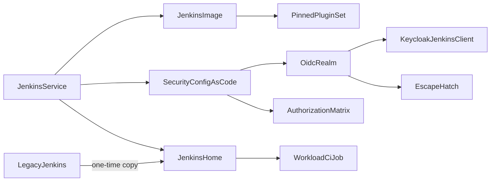

# Domain Entities — jenkins-keycloak-sso

Text alternative:
- The Jenkins service runs a pinned image with a pinned plugin set.
- Its home is copied once from the legacy instance and holds the workload CI job.
- Configuration as code defines the OIDC realm, which uses the Keycloak `jenkins` client and has an escape hatch, and the authorization matrix.

## JenkinsImage (modified `infra/jenkins/Dockerfile`)
- **Base**: the existing digest-pinned `jenkins/jenkins:lts-jdk21` (Jenkins 2.580.1) plus the pinned Python 3.10 runtime.
- **Plugin install**: `jenkins-plugin-cli --plugin-file /usr/share/jenkins/ref/plugins.txt` at build, into `/usr/share/jenkins/ref/plugins`.
- **Build check**: the build fails if the installed set differs from `plugins.txt`.

## PinnedPluginSet (`infra/jenkins/plugins.txt`, new)
- The 102 legacy plugins at their exact legacy versions (J1).
- Plus `oic-auth:4.731.v4932b_506e767` and `nimbus-jose-jwt-api:10.10-12.vd4e6d651b_7f7` (J2).
- 104 entries, one `name:version` per line, sorted.

## JenkinsService (Compose service `jenkins`, new)
| Setting | Value |
|---|---|
| Image | `local/lakehouse-jenkins:2.580.1` built from `infra/jenkins/Dockerfile` |
| Port | `127.0.0.1:${JENKINS_HOST_PORT:-8090}:8080` |
| Volume | `jenkins-home` → `lakehouse-local_jenkins-home` at `/var/jenkins_home` |
| Network | `core` (Keycloak back-channel; outbound HTTPS to GitHub) |
| Environment | `CASC_JENKINS_CONFIG=/var/jenkins_casc/jenkins.yaml`, `PLUGINS_FORCE_UPGRADE=true`, `JAVA_OPTS=-Djenkins.install.runSetupWizard=false`, `JENKINS_HOST_PORT` |
| Read-only mounts | `infra/jenkins/casc/jenkins.yaml`; `.runtime/container-mounts/jenkins-oidc-client-secret`; `.runtime/container-mounts/jenkins-break-glass-password` |
| Not mounted | Docker socket (FR-4); no `group_add` |
| Healthcheck | `curl -fsS http://127.0.0.1:8080/login` |
| Depends on | `keycloak` healthy |

## JenkinsHome (volume `lakehouse-local_jenkins-home`, new)
- Created with Compose labels (project `lakehouse-local`, volume `jenkins-home`) so Compose adopts it.
- **Marker file** `/var/jenkins_home/.lakehouse-home-origin`: `migrated:iceberg-poc-jenkins-home <UTC timestamp>`, or `fresh <UTC timestamp>` (FD Q1: A).
- **Content after migration**: an exact copy of the legacy home, including the job, build history, `secrets/`, `secret.key`, and `identity.key.enc`. Plugins are overridden by the image at start (J9).

## WorkloadCiJob (migrated, unchanged)
- Folder `opensource-lakehouse-dp` containing the multibranch `opensource-lakehouse-ci`.
- Source: anonymous `https://github.com/cdiogo1979/opensource-lakehouse/`. Script path: `Jenkinsfile`.
- Branches: `main` and `uat` (history preserved).

## SecurityConfigAsCode (`infra/jenkins/casc/jenkins.yaml`, new)
Manages only:
- the security realm
- the authorization strategy
- executors (2) and mode (`NORMAL`)
- the CSRF crumb issuer
- `unclassified.location.url = http://127.0.0.1:${JENKINS_HOST_PORT}/`

Secrets are referenced through `${readFile:/run/secrets/...}` and never written inline.

## OidcRealm (`jenkins.securityRealm.oic`)
| Key | Value |
|---|---|
| `serverConfiguration.manual.authorizationServerUrl` | `http://keycloak.localhost:8080/realms/lakehouse/protocol/openid-connect/auth` |
| `…endSessionUrl` | `http://keycloak.localhost:8080/realms/lakehouse/protocol/openid-connect/logout` |
| `…tokenServerUrl` | `http://keycloak:8080/realms/lakehouse/protocol/openid-connect/token` |
| `…jwksServerUrl` | `http://keycloak:8080/realms/lakehouse/protocol/openid-connect/certs` |
| `…userInfoServerUrl` | `http://keycloak:8080/realms/lakehouse/protocol/openid-connect/userinfo` |
| `…issuer` | `http://keycloak.localhost:8080/realms/lakehouse` |
| `…scopes` | `openid profile email` |
| `clientId` / `clientSecret` | `jenkins` / `${readFile:/run/secrets/jenkins_oidc_client_secret}` |
| `userNameField`, `fullNameFieldName`, `emailFieldName`, `groupsFieldName` | `preferred_username`, `name`, `email`, `groups` |
| `logoutFromOpenidProvider`, `postLogoutRedirectUrl` | `true`, `http://127.0.0.1:${JENKINS_HOST_PORT}/` |
| `rootURLFromRequest` | `true` (callbacks work from both `localhost` and `127.0.0.1`) |
| `properties` | `pkce`; `escapeHatch{username: jenkins-break-glass, group: jenkins-break-glass, secret: ${readFile:/run/secrets/jenkins_break_glass_password}}` |

## AuthorizationMatrix (`jenkins.authorizationStrategy.globalMatrix.entries`)
| Group | Permissions |
|---|---|
| `role-default-owner` | `Overall/Administer` |
| `jenkins-break-glass` (escape hatch) | `Overall/Administer` |
| `role-default-developer` | `Overall/Read`, `Job/Read`, `Job/Build`, `Job/Cancel`, `Job/Workspace` |
| `role-default-analyst` | `Overall/Read`, `Job/Read` |

There is no entry for `anonymous`, `authenticated`, or `role-default-writer`.

## KeycloakJenkinsClient (new, `infra/keycloak/bootstrap-realm.py`)
- **clientId** `jenkins`: confidential, standard flow only, `pkce.code.challenge.method=S256`, `webOrigins=[]`.
- **redirectUris**: `http://localhost:<port>/securityRealm/finishLogin` and `http://127.0.0.1:<port>/securityRealm/finishLogin`.
- **post.logout.redirect.uris**: `http://localhost:<port>/` and `http://127.0.0.1:<port>/`.
- **Port**: `<port>` = `JENKINS_HOST_PORT`, resolved from the environment, then `.env`, then 8090.
- **Mapper** `lakehouse-jenkins-groups`: `oidc-group-membership-mapper`, `claim.name=groups`, `full.path=false`, and ID, access, and userinfo token claims all `true`.

## Secrets (new protected files)
- `.runtime/credentials/jenkins-oidc-client-secret` (hex) and `.runtime/credentials/jenkins-break-glass-password` (hex).
- Each is created once, mode 0600, and staged as a read-only mount copy (0644 under the 0700 mounts directory).

## LegacyJenkins (existing, removal target)
- **Removal target**: container `hive-dremio-rustfs-jenkins-1` and volume `iceberg-poc-jenkins-home`.
- **Never removed**: `jenkins_home` (the unrelated `jenkins-docker` project) and the image `local/lakehouse-jenkins-validation:1.0.0`.
