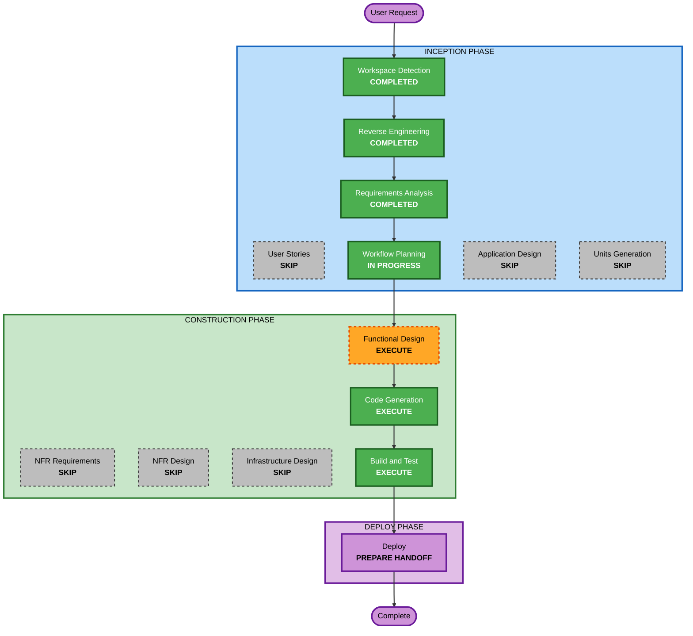

# Execution Plan — Jenkins Onboarding and Keycloak SSO

## Detailed Analysis Summary

### Transformation Scope
- **Transformation Type**: Infrastructure migration plus integration. One new v2 service (Jenkins) is migrated from a legacy, hand-configured instance and then gets Keycloak SSO.
- **Primary Changes**:
  - pinned Jenkins image with exact plugins
  - Compose service and new home volume
  - one-time home copy
  - configuration as code for security
  - Keycloak `jenkins` client and groups mapper
  - break-glass secret
  - core-start wiring
  - legacy removal step
- **Related Components**: `infra/jenkins/`, `docker-compose.yml`, `docker-compose.deferred.yml`, `infra/keycloak/`, `scripts/prepare-lakehouse-runtime.py`, `scripts/lakehouse.sh`, README, tests.

### Change Impact Assessment
- **User-facing changes**: Yes. Jenkins becomes available at `127.0.0.1:8090` with Keycloak sign-in.
- **Structural changes**: Yes, minor. A new service and volume. Jenkins depends on Keycloak.
- **Data model changes**: Yes. A new home volume is copied from the legacy home. The legacy home is removed later as a separate approved step.
- **API changes**: Yes. A new Keycloak client. No changes to other clients or services.
- **NFR impact**: Yes. Authentication surface, secret handling, and core-start time.

### Component Relationships
- **Primary Component**: `jenkins` service (new in v2). Major. Critical.
- **Infrastructure Components**: `infra/keycloak/bootstrap-realm.py` and `realm-contract.json` (additive client). Minor. Critical.
- **Shared Components**: `scripts/prepare-lakehouse-runtime.py` (OIDC client secret, escape-hatch credentials). Minor. Critical.
- **Supporting Components**:
  - `scripts/lakehouse.sh` (start, status, stop, migration hook, legacy-removal command). Minor. Important.
  - `docker-compose.deferred.yml`. Configuration only. Optional.
- **Dependent Components**: none. No existing service depends on Jenkins.
- **External**: GitHub (anonymous SCM); the sibling `opensource-lakehouse/Jenkinsfile` (unchanged).

### Risk Assessment
- **Risk Level**: Medium-High.
  - The migrated hand-configured state must be pinned to 102 exact plugin versions.
  - OIDC plugin compatibility with 2.580.1 is unverified.
  - The legacy removal is destructive (gated, last).
- **Rollback Complexity**: Moderate. Before legacy removal: stop the v2 service and drop the new volume, leaving the legacy instance intact. After legacy removal: rollback depends on the v2 home and backups.
- **Testing Complexity**: Moderate to complex. Contract tests, runtime checks, headless OIDC with temporary users, a real CI build, and an interactive login.

## Workflow Visualization



### Text Alternative
```
Phase 1: INCEPTION
- Workspace Detection (COMPLETED)
- Reverse Engineering (COMPLETED)
- Requirements Analysis (COMPLETED)
- User Stories (SKIP)
- Workflow Planning (IN PROGRESS)
- Application Design (SKIP)
- Units Generation (SKIP)
Phase 2: CONSTRUCTION (single unit: jenkins-keycloak-sso)
- Functional Design (EXECUTE)
- NFR Requirements (SKIP)
- NFR Design (SKIP)
- Infrastructure Design (SKIP)
- Code Generation (EXECUTE)
- Build and Test (EXECUTE)
Phase 3: DEPLOY
- Deploy handoff (EXECUTE)
Then: legacy removal (separate approved step) and Artifact Compaction / Intent Closure
```

## Phases to Execute

### INCEPTION PHASE
- [x] Workspace Detection (COMPLETED)
- [x] Reverse Engineering (COMPLETED)
- [x] Requirements Analysis (COMPLETED)
- [x] User Stories (SKIPPED). The permission table and verification criteria define acceptance.
- [x] Execution Plan (IN PROGRESS)
- [ ] Application Design - SKIP
  - **Rationale**: One new, self-contained service with an obvious boundary: CI for the workload repository, authenticated by Keycloak. Its responsibilities and interfaces are fixed by the requirements. No new service layer or cross-component contract beyond one more Keycloak client of the established pattern. Functional Design records the component's rules.
- [ ] Units Generation - SKIP
  - **Rationale**: A single cohesive unit, `jenkins-keycloak-sso`. The migration, plugin pinning, and SSO are verified together on one service. The legacy removal is a gated final step within the unit.

### CONSTRUCTION PHASE
- [ ] Functional Design - EXECUTE
  - **Rationale**: Resolve the unverified technical points before code:
    - an `oic-auth` version compatible with Jenkins 2.580.1, and the dependency deltas against the legacy pins (any deviation from exact legacy versions comes back for approval)
    - the configuration-as-code keys for `oic-auth`, the escape hatch, and the matrix authorization
    - group-claim handling
    - `keycloak.localhost` resolution: manual endpoints vs. alias
    - callback and logout URIs
    - the migration procedure: copy semantics, refusal on non-empty target, plugin override at start
    - the legacy-removal procedure and its preconditions
  - Spikes are read-only or isolated (throwaway containers, copied volumes).
- [ ] NFR Requirements - SKIP
  - **Rationale**: NFRs are fixed in the requirements. The stack is pinned. No extensions are enabled.
- [ ] NFR Design - SKIP
  - **Rationale**: Only established project patterns are used: protected files, exact callbacks, loopback, fail-closed bootstrap.
- [ ] Infrastructure Design - SKIP
  - **Rationale**: Compose-level decisions (service, volume, port, mounts, startup ordering) are covered in the Functional Design runtime-integration section, as in prior intents.
- [ ] Code Generation - EXECUTE (ALWAYS)
- [ ] Build and Test - EXECUTE (ALWAYS)
  - **Rationale**: Contract tests, runtime checks, headless OIDC with temporary users, a workload CI build, and an interactive login.

### DEPLOY PHASE
- [ ] Deploy - EXECUTE (ALWAYS)
  - **Rationale**: `pr_request.md` and ordered `deploy_instructions.md`: secrets, image build, home copy, start, realm bootstrap, verification, and the gated legacy removal. Documentation only.

## Canonical Knowledge Impact Inventory (MANDATORY)
| Canonical path | Action | Requirement and owning component | Reason / new-boundary justification |
|---|---|---|---|
| `aidlc-docs/knowledge/opensource-lakehouse-infra-v2/application-design.md` | UPDATE | FR-1–FR-12; Jenkins and Keycloak components | Jenkins moves from deferred to supported. Add the service, port, home volume, Keycloak `jenkins` client, SSO and break-glass, startup sequence, legacy removal, and verification status. |
| `aidlc-docs/knowledge/opensource-lakehouse-infra-v2/functional-design/jenkins-ci-access.md` | CREATE | FR-3–FR-9, FR-11; Jenkins component | Does not exist. Jenkins is a new component boundary in v2 (a CI service with its own authorization model and plugin and configuration-as-code rules), distinct from data-product access. |
| `aidlc-docs/knowledge/opensource-lakehouse-infra-v2/functional-design/lakehouse-product-access.md` | RETAIN | — | Data-product access (Keycloak, Polaris, RustFS) is unchanged. Jenkins tool permissions live in the Jenkins component design, as Airflow UI roles live in the application design. |
| `aidlc-docs/knowledge/opensource-lakehouse/application-design.md` | RETAIN | — | The workload repository's Airflow contract is unchanged. Its `Jenkinsfile` is not modified. |
| `aidlc-docs/knowledge/opensource-lakehouse/functional-design/airflow-workload-execution.md` | RETAIN | — | Airflow workload execution is unaffected. |

Archived intent artifacts remain immutable.

## Package Change Sequence
1. Plugin pinning: `infra/jenkins/plugins.txt` plus the Dockerfile install step, resolved in Functional Design.
2. Protected secrets: the Keycloak `jenkins` client secret and the escape-hatch credentials.
3. Configuration as code: security realm (`oic-auth`), authorization matrix, escape hatch, root URL. Secrets are referenced, never inlined.
4. Keycloak `jenkins` client, mapper, and contract.
5. Compose service, volume, and port, plus the deferred-inventory update.
6. Migration helper (one-time copy, refusal on non-empty target) and core-start wiring, status, and stop.
7. Tests and README.
8. Legacy removal command or step (gated; run only after verification and approval).

Testing checkpoints:
- contract tests after steps 1–6
- live runtime checks after step 6
- the CI build and headless OIDC check before any legacy removal

## Estimated Timeline
- **Total Phases**: 4 remaining stages, then the gated legacy removal and closure.
- **Estimated Duration**: several working sessions. Plugin compatibility is the main uncertainty.

## Success Criteria
- **Primary Goal**: the migrated Jenkins runs in v2 at `127.0.0.1:8090`. Keycloak users get exactly their group's permissions, and users without a group are refused. The escape hatch works. The workload CI builds successfully.
- **Key Deliverables**: pinned image and plugins, configuration as code for security, Keycloak client, Compose service and volume, migration helper, core-start wiring, tests, README, knowledge updates, and the gated legacy removal.
- **Quality Gates**:
  - contract tests pass
  - OIDC redirect uses the exact callbacks
  - the headless permission matrix passes
  - a workload CI build succeeds
  - you confirm an interactive login
  - legacy removal happens only after these pass and you approve it
