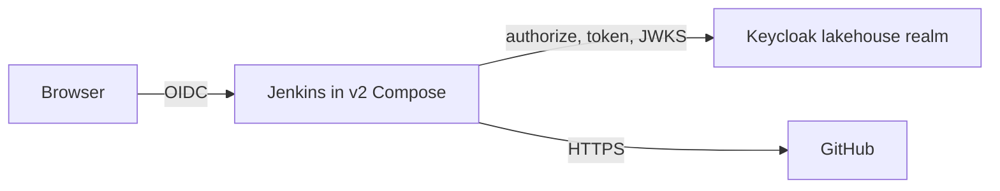

# System Architecture — Jenkins / Keycloak

## Current state
- **v2 stack (this workspace)**: Jenkins is **not** in `docker-compose.yml`. `docker-compose.deferred.yml` lists it as `unsupported-pending-migration`. Only `infra/jenkins/Dockerfile` remains. It builds on `jenkins/jenkins:lts-jdk21` (digest-pinned) plus a pinned Python 3.10 runtime, and validates that `python3.10`, `bash`, and `git` work. It installs no plugins and has no configuration as code.
- **Legacy instance (outside v2)**: container `hive-dremio-rustfs-jenkins-1` from the sibling `hive-dremio-rustfs` project.
  - Image `local/lakehouse-jenkins-validation:1.0.0`, Jenkins **2.580.1**.
  - Status: exited 3 days ago.
  - Published on host port **8098 on all interfaces**, not loopback.
  - Docker socket bind-mounted, on network `iceberg-poc-net`.
  - Home volume `iceberg-poc-jenkins-home`.
- **Legacy home contents** (read-only inspection):
  - Jobs: folder `opensource-lakehouse-dp` containing the multibranch pipeline `opensource-lakehouse-ci`, which uses Git source `https://github.com/cdiogo1979/opensource-lakehouse/`, `scriptPath` `Jenkinsfile`, and no credentials ID.
  - Security: `HudsonPrivateSecurityRealm` (local users) with one admin user, `FullControlOnceLoggedInAuthorizationStrategy`, and signup disabled.
  - Plugins: 102 installed by hand. They include `configuration-as-code`, `matrix-auth`, `ldap`, `git`, `github-branch-source`, and `workflow-aggregator`. There is **no OIDC plugin**.
- **Other volume**: `jenkins_home` (created 2026-09-27) belongs to an unrelated `jenkins-docker` Compose project.
- **Pipelines**:
  - `opensource-lakehouse/Jenkinsfile` uses Python venv, `requirements-dev.txt`, compileall, `scripts/code_quality.sh` (lint, flake8, bandit), and pytest.
  - This workspace also has a root `Jenkinsfile` (pytest with the Hypothesis seed). It has never been wired to a job, and this workspace has no Git remote.

## Target integration boundary

Text alternative: a v2 Jenkins service would authenticate browsers through Keycloak and reach GitHub for SCM.

## Known integration pitfall
Keycloak advertises `keycloak.localhost:8080`, which resolves to loopback inside containers. Airflow solved this by configuring an internal JWKS URI; RustFS used a network alias. A Jenkins OIDC plugin that allows manual endpoint configuration can use the internal name for token and JWKS calls.

## Unknowns for Requirements Analysis
- Scope of the onboarding: a fresh v2 Jenkins configured as code, or migrating the legacy home.
- Which jobs to create (workload repository only, or this repository too).
- Agent and executor model: built-in node, Docker socket, or none.
- Which Keycloak groups map to which Jenkins permissions.
- Break-glass admin.
- Host port and loopback binding.
- Plugin pinning approach.
- GitHub access: anonymous or a token.
- Webhooks or polling.
- Fate of the legacy container and volumes.
