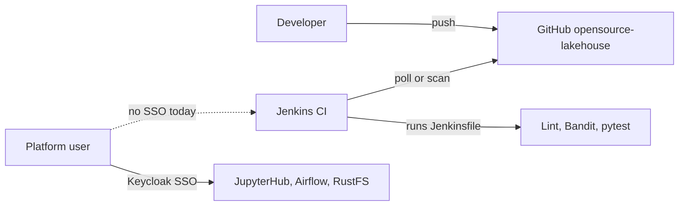

# Business Overview — Jenkins / Keycloak

## Business Context Diagram

Text alternative: Jenkins provides CI for the `opensource-lakehouse` workload repository by running its `Jenkinsfile` (lint, flake8, bandit, pytest). Humans sign in to JupyterHub, Airflow, and RustFS through Keycloak. Jenkins is not part of the v2 runtime and has no SSO.

## Business Description
- **Business Description**: Jenkins validates changes to the workload repository (DAGs, notebooks, Bundle client) before Airflow Git Bundles pick them up.
- **Business Transactions**:
  - *Multibranch CI*: scan `github.com/cdiogo1979/opensource-lakehouse` branches and run `Jenkinsfile` per branch.
  - *Human console access*: today a single local Jenkins admin account (legacy stack only).
- **Business Dictionary**: product groups `role-default-{owner,developer,analyst,writer}`; workload repository = `opensource-lakehouse`; infra repository = `opensource-lakehouse-infra-v2` (this workspace).

## Component Level Business Descriptions
### Jenkins
- **Purpose**: CI for the workload repository.
- **Responsibilities**: Branch discovery, pipeline execution, build history, developer feedback.
### Keycloak
- **Purpose**: Platform identity provider for human browser logins.
