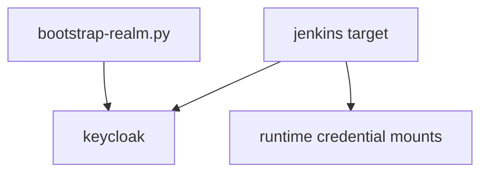

# Dependencies — Jenkins / Keycloak

## Internal Dependencies

Text alternative: a v2 Jenkins would depend on Keycloak (OIDC) and protected runtime secrets. The realm bootstrap would add its client.

## External Dependencies
### jenkins/jenkins
- **Version**: lts-jdk21 (digest-pinned)
- **Purpose**: CI server
- **License**: MIT
### Jenkins plugins
- **Version**: to be pinned (none pinned in v2 today)
- **Purpose**: pipeline, Git/GitHub, OIDC, matrix authorization, configuration as code
- **License**: mostly MIT/Apache-2.0 (to confirm per plugin)
### GitHub
- **Purpose**: SCM for `cdiogo1979/opensource-lakehouse`; the legacy job used no credentials.
