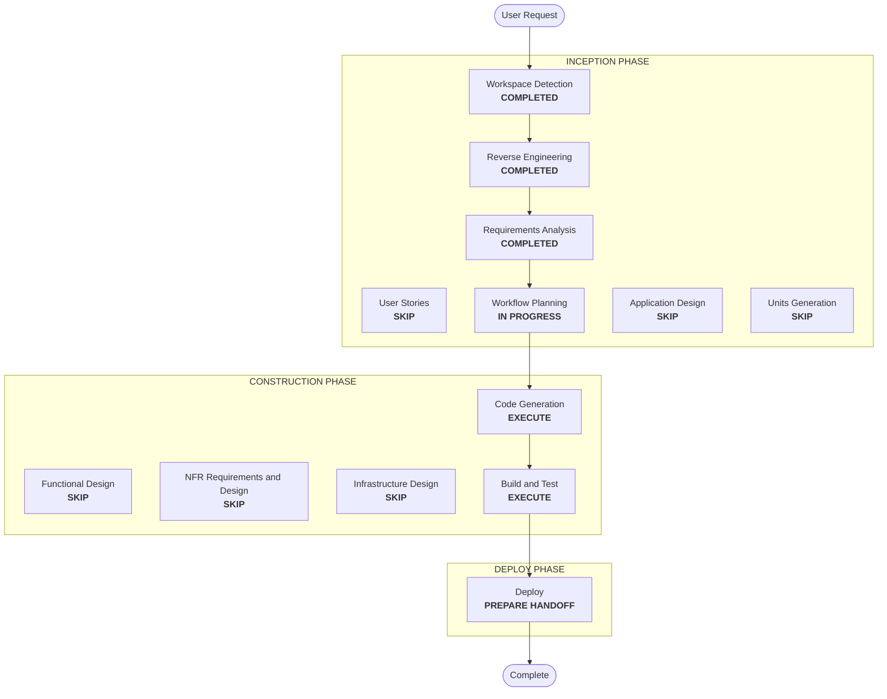

# Execution Plan — Cleanup and Modular Compose

## Detailed Analysis Summary
- **Transformation type**: restructuring and cleanup across existing components, plus one repair (Spark smoke). No new component.
- **Primary changes**:
  - remove unused files
  - split `docker-compose.yml` into core, jupyter, and jenkins files, and rename the Airflow and StarRocks files
  - build the module file list in `lakehouse.sh`
  - repoint the Spark smoke checks
  - update the README
- **Change impact**:
  - **User-facing**: yes. New Compose file names and opt-out flags, plus README changes.
  - **Structural**: yes. The Compose layout changes.
  - **Data, API, and NFR**: no.
- **Risk**: low to medium.
  - Compose references are spread across 10+ files; contract tests catch misses.
  - Resource names are unchanged, so running state is unaffected.
  - The Spark repair has an unknown failure to diagnose.
- **Rollback**: easy. Files are snapshotted, and resource names are unchanged.
- **Testing**: moderate. Contract tests, Compose config across module combinations, a live start with opt-outs, the product bootstrap end to end, and the verifiers.

## Workflow Visualization

Text alternative: Workspace Detection, Reverse Engineering, and Requirements Analysis are completed. Workflow Planning then leads directly to Code Generation, Build and Test, and Deploy. All design stages are skipped.

## Phases
- [x] Workspace Detection, Reverse Engineering (focused), Requirements Analysis: COMPLETED
- [x] User Stories: SKIP. A technical cleanup with no new user journeys.
- [ ] Application Design: SKIP. No new components; the module map in `compose-module-map.md` is enough.
- [ ] Units Generation: SKIP. One unit, `cleanup-modular-compose`.
- [ ] Functional Design: SKIP. There is no new business logic; module selection follows the existing `STARROCKS_ENABLED` pattern.
- [ ] NFR Requirements, NFR Design, Infrastructure Design: SKIP. Extensions are off, and the layout is defined in the module map.
- [ ] Code Generation: EXECUTE.
- [ ] Build and Test: EXECUTE. Live start with all modules, opt-outs, product bootstrap, and verifiers.
- [ ] Deploy: EXECUTE (handoff only).

## Canonical Knowledge Impact Inventory
| Canonical path | Action | Requirement and component | Reason |
|---|---|---|---|
| `aidlc-docs/knowledge/opensource-lakehouse-infra-v2/application-design.md` | UPDATE | FR-1, FR-2, FR-4, FR-5 (platform) | Compose module layout, opt-out flags, removed migration and legacy items, repaired smoke checks |
| `aidlc-docs/knowledge/opensource-lakehouse-infra-v2/functional-design/jenkins-ci-access.md` | UPDATE | FR-2 (Jenkins) | The home-migration lifecycle is removed; Jenkins lives in `compose.jenkins.yml` |
| `aidlc-docs/knowledge/opensource-lakehouse-infra-v2/functional-design/starrocks-sql-access.md` | UPDATE | FR-3, FR-4 (StarRocks) | New file name `compose.starrocks.yml`; the smoke-image limitation is resolved; DBeaver's StarRocks connection needs only `idTokenFile` (user finding during Build and Test) |
| `aidlc-docs/knowledge/opensource-lakehouse-infra-v2/functional-design/lakehouse-product-access.md` | RETAIN | none | No Compose or cleanup references; verified in Code Generation |

## Package Change Sequence
1. Snapshot, then remove the unused files (FR-1, FR-2). Update `.gitignore`.
2. Split and rename the Compose files (FR-4).
3. Build the module file list in `lakehouse.sh`, and update every Compose reference in scripts and tests (FR-5).
4. Repair the Spark smoke checks (FR-3).
5. README (FR-6), tests, and the code summary.

## Success Criteria
- No references to removed files or old Compose names remain outside `aidlc-docs`.
- `docker compose config` passes for every module combination.
- A live start with all modules leaves the running containers unchanged in name and state, and each opt-out works.
- `bootstrap-default-product.sh` completes end to end.
- The suite passes, apart from the 2 known Airflow failures.
