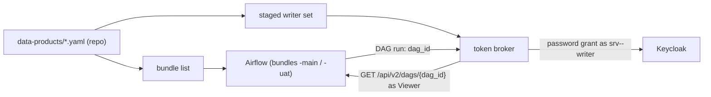

# Component Dependencies — Data Product Airflow Bundles

| Component | Reads | Talks to |
|---|---|---|
| C2 Bundle list | C1 product files | none |
| C3 Writer staging | C1, the writer password files | none |
| C4 Broker | staged writers (read-only mount) | Keycloak (password grant per writer), Airflow API (Viewer, read DAG) |
| C5 Broker Viewer | its protected password file | Airflow metadata database (in `airflow-init`) |
| C6 Lifecycle | C1, C2, C3 | Docker Compose (Airflow services) |
| Workload DAGs | their bundle checkout | the broker (`POST /v1/runs` with the DAG ID, unchanged) |

Text alternative:
- The product files produce the bundle list (for Airflow) and the staged writer set (for the broker).
- A DAG run sends its DAG ID to the broker. The broker asks Airflow which bundle the DAG is in, then gets a token from Keycloak as that product's writer.
