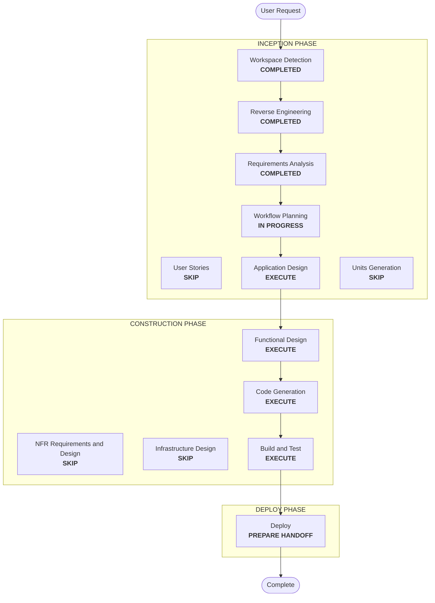

# Execution Plan — Data Product Airflow Bundles

## Detailed Analysis Summary
- **Transformation type**: extension of existing components, with no new service:
  - the product model gains a `repo` block
  - the Airflow bundle configuration is generated from the product files
  - the operator scripts register bundles
  - the writer token broker serves several products
  - a patch is delivered for the workload repository
- **Change impact**:
  - **User-facing**: yes. The product file gains a `repo` block, and default's bundle and DAG names change.
  - **Structural**: small. The broker gains an Airflow API dependency.
  - **Security**: yes. The broker holds several writer credentials and must isolate products.
- **Risk**: **medium**.
  - Renaming default's bundles changes its DAG IDs; DAGs misbehave until the workload patch is pushed (accepted, Q3 B).
  - Unproven: the Airflow 3.3 API exposing a DAG's bundle to a read-only identity, and recreating Airflow with a new bundle list.
- **Rollback**: easy for the infrastructure. Remove the `repo` blocks and the bundle list returns to none; the old default bundle names can be restored from the previous code. The broker keeps working for default.
- **Testing**:
  - contract tests and Hypothesis properties
  - live: default bundles renamed and loading; a test product's bundles loading; broker selection and refusal; the workload patch tested against the local checkout

## Workflow Visualization

Text alternative: Workspace Detection, Reverse Engineering, and Requirements Analysis are completed. Workflow Planning leads to Application Design, then Functional Design, Code Generation, Build and Test, and Deploy. User Stories, Units Generation, NFR, and Infrastructure Design are skipped.

## Phases
- [x] Workspace Detection, Reverse Engineering (focused), Requirements Analysis (incl. CR-1): COMPLETED
- [x] User Stories: SKIP. Operator configuration with the existing personas.
- [ ] Application Design: **EXECUTE**.
  - Where each change lives, and the broker's Airflow identity and API call.
  - The credential staging for the broker, and how apply and remove recreate Airflow.
  - The shape of the workload patch.
  - **Probes before code**: the Airflow 3.3 API returns a DAG's bundle to a read-only (Viewer) identity, and how the broker obtains an Airflow API token.
- [ ] Units Generation: SKIP. One unit, `airflow-bundles`.
- [ ] Functional Design: **EXECUTE**. Rules for the `repo` block, bundle-list generation and validation, DAG-ID-to-product mapping, broker refusals, and change detection for restarts. Property identification.
- [ ] NFR Requirements, NFR Design, Infrastructure Design: SKIP. Extensions are off except PBT (Hypothesis is already selected), and there is no new service.
- [ ] Code Generation: EXECUTE (including the workload patch and the PBT steps).
- [ ] Build and Test: EXECUTE (live).
- [ ] Deploy: EXECUTE (handoff, including the workload patch).

## Canonical Knowledge Impact Inventory
| Canonical path | Action | Requirement and component | Reason |
|---|---|---|---|
| `aidlc-docs/knowledge/opensource-lakehouse-infra-v2/application-design.md` | UPDATE | FR-2, FR-3, FR-4 (Airflow, broker) | Bundles generated from product files, renamed default bundles, Airflow recreation on apply and remove, per-product broker with an Airflow check, the workload contract |
| `aidlc-docs/knowledge/opensource-lakehouse-infra-v2/functional-design/lakehouse-product-access.md` | UPDATE | FR-1, FR-4 (product model, writer identities) | The `repo` block; the writer follows from the product name; broker isolation rules |
| `aidlc-docs/knowledge/opensource-lakehouse-infra-v2/functional-design/starrocks-sql-access.md` | RETAIN | none | StarRocks is unaffected |
| `aidlc-docs/knowledge/opensource-lakehouse-infra-v2/functional-design/jenkins-ci-access.md` | RETAIN | none | Jenkins is unaffected |

## Package Change Sequence
1. Product model: the `repo` block, template, `default.yaml` (FR-1).
2. Bundle-list generation and validation (FR-2).
3. Broker per product: credential staging, DAG-ID mapping, Airflow check (FR-4).
4. Operator scripts and `lakehouse.sh`: register bundles and recreate Airflow on change (FR-3).
5. The workload patch, tested against the local checkout (FR-5).
6. README, tests, summary (FR-6).

## Success Criteria
- `default-main` and `default-uat` load from the configured branches; a test product with a repo gets its own two bundles after `create-data-product.sh`.
- The broker issues `srv-
-writer` for a DAG in `
`'s bundle, and refuses an unknown prefix or a DAG whose bundle belongs to another product.
- The workload patch passes its checks locally and is delivered; the interim state is documented if it is not yet pushed.
- The suite passes, apart from the known Airflow drift.
