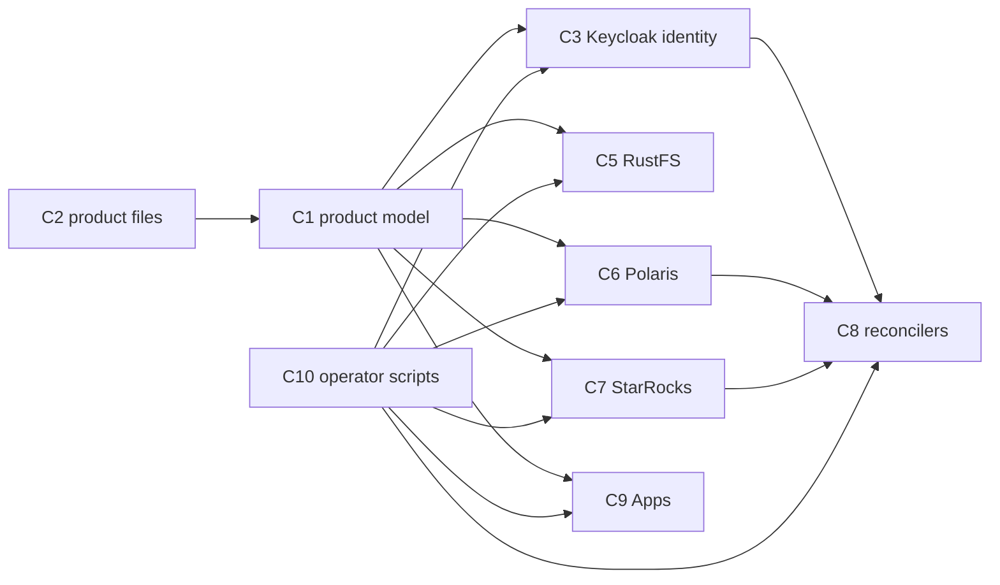

# Component Dependencies — Data Product and User Scripts

## Dependency matrix
| Component | Reads | Writes | Calls |
|---|---|---|---|
| C1 Product model | C2 files, applied state | applied state, `--init` file | none |
| C3 Keycloak identity | C1 | Keycloak admin API | none |
| C4 Create user | none | Keycloak admin API | none |
| C5 RustFS | C1 | RustFS admin and S3 API | none |
| C6 Polaris | C1 | Polaris management and catalog API | none |
| C7 StarRocks | C1 | StarRocks SQL (root, stdin) | none |
| C8 Reconcilers | C1 (mounted files), Keycloak | Polaris, StarRocks | none |
| C9 Apps | C1 (mounted files) | the rendered Jenkins CasC | none |
| C10 Operator scripts | C1 | backups | C3, C5, C6, C7, C8, C9 scripts; `docker compose restart jenkins` |
| C11 Product bootstrap | C2 | none | C10 apply steps for every file |

## Order of dependence
Keycloak groups must exist before the RustFS policies are useful, before the Polaris principal roles are reconciled, and before the StarRocks users are reconciled. Removal runs in the reverse order.

Text alternative:
- The product files feed the product model.
- The Keycloak, RustFS, Polaris, StarRocks, and app components read the model.
- The reconcilers depend on Keycloak, Polaris, and StarRocks.
- The operator scripts call every component in order.

## Runtime communication
- Host scripts reach the services on their published loopback ports, as today.
- StarRocks SQL goes through `docker exec`, with the password in the environment.
- Containers read product files from a read-only mount (`/opt/lakehouse/data-products`) and never write them:
  - the scheduled reconciler
  - JupyterHub
  - Airflow (API server)
- A malformed or unreadable product file:
  - **JupyterHub and Airflow fail closed**: only `role-platform-admin` is admitted, and the error is logged.
  - **The reconciler skips the cycle with nothing changed**, the same as the current safety on an unreadable Keycloak.
