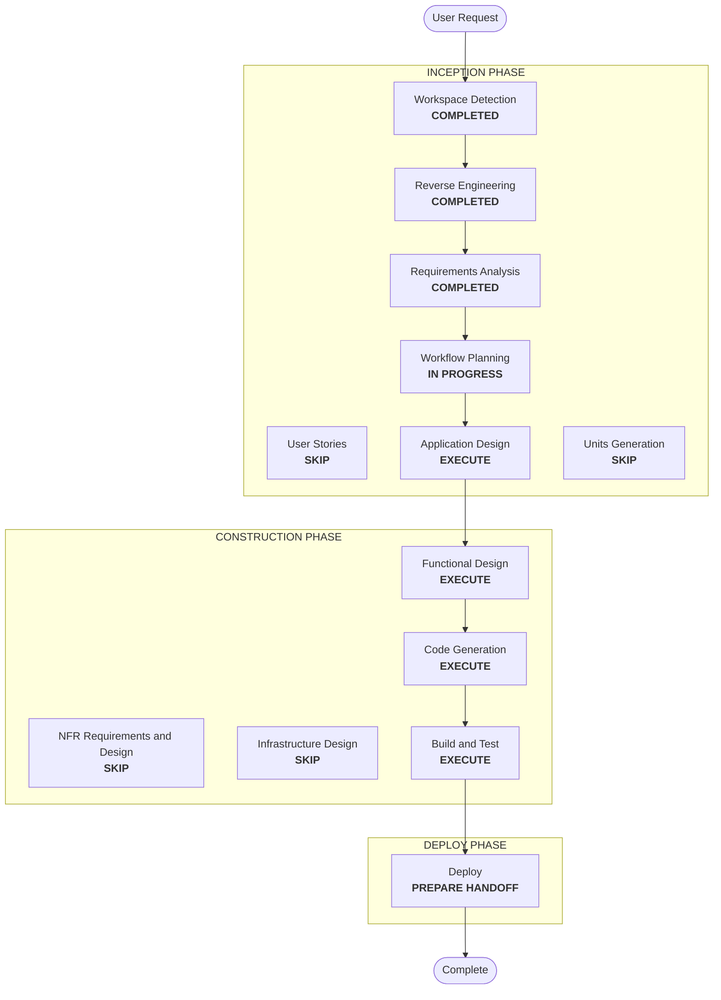

# Execution Plan — Data Product and User Scripts

## Detailed Analysis Summary
- **Transformation type**: the platform goes from one hard-coded product (`default`) to a registry of products in the shared environment catalogs. Two operator scripts sit on top. No new service or container.
- **Primary changes**:
  - a product registry (`data-products.json`) and a shared product-model module that derives every name from a product
  - every product-aware bootstrap and reconciler is parameterized by the registry (Keycloak, RustFS, Polaris, StarRocks, JupyterHub, Airflow, Jenkins)
  - Polaris and StarRocks grants move from catalog-wide to namespace- or database-scoped, **including `default`**
  - the Polaris OIDC filter is generated from the registry
  - `scripts/operations/create-data-product.sh` and `scripts/operations/create-user.sh`
  - README and tests
- **Change impact**:
  - **User-facing**: yes. Two new commands; app access for every product's groups.
  - **Structural**: yes. Single product to many; generated configuration (OIDC filter, Jenkins matrix).
  - **Data**: no data moves. `default`'s tables stay in place; only its grants change.
  - **Access (security-relevant)**: yes. A grant migration on the live `default` product, and cross-product isolation in shared catalogs.
- **Risk**: **medium to high**.
  - The grant migration for `default` can lock users out, or over-grant, if a namespace-scoped privilege is missing.
  - Four Polaris and StarRocks behaviors are unverified (see Application Design).
  - About 22 files carry `default` constants.
- **Rollback**: moderate. The registry with only `default` plus the catalog-wide grant mode restores today's behavior; the Polaris, RustFS, and StarRocks state for a new product can be removed by hand (product deletion is out of scope).
- **Testing**: contract tests for names, registry, grant plans, generated filter and Jenkins matrix; live tests for a new product, the `default` migration, cross-product isolation, and a new user.

## Workflow Visualization

Text alternative: Workspace Detection, Reverse Engineering, and Requirements Analysis are completed. Workflow Planning leads to Application Design, then Functional Design, Code Generation, Build and Test, and Deploy. User Stories, Units Generation, NFR, and Infrastructure Design are skipped.

## Phases
- [x] Workspace Detection, Reverse Engineering (focused), Requirements Analysis: COMPLETED
- [x] User Stories: SKIP. Operator tooling with one persona (the platform operator); the requirements already carry the acceptance checks.
- [ ] Application Design: **EXECUTE**.
  - Defines the new product-model module and how each component consumes the registry, and which files are generated (OIDC filter, Jenkins matrix).
  - Defines the two scripts' step order and restart rules.
  - **Confirms the four assumptions with read-only probes and a throwaway namespace against the running stack**, before any code: Polaris allowed-location extension and cross-bucket namespace locations with credential vending; Polaris namespace-level grants; StarRocks database-scoped grants on external catalogs; Jenkins CasC generation.
- [ ] Units Generation: SKIP. One unit, `data-product-provisioning`; Code Generation orders the work by component.
- [ ] Functional Design: **EXECUTE**.
  - The exact namespace-scoped Polaris privilege sets per role and environment, and the catalog-level minimum for listing namespaces.
  - The StarRocks database-scoped matrix and its coverage rule.
  - The `default` migration order (grant new, verify, then revoke catalog-wide) so no user loses access mid-way.
  - Idempotency and conflict rules for both scripts.
- [ ] NFR Requirements, NFR Design, Infrastructure Design: SKIP. Extensions are off; no new containers, ports, or volumes.
- [ ] Code Generation: EXECUTE.
- [ ] Build and Test: EXECUTE. Contract suite plus live checks (new product, `default` after migration, isolation both ways, new user).
- [ ] Deploy: EXECUTE (handoff only).

## Canonical Knowledge Impact Inventory
| Canonical path | Action | Requirement and component | Reason |
|---|---|---|---|
| `aidlc-docs/knowledge/opensource-lakehouse-infra-v2/application-design.md` | UPDATE | FR-1, FR-2, FR-8, FR-9 (platform) | Product registry, multi-product model in shared catalogs, generated OIDC filter, the two operator scripts |
| `aidlc-docs/knowledge/opensource-lakehouse-infra-v2/functional-design/lakehouse-product-access.md` | UPDATE | FR-3, FR-4, FR-5, FR-7, FR-8 (Keycloak, RustFS, Polaris, apps) | Owns the product access model: per-product groups, namespace-scoped grants, `default` migration, app mappings for every product, product provisioning and user creation |
| `aidlc-docs/knowledge/opensource-lakehouse-infra-v2/functional-design/starrocks-sql-access.md` | UPDATE | FR-6, FR-8 (StarRocks) | Database-scoped roles per product, MV databases per product, reconcile across products |
| `aidlc-docs/knowledge/opensource-lakehouse-infra-v2/functional-design/jenkins-ci-access.md` | UPDATE | FR-7 (Jenkins) | Permission matrix generated for every product's groups |

No new canonical component: product provisioning extends the existing product access model, so it lives in `lakehouse-product-access.md`.

## Package Change Sequence
1. Product model module and registry (FR-1), with tests.
2. Keycloak groups, client roles, writer users, and `srv-starrocks` membership per product (FR-3).
3. RustFS buckets and policies per product (FR-4).
4. Polaris: allowed locations, namespaces, namespace-scoped grants, generated OIDC filter, and the `default` migration (FR-5).
5. StarRocks database-scoped roles and MV databases per product (FR-6).
6. Reconcilers (FR-8), then apps: JupyterHub, Airflow, Jenkins (FR-7).
7. `create-data-product.sh` and `create-user.sh` (FR-2, FR-9).
8. README, tests, and the code summary (FR-10).

## Success Criteria
- With only `default` registered, a full reset and bootstrap give `default` users the same effective access as today, through namespace-scoped grants.
- `create-data-product.sh sales` creates the product end to end; a second run changes nothing.
- An owner, developer, and analyst of the new product get exactly their matrix in Spark (Polaris) and StarRocks, and can sign in to JupyterHub, Airflow, and Jenkins.
- Cross-product isolation holds both ways.
- `create-user.sh` creates a user that can sign in, and gains access once added to a group.
- The suite passes, apart from the known Airflow failures.
