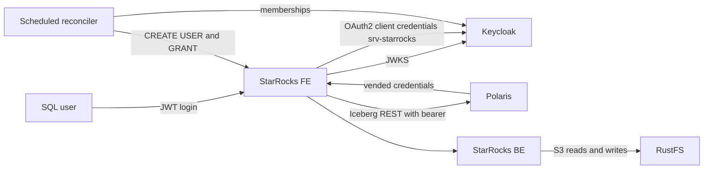

# Component Dependencies — StarRocks Integration

## Dependency matrix
| Component | Depends on | Interface |
|---|---|---|
| C1 runtime | Keycloak (JWKS), Polaris, RustFS | HTTP on the `core` and `data-access` networks |
| C2 identities | Keycloak admin API | REST |
| C3 credentials | filesystem `.runtime/credentials` | files at mode 0600 |
| C4 bootstrap | C1 FE, C3 credentials, Polaris catalogs | MySQL protocol via `docker exec` or the network |
| C5 reconciler | Keycloak admin API, C1 FE, C4 roles | REST and MySQL protocol |
| C6 scheduled reconciler | C5, the Polaris reconciler | in-container calls |
| C7 login helper | C2 `starrocks` client, C1 FE | token endpoint, MySQL 9.x client |
| C8 lifecycle | C1–C5 | shell |
| C9 Polaris principal | C2 service account | Keycloak and Polaris management APIs |

## Networks
| Network | Members | Purpose |
|---|---|---|
| `lakehouse-local_core` | FE (plus the existing services, including the reconciler) | Keycloak token and JWKS, Polaris REST, scheduled reconcile, login client |
| `lakehouse-local_data-access` | FE, BE | RustFS S3 (`rustfs:9000`) |
| `lakehouse-local_starrocks` (new, internal) | FE, BE | FE–BE heartbeats and data exchange |

## Data flow

Text alternative:
- A SQL user logs in to the FE with a Keycloak JWT. The FE validates it against Keycloak's JWKS.
- For catalog access, the FE gets an OAuth2 token for `srv-starrocks` from Keycloak and calls Polaris. Polaris returns metadata and vended credentials.
- The BE reads and writes files in RustFS.
- The scheduled reconciler reads memberships from Keycloak and applies users and grants in StarRocks.
