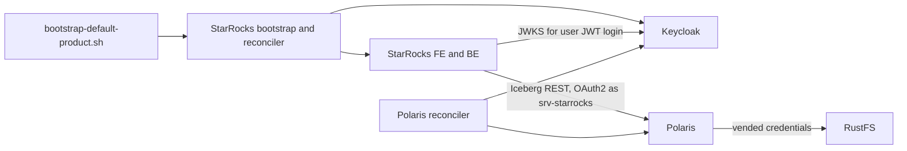
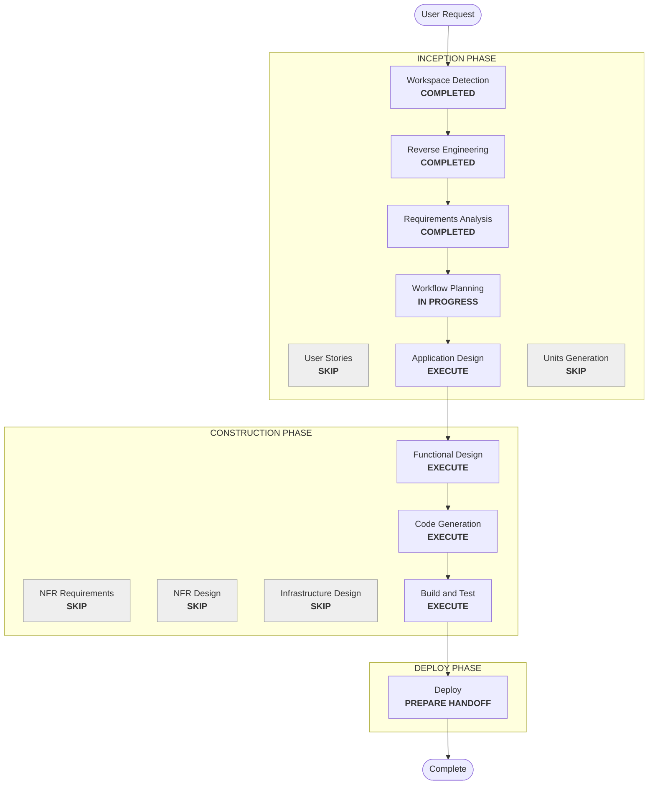

# Execution Plan — StarRocks Integration

## Detailed Analysis Summary

### Transformation Scope (Brownfield)
- **Transformation type**: a new component, the StarRocks SQL engine. It is integrated with the existing identity (Keycloak), catalog (Polaris), and storage (RustFS) components, and with the platform scripts.
- **Primary changes**:
  - a new `docker-compose.starrocks.yml` and FE/BE images
  - the Keycloak clients `srv-starrocks` and `starrocks`
  - a StarRocks bootstrap for catalogs, roles, MV databases, and users
  - a StarRocks user and role reconciler
  - a login helper
  - lifecycle and reset wiring
  - README
  - retirement of the legacy StarRocks assets
- **Related components**:
  - Keycloak realm bootstrap and contract
  - the Polaris reconciler (it must also cover a service-account member)
  - `scripts/lakehouse.sh`, `scripts/reset-lakehouse.py`, `scripts/prepare-lakehouse-runtime.py`, `scripts/bootstrap-default-product.sh`
  - `.env.example`, `docker-compose.deferred.yml`

### Change Impact Assessment
- **User-facing changes**: yes. A new SQL endpoint on loopback, a Keycloak-token login, and roles that match the product groups.
- **Structural changes**: yes. A new Compose file and service set that is part of core start (opt-out available).
- **Data model changes**: no change to existing data. New StarRocks catalog, role, and user metadata and three internal MV databases.
- **API changes**: Keycloak gains two clients, and Polaris gains one principal. Existing interfaces are unchanged.
- **NFR impact**: yes. Core start time and memory increase, and secret handling extends to two new credentials.

### Component Relationships

Text alternative: the product bootstrap calls the new StarRocks bootstrap and reconciler, which configures StarRocks from Keycloak data. StarRocks reaches Polaris as `srv-starrocks` and validates user tokens with Keycloak keys. Polaris vends RustFS credentials, and the existing Polaris reconciler adds the `srv-starrocks` principal.

### Risk Assessment
- **Risk level**: high. The version must support all of: JWT users, Iceberg REST with OAuth2, vended credentials, and arm64. Resource use on a laptop is also a concern.
- **Rollback complexity**: easy to moderate. `STARROCKS_ENABLED=false` removes it from start, and the reset removes its state. Keycloak clients remain until a reset.
- **Testing complexity**: complex. It needs live JWT logins per role, a catalog read/write matrix across three environments, MV refresh, and a reconcile after membership changes.

## Workflow Visualization

Text alternative: the sequence runs Workspace Detection, Reverse Engineering, Requirements Analysis (all completed), then Workflow Planning, Application Design, Functional Design, Code Generation, Build and Test, and Deploy. User Stories, Units Generation, NFR Requirements, NFR Design, and Infrastructure Design are skipped.

## Phases to Execute

### INCEPTION PHASE
- [x] Workspace Detection (COMPLETED)
- [x] Reverse Engineering (COMPLETED, focused)
- [x] Requirements Analysis (COMPLETED)
- [x] User Stories (SKIPPED). **Rationale**: the personas are the existing product roles, and the requirements already state the role matrix and login flow precisely.
- [x] Execution Plan (IN PROGRESS)
- [ ] Application Design: EXECUTE
  - **Rationale**: StarRocks is a new component. Its interfaces must be designed and the four requirement assumptions checked against the real images and documentation before any code is written. The interfaces are: Compose services, networks and volumes, the Keycloak clients, the catalog DDL contract, the JWT login contract, and the bootstrap and reconciler boundaries.
  - **Scope**: pick the exact 4.x version and digest for arm64. It also absorbs the Compose and network topology and the resource limits, which is why Infrastructure Design is skipped.
- [ ] Units Generation: SKIP
  - **Rationale**: one unit, `starrocks-integration`. The parts are tightly coupled (catalogs need the identity; roles need the catalogs), so they are sequenced as code-generation steps rather than separate units.

### CONSTRUCTION PHASE
- [ ] Functional Design: EXECUTE
  - **Rationale**: real business rules need detailed design:
    - the role-to-grant matrix across external catalogs and MV databases
    - platform-admin system rights
    - the user and grant reconcile plan: add, change, revoke, disable
    - conflict handling for existing catalogs
    - the opt-out and skip behavior
  - This is where the PBT-partial properties are identified.
- [ ] NFR Requirements: SKIP
  - **Rationale**: the NFRs are decided in requirements (loopback, secrets, idempotency, configurable memory), and the security and resiliency extensions are off.
- [ ] NFR Design: SKIP
  - **Rationale**: follows from skipping NFR Requirements.
- [ ] Infrastructure Design: SKIP
  - **Rationale**: the local Compose topology is covered in Application Design. There is no cloud infrastructure.
- [ ] Code Generation: EXECUTE (ALWAYS)
- [ ] Build and Test: EXECUTE (ALWAYS)
  - **Rationale**: needs live verification of every assumption and of the full role matrix.

### DEPLOY PHASE
- [ ] Deploy: EXECUTE (ALWAYS). Prepare the PR request and deployment instructions only.

## Canonical Knowledge Impact Inventory (MANDATORY)
| Canonical path | Action | Requirement and owning component | Reason / new-boundary justification |
|---|---|---|---|
| `aidlc-docs/knowledge/opensource-lakehouse-infra-v2/application-design.md` | UPDATE | FR-1..FR-4, FR-7, FR-8 (platform architecture) | Add StarRocks to components, the topology, startup and bootstrap, reset scope, verification, and the separate Compose file; mark StarRocks no longer deferred |
| `aidlc-docs/knowledge/opensource-lakehouse-infra-v2/functional-design/starrocks-sql-access.md` | CREATE | FR-4..FR-7 (StarRocks component) | StarRocks is a genuinely new component with its own rules: catalogs, role matrix, MV databases, JWT users, and reconcile. It mirrors the per-component pattern of `jenkins-ci-access.md` |
| `aidlc-docs/knowledge/opensource-lakehouse-infra-v2/functional-design/lakehouse-product-access.md` | UPDATE | FR-3, FR-5 (product access model) | Add `srv-starrocks`, the StarRocks authorization layer, and platform admin in StarRocks to the per-service table |
| `aidlc-docs/knowledge/opensource-lakehouse-infra-v2/functional-design/jenkins-ci-access.md` | RETAIN | none | Jenkins is unaffected |
| `aidlc-docs/knowledge/opensource-lakehouse/` | RETAIN (absent) | none | Retired on 2026-10-31; not recreated |

## Package Change Sequence
1. **Keycloak**: add the `srv-starrocks` and `starrocks` clients to the realm contract and bootstrap. Everything else depends on these identities.
2. **Runtime**: prepare the credentials (root password, client secret). Then add the Compose file, images, `.env.example`, and lifecycle wiring in `lakehouse.sh`.
3. **Polaris**: make sure the reconciler gives the `srv-starrocks` service account its principal and writer role.
4. **StarRocks bootstrap**: catalogs, roles, grants, MV databases. Then the user and role reconciler. Then the product-bootstrap wiring.
5. **Login helper, reset inventory, legacy retirement, README, and tests.**

## Estimated Timeline
- **Total stages to run**: 6 (Workflow Planning, Application Design, Functional Design, Code Generation, Build and Test, Deploy) plus closure.
- **Estimated duration**: several working sessions. Application Design checks of the real images and Build and Test live verification take most of the time.

## Success Criteria
- **Primary goal**: StarRocks runs from its own Compose file as part of the platform. It queries all three Polaris catalogs with access identical to the product roles. People log in with Keycloak tokens.
- **Key deliverables**:
  - `docker-compose.starrocks.yml` and images
  - the Keycloak clients
  - the StarRocks bootstrap and reconciler
  - the login helper
  - lifecycle and reset wiring
  - README
  - tests, including PBT for pure functions
- **Quality gates**:
  - contract tests and PBT (PBT-02/03/07/08/09) pass
  - a live reset, start, and bootstrap
  - a JWT login per bootstrap user
  - the read/write matrix across three catalogs and the MV databases
  - the reconcile after a membership change
  - `STARROCKS_ENABLED=false` skips cleanly
- **Integration testing**: Polaris, RustFS, Airflow, JupyterHub, and Jenkins verifiers still pass.
- **Release handoff**: the PR request and deployment instructions are prepared.
