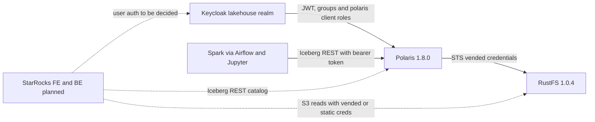

# System Architecture (StarRocks-relevant view)

## System Overview
The v2 stack is Docker Compose project `lakehouse-local`. The core file `docker-compose.yml` holds Keycloak, Polaris, RustFS, JupyterHub, and Jenkins. Airflow is an overlay, `docker-compose.airflow.yml`, started by `scripts/lakehouse.sh start-airflow`. `docker-compose.deferred.yml` is an inventory only and lists `starrocks: unsupported-pending-migration`. Airflow is the precedent for an optional separate Compose file with its own start, status, and stop commands.

## Architecture Diagram

Text alternative: Keycloak issues tokens that Polaris accepts. Polaris vends RustFS credentials. Spark already uses this path. StarRocks (dotted, planned) would connect to Polaris as an Iceberg REST catalog, read RustFS objects, and authenticate users in a way to be decided.

## Component Descriptions
### Polaris
- **Authentication**: `mixed`. It accepts internal tokens and Keycloak tokens (issuer `http://keycloak.localhost:8080/realms/lakehouse`, JWKS from `keycloak:8080`).
- **Principal**: `preferred_username`.
- **Principal roles**: taken from `resource_access.polaris.roles`, filtered to `role-default-(developer|analyst|owner|writer)`. `role-platform-admin` reaches Polaris as `role-default-owner` through its client role.
- **Catalog grants**: per catalog role. Owner has `CATALOG_MANAGE_CONTENT` and `CATALOG_MANAGE_ACCESS`; the others have read and write sets (`infra/polaris/bootstrap-product-authorization.py`).
- **Principal records**: must exist for each Keycloak username (`reconcile-keycloak-groups.py`).

### Keycloak
- **Groups**: `role-default-{developer,analyst,owner,writer}` and `role-platform-admin`.
- **Clients**: `polaris`, `lakehouse-cli`, `lakehouse-writer` (password grant), `jupyterhub`, `airflow`, `rustfs`, `jenkins`.
- **Users**: five bootstrap users with `ChangeM3!`.
- **Contract**: `infra/keycloak/realm-contract.json`.

### RustFS
Three buckets. Each group has an IAM policy of the same name. STS is used by Polaris for vended credentials, and root keys are break-glass only.

## Data Flow
Writes come from Spark through Polaris with vended credentials. The planned StarRocks reads would follow the same flow: catalog metadata from Polaris, data files from RustFS.

## Integration Points
- **Iceberg REST catalog**: `http://polaris:8181/api/catalog`, warehouse equals the catalog name, OAuth2 bearer.
- **Token endpoint**: `http://keycloak:8080/realms/lakehouse/protocol/openid-connect/token`. Browser and canonical issuer: `keycloak.localhost:8080`.
- **S3 endpoint**: `http://rustfs:9000`, path-style.
- **Networks**: `lakehouse-local_core` (Polaris, Keycloak) and `lakehouse-local_data-access` (RustFS and data clients).

## Infrastructure Components
- **Volumes**: legacy `iceberg-poc-starrocks-fe-meta` and `iceberg-poc-starrocks-be-storage` exist from the old stack, and are not v2.
- **Images**: `local/starrocks-fe:4.1.6-kerberos` (2.79 GB) is present. It is a Kerberos-layered image, not suitable as-is.
- **Reset**: `scripts/reset-lakehouse.py` must learn any new StarRocks volumes and networks.
