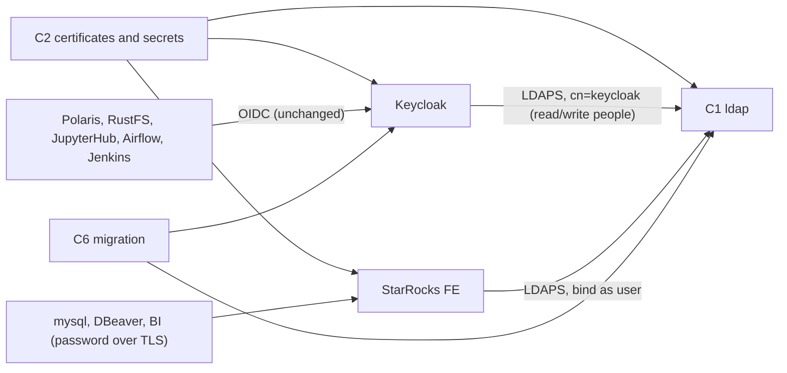

# Component Dependencies — StarRocks LDAP Login

| Component | Depends on | Talks to |
|---|---|---|
| C1 LDAP | C2 (certificates, secrets) | none |
| C3 Keycloak federation | C1, C2 (CA in the trust store) | LDAP over LDAPS as `cn=keycloak` |
| C4 StarRocks | C1, C2 (CA) | LDAP over LDAPS, binding as the logging-in user |
| C5 Clients | StarRocks TLS | StarRocks |
| C6 Migration | C1, C3 | Keycloak admin API (master admin), LDAP (as `cn=keycloak`, through `docker exec ldap` with LDAPS), Docker volumes |
| Reconcilers | Keycloak, StarRocks | unchanged, except TLS for the network runner |

Text alternative:
- The certificates feed LDAP, Keycloak, and StarRocks.
- Keycloak reads and writes people in LDAP as `cn=keycloak`. StarRocks checks passwords by binding to LDAP as the user.
- All apps keep using Keycloak OIDC.
- The migration uses Keycloak and LDAP. SQL clients reach StarRocks with a password over TLS.

**LDAP outage**:
- **Fails**: Keycloak sign-ins of federated users, StarRocks password logins, user creation, and password changes.
- **Keeps working**: client-credentials service accounts (local), existing tokens and sessions, and open StarRocks sessions.
- **Syncs**: they read Keycloak's database, which holds the imported users and the groups, so they keep working.
