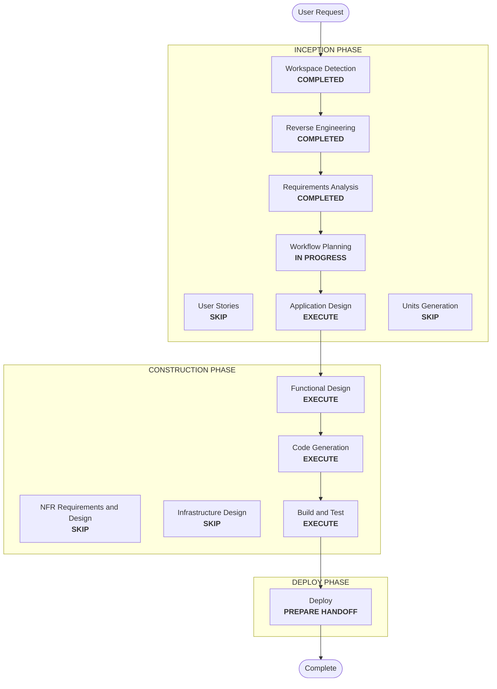

# Execution Plan — StarRocks LDAP Login

## Detailed Analysis Summary
- **Transformation type**: a new core service (an OpenLDAP directory) and a change of user storage (Keycloak federates users from LDAP). StarRocks moves from token to LDAP password login, and the existing users are migrated once.
- **Primary changes**:
  - **LDAP**: the image, Compose service, TLS material, and credentials
  - **Keycloak**: the federation provider in `bootstrap-realm.py`
  - **StarRocks**: FE LDAP settings and TLS enforcement; the user sync switches to `authentication_ldap_simple`
  - **Clients**: `starrocks-login.sh` uses a password; `starrocks-token.sh` and the `starrocks` client are removed
  - **Migration**: users and Jupyter homes
  - **Lifecycle**: reset, bootstrap order, README, tests
- **Change impact**:
  - **User-facing**: yes. StarRocks clients use passwords; users are migrated, and hand-changed passwords are reset.
  - **Structural**: yes. A new service, and users stored in LDAP.
  - **Data**: user records move. Jupyter homes are copied to new volume names. Table data is untouched.
  - **Security**: yes. Passwords now travel to StarRocks and LDAP, so TLS must be enforced.
- **Risk**: **medium to high**.
  - The migration deletes local Keycloak users after recreating them, so a mistake can lock people out.
  - Keycloak user IDs change (the JupyterHub home copy).
  - Two behaviors are unproven: TLS enforcement in StarRocks, and writable-federation details in Keycloak 26.8.
- **Rollback**:
  - **Before migration**: remove the federation provider.
  - **After migration**: there is no automatic way back. Users would be recreated locally with their known passwords.
- **Testing**:
  - contract tests and Hypothesis properties (partial)
  - live: migration, sign-ins, StarRocks password logins with and without TLS, roles, password change, new users, the Airflow broker

## Workflow Visualization

Text alternative: Workspace Detection, Reverse Engineering, and Requirements Analysis are completed. Workflow Planning leads to Application Design, then Functional Design, Code Generation, Build and Test, and Deploy. User Stories, Units Generation, NFR, and Infrastructure Design are skipped.

## Phases
- [x] Workspace Detection, Reverse Engineering (focused, with the StarRocks LDAP probe), Requirements Analysis: COMPLETED
- [x] User Stories: SKIP. One change in login method, for the existing personas.
- [ ] Application Design: **EXECUTE**.
  - The LDAP service: image, schema and tree, TLS and CA, credentials and bind identities, networks.
  - Its place in start, bootstrap, and reset.
  - The federation settings, the StarRocks settings, and the migration component.
  - **Probes before any code**:
    - how StarRocks 4.1.7 forces TLS for password logins
    - Keycloak 26.8 writable federation on a throwaway realm: create user, reset password, account console change, group membership, and the import and ID behavior
    - the Alpine OpenLDAP packages and password hashing
- [ ] Units Generation: SKIP. One unit, `ldap-password-login`.
- [ ] Functional Design: **EXECUTE**.
  - Migration rules: inventory, the password source, order, verification before delete, group restore, the Jupyter home copy, idempotency.
  - The user-sync plan for the switch from JWT to LDAP.
  - LDAP entry rendering.
  - Property identification (PBT-01, advisory in partial mode).
- [ ] NFR Requirements, NFR Design, Infrastructure Design: SKIP.
  - Security and Resiliency extensions are off.
  - The PBT framework (PBT-09) is the existing Hypothesis, pinned in `tests/requirements-pbt.txt`, and is recorded in Functional Design.
  - The service, network, and TLS layout is settled in Application Design, like the earlier StarRocks and RustFS services.
- [ ] Code Generation: EXECUTE, including the PBT steps.
- [ ] Build and Test: EXECUTE. Live migration on the running stack, with a backup of the Keycloak database and Jupyter homes first.
- [ ] Deploy: EXECUTE (handoff only).

## Canonical Knowledge Impact Inventory
| Canonical path | Action | Requirement and component | Reason |
|---|---|---|---|
| `aidlc-docs/knowledge/opensource-lakehouse-infra-v2/application-design.md` | UPDATE | FR-1, FR-2, FR-6 (platform) | New core service `ldap`; users federated into Keycloak; start, bootstrap, and reset order; StarRocks client interfaces |
| `aidlc-docs/knowledge/opensource-lakehouse-infra-v2/functional-design/lakehouse-product-access.md` | UPDATE | FR-2, FR-5 (identity) | Owns users and bootstrap identities: user storage in LDAP, writable federation, the migration, password handling |
| `aidlc-docs/knowledge/opensource-lakehouse-infra-v2/functional-design/starrocks-sql-access.md` | UPDATE | FR-3, FR-4 (StarRocks) | LDAP password login, TLS enforcement, the user-sync switch, clients, removal of the token client |
| `aidlc-docs/knowledge/opensource-lakehouse-infra-v2/functional-design/jenkins-ci-access.md` | RETAIN | none | Jenkins signs in through Keycloak OIDC, which is unchanged |

No new canonical component file: the LDAP directory is an identity store behind Keycloak, so its rules belong with user identity in `lakehouse-product-access.md`, and its architecture in `application-design.md`.

## Package Change Sequence
1. The LDAP image, Compose service, TLS and credential setup, and reset (FR-1).
2. The Keycloak federation in the realm bootstrap (FR-2).
3. StarRocks LDAP settings, TLS enforcement, and the user-sync switch (FR-3).
4. Clients, removal of the token client and script, README (FR-4).
5. The migration script (FR-5), and fresh-install order (FR-6).
6. Tests, including Hypothesis properties (FR-7), and the code summary.

## Success Criteria
- Every current user can sign in to Keycloak and to StarRocks with the same password after the migration, with unchanged groups and roles and the Jupyter home preserved.
- A service user (`srv-default-writer`) logs in to StarRocks with its password, and the Airflow broker still gets its token.
- A password login without TLS is refused.
- A password changed in Keycloak works in StarRocks.
- New users and product writer users are created in LDAP.
- A reset and rebuild work with no migration step.
- The suite passes, apart from the known Airflow drift.
