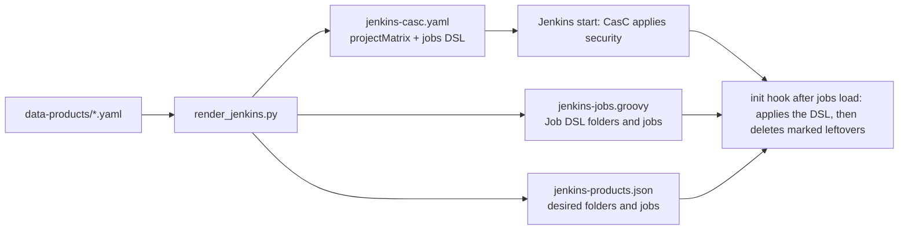

# Application Design — Data Product Jenkins Pipelines

Unit `jenkins-pipelines`. It implements FR-1 to FR-7 and NFR-1 to NFR-6 of `../requirements/requirements.md`. It is grounded in the probes run on 2026-11-10 against a throwaway Jenkins built from the current image plus `job-dsl`; the results are below.

## Probe results (2026-11-10)
| Probe | Result |
|---|---|
| `job-dsl 3732.v9a_c49a_61a_313` on Jenkins 2.580.1 | Installs. It needs Jenkins 2.479.3 or later, and every dependency's minimum version is below our pins. A bare `jenkins-plugin-cli --plugins job-dsl` also bumped `cloudbees-folder` to 6.1107, so the image check must compare versions, not only names. |
| `projectMatrix` in CasC, plus the Job DSL folder `authorizationMatrix` with `inheriting()` and `user` or `group` entries | Works. The folder's `config.xml` gets `GROUP:<permission>:<group>` lines. |
| Effective rights (owner, developer, other product's member, admin) | The owner configures the folder and its jobs and creates items, but `/manage` returns 403. The developer reads and builds, but configure returns 403. The other product's member gets 404 on the folder. The admin has full access. |
| `_ci`: `git` source with `gitBranchDiscovery()` and `headWildcardFilter('main uat')`, `periodicFolderTrigger('5m')` | Scan found both branches. `main` #1 and `uat` #1 passed with the workload `Jenkinsfile`. A restart didn't rebuild them. |
| `_cd`: `github` source with `gitHubBranchDiscovery { strategyId(2) }` and no PR or fork traits, `periodicFolderTrigger('30m')`, unauthenticated | Scan succeeded in 1.9 s. `main` and `uat` were ignored because no PR is filed for them; there are 0 open PRs. |
| Deleting from inside the CasC Job DSL script | **Doesn't work.** CasC applies `jobs:` before Jenkins has loaded existing items, so the script sees none. |
| Deleting from an `init.groovy.d` hook that reads a desired-state JSON | **Works.** It runs after the jobs are loaded. It deleted the marked folder that left the file and the `_cd` job that left the file, and kept an unmarked hand-made folder and an owner-created job in a managed folder. A second restart was a no-op. |

## Components and responsibilities
| Component | Change |
|---|---|
| `infra/jenkins/plugins.txt` | Add `job-dsl:3732.v9a_c49a_61a_313` (105 plugins). |
| `infra/jenkins/Dockerfile` | The parity check compares `name:version` from each installed plugin's manifest with `plugins.txt`, not just names. |
| `infra/jenkins/casc/jenkins.yaml` | `globalMatrix` becomes `projectMatrix`, with the same static entries. The comment explains that the renderer adds the global read entries and the `jobs:` script. |
| `infra/jenkins/init.groovy.d/reconcile-data-products.groovy` (new) | The deletion hook, mounted read-only. It reads `/run/lakehouse/jenkins-products.json`. Rules are in the functional design (BR-6). |
| `infra/products/data_products.py` | `JENKINS_PERMISSIONS` becomes the folder-level set. `FOLDER_ADMIN_PERMISSIONS` is new. `apps.jenkins` refuses `owner` (the owner is always folder admin) and any `Overall/*` permission. New `github_repository(url)` returns `(owner, repository)` or `None`. |
| `infra/products/render_jenkins.py` | `render()` emits the `projectMatrix` entries; `job_dsl()` the Job DSL script (own file, see the change below). `desired_items()` and `render_state()` produce the JSON. `groovy_string()` quotes every value placed in the script. `plan()` compares with the current state file: folders and jobs to create or delete. Writes both files and returns exit 3 if either changed. `--check` prints the plan. |
| `compose.jenkins.yml` | Two read-only mounts: `.runtime/container-mounts/jenkins-products.json` at `/run/lakehouse/jenkins-products.json`, and the hook at `/var/jenkins_home/init.groovy.d/reconcile-data-products.groovy`. |
| `scripts/setup/prepare-runtime.py` | No logic change. It already runs the renderer, which now also writes the state file. |
| `scripts/operations/lib/data-products.sh` (`apply_jenkins`) | Messages say "Jenkins folders, jobs and permissions". The dry run prints the plan. The restart rule is unchanged. |
| `create-data-product.sh`, `remove-data-product.sh` | Step titles and the comment header only. The order is unchanged. |
| `data-products/default.yaml`, `infra/products/template.yaml` | `apps.jenkins`: owner removed. Developer gets `[Job/Read, Job/Build, Job/Cancel, Job/Workspace]`, analyst gets `[Job/Read]`. The comment states the folder rule. |
| `infra/keycloak/realm-contract.json` | `jenkins.authorized_groups` is updated to the new mapping. |
| `scripts/verify/jenkins-oidc.py` | It checks `ProjectMatrixAuthorizationStrategy`. The old job check is replaced: every product in the state file has its folder, with the marker and the owner's folder entry, and exactly its expected jobs. |
| Tests | `tests/jenkins/test_casc_contract.py` (updated), `tests/jenkins/test_product_pipelines.py` (new: rendering, hook contract, PBT), and `tests/products/test_data_products.py` (updated). |
| Docs | The README, and the three knowledge documents per the execution plan. |

## Service flow

Text alternative: the product files feed `render_jenkins.py`, which writes the CasC file (security only), the Job DSL script, and the desired-state JSON. At start, CasC applies security. Once the jobs are loaded, the init hook applies the Job DSL script, then reads the JSON and deletes managed leftovers.

- **Create, change and remove** all go through the same path: render, then restart Jenkins if either file changed.
  - If Jenkins isn't running, the next `start` renders the files (`prepare-runtime.py`) and Jenkins converges.
  - Nothing calls the Jenkins API, so no credential is needed.

## Dependencies and risks
- **Lockout**: the static admin entries are unchanged and tested. If the CasC file fails to apply, Jenkins fails to start, and the previous file is restored by re-rendering from the previous code.
- **Owner UI edits**: owners may edit their folder in the UI, but Job DSL rewrites the folder (description, permissions) and the jobs at every start, so those edits don't last. This is documented.
- **Branch changes**: a changed branch filter, or a closed PR, prunes the orphaned branch jobs and their history (`discardOldItems`). This is documented.

## Change found in Build and Test (2026-11-10)
- **Problem**: a Job DSL script in CasC runs between "System config loaded" and "Loaded all jobs". Jenkins builds its list of job directories before that, so a folder that Job DSL creates for a **new** product was written to disk but dropped from memory until the next restart. Updates to existing folders were not affected, which is why the probe and `default` looked fine. Seen live with `jptest` on 2026-11-10.
- **Change**: the DSL moved out of CasC into its own rendered file, `.runtime/container-mounts/jenkins-jobs.groovy`, mounted at `/run/lakehouse/jenkins-jobs.groovy`. The init hook applies it with `DslScriptLoader` and `JenkinsJobManagement` after the jobs are loaded, and only then deletes leftovers; if the apply fails, it deletes nothing. CasC holds security only.
- **Side effects**: the `^${` escaping is no longer needed, because the DSL file isn't read by CasC and single-quoted Groovy literals never interpolate. `render_jenkins.py` writes three files (`--jobs-output` added) and returns exit 3 if any changed.
- **Verified**: `jptest` re-created from scratch got its folder and both jobs in memory after one start, and `jptest_ci` built `main` and `uat` successfully.
