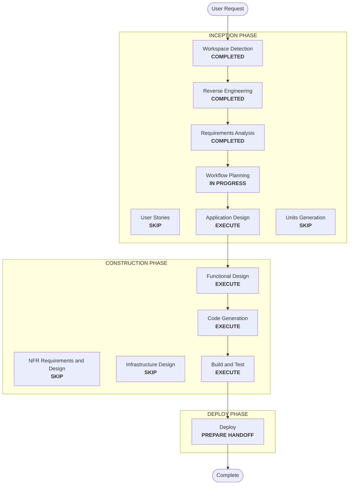

# Execution Plan — Data Product Jenkins Pipelines

## Detailed Analysis Summary
- **Transformation type**: extension of existing components. No new service.
  - The Jenkins image gains the `job-dsl` plugin.
  - The CasC renderer emits folders, jobs, and per-folder authorization.
  - The product model's `apps.jenkins` changes meaning, from platform-wide to folder.
  - The operator scripts delete managed items on removal.
- **Change impact**:
  - **User-facing**: yes. A Jenkins folder and two jobs appear per product. Owners lose their Jenkins-wide administration. Developers and analysts see only their product's folder.
  - **Structural**: small. The authorization strategy changes from `globalMatrix` to `projectMatrix`, and jobs become configuration as code.
  - **Security**: yes. The permission model changes, the deletion path must touch managed items only, and builds run code from same-repository PR branches.
- **Risk**: **medium**.
  - Switching the authorization strategy with a wrong entry can lock people out. Break-glass and the platform admin remain the recovery path.
  - Still unproven:
    - the exact Job DSL syntax for the GitHub Branch Source traits (only branches filed as PRs, no fork discovery) and for folder authorization under matrix-auth 3.3, applied through CasC;
    - unauthenticated GitHub scanning behavior;
    - a deletion path for items that leave the CasC script.
- **Rollback**: easy. Restore the previous `render_jenkins.py`, `jenkins.yaml` template, plugin list and product files, then restart Jenkins. The generated folders stay until deleted; they hold nothing but build history.
- **Testing**:
  - **Offline**: contract tests on the rendered CasC, and Hypothesis properties on the rendering.
  - **Live**:
    - the `default` folder and both jobs appear;
    - `default_ci` builds `main` and `uat`;
    - `default_cd` scans without error (there are no open PRs today; a PR test needs the user's approval to push a branch and open a PR);
    - the folder permissions hold for each role and for another product's member;
    - a test product is created, its `repo` removed, and the product removed.

## Workflow Visualization

Text alternative: Workspace Detection, Reverse Engineering, and Requirements Analysis are completed. Workflow Planning leads to Application Design, then Functional Design, Code Generation, Build and Test, and Deploy. User Stories, Units Generation, NFR, and Infrastructure Design are skipped.

## Phases
- [x] Workspace Detection, focused Reverse Engineering, Requirements Analysis: COMPLETED.
- [ ] User Stories: SKIP. Operator configuration for the existing personas (owner, developer, analyst, platform admin).
- [ ] Application Design: **EXECUTE**.
  - Where each change lives and how the render is split between authorization, folders and jobs.
  - The deletion mechanism: how items that leave the CasC script are deleted, which identity does it, and what happens when Jenkins isn't running.
  - Upgrading the existing Jenkins (strategy switch) and the plugin pin.
  - **Probes before code**, on a throwaway Jenkins container from the built image:
    - the Job DSL folder authorization and the `projectMatrix` CasC syntax;
    - the GitHub Branch Source trait for PR source branches without forks, scanned unauthenticated against the workload repository;
    - the plain Git source with a prod/UAT branch filter;
    - periodic folder triggers.
- [ ] Units Generation: SKIP. One unit, `jenkins-pipelines`.
- [ ] Functional Design: **EXECUTE**.
  - **Rules**: the folder admin permission set; mapping `apps.jenkins` to folder and global entries; validation of the new allowed permissions; GitHub URL parsing for `_cd`; the deletion scope (managed items only); change detection for restarts.
  - **Property identification**: PBT-02 (render, then parse the rendered names back), PBT-03 (invariants: every product folder grants only its own groups; no product role has a global permission beyond `Overall/Read`).
- [ ] NFR Requirements, NFR Design, Infrastructure Design: SKIP. Security and Resiliency are off; Hypothesis is already selected for PBT; there is no new service.
- [ ] Code Generation: **EXECUTE**, including the PBT steps.
- [ ] Build and Test: **EXECUTE**, live.
- [ ] Deploy: **EXECUTE**, as a handoff.

## Canonical Knowledge Impact Inventory
| Canonical path | Action | Requirement and component | Reason |
|---|---|---|---|
| `aidlc-docs/knowledge/opensource-lakehouse-infra-v2/functional-design/jenkins-ci-access.md` | UPDATE | FR-1 to FR-6 (Jenkins) | Per-product folders and the two jobs; jobs as code; `projectMatrix` and folder rights; the deletion path; the old job retired; the job-dsl pin |
| `aidlc-docs/knowledge/opensource-lakehouse-infra-v2/functional-design/lakehouse-product-access.md` | UPDATE | FR-4, FR-5 (product model, create and remove) | `apps.jenkins` now means folder rights; `Overall/Administer` disallowed; the new create and remove steps |
| `aidlc-docs/knowledge/opensource-lakehouse-infra-v2/application-design.md` | UPDATE | FR-3, FR-5, FR-6 | Jenkins jobs as code; the "platform-wide app rights" note now covers Airflow only; the Jenkins CI follow-up resolved |
| `aidlc-docs/knowledge/opensource-lakehouse-infra-v2/functional-design/starrocks-sql-access.md` | RETAIN | none | StarRocks is unaffected |

Existing ownership: the Jenkins component (`infra/jenkins/`, `render_jenkins.py`) and the product model own every change. No new component boundary is needed.

## Package Change Sequence
1. **Probes** on a throwaway container (Application Design).
2. **Jenkins image**: pin `job-dsl` (FR-3).
3. **Product model**: the new `apps.jenkins` meaning and validation, the template and `default.yaml` (FR-4).
4. **`render_jenkins.py` and the CasC template**: `projectMatrix`, folders, jobs (FR-1 to FR-4).
5. **Operator scripts**: deletion on `repo` removal and on product removal, and the dry-run listing (FR-5).
6. **Verifier**, tests, README, knowledge docs (FR-6, FR-7).

## Success Criteria
- After `start`, Jenkins shows `default/default_ci` and `default/default_cd`. `default_ci` builds `main` and `uat` from the workload `Jenkinsfile`; `default_cd` scans without errors.
- `role-default-owner` administers the `default` folder but not Jenkins. Developers and analysts have their rights only there. A member of another product doesn't see it.
- Creating a test product with `repo` creates its folder and jobs. Removing its `repo` deletes only the jobs. Removing the product deletes the folder. Nothing else in Jenkins is touched.
- A reapply with no changes doesn't restart Jenkins. A `reset` and `start` recreates the folders and jobs.
- The suite passes, including the new Hypothesis properties.
