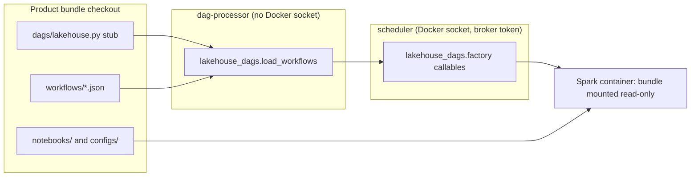

# Application Design — Platform DAG Factory

Unit `dag-factory`, across two repositories. It implements FR-1 to FR-9 and NFR-1 to NFR-5 of `../requirements/requirements.md`, and is grounded in the probes below.

## Probe results (2026-11-10, throwaway containers; the live Airflow was untouched)
| Probe | Result |
|---|---|
| Safe-mode discovery (`might_contain_dag_via_default_heuristic`, Airflow 3.3.2) | Lowercases the file. It needs `airflow`, plus `dag` or `asset`. A stub whose comment says "Airflow DAGs" qualifies. |
| A package on a read-only mount (`PYTHONPATH=/opt/lakehouse/python`) and a stub in a fake `probe-uat` checkout, parsed by `DagBag(safe_mode=True)` | No import errors. DAG `probe-uat-probe` was built from `workflows/probe.json`, with per-task `retries` applied. The bundle name came from the stub's path (`.../<bundle>/tracking_repo/...`). |
| `local/lakehouse-spark-runtime:3.5.5_1.10.2` with the workload checkout at `/opt/lakehouse-bundle` | Python 3.10.16 and PyYAML 6.0.2. The repository's `config_loader` validated `uat`/`default` in the container, and a missing config exited 1 with `FileNotFoundError`. |
| `spark-submit ... app.py --environment uat --config-dir /x -- --date 2026-11-10 "two words"` | The app received `['--environment', 'uat', '--config-dir', '/x', '--', '--date', '2026-11-10', 'two words']`. |
| Jenkins container | `/usr/local/bin/python3` 3.10.22 is on `PATH`. |

## Components
| Component | Location | Responsibility |
|---|---|---|
| `lakehouse_dags/__init__.py` | `infra/airflow/lakehouse_dags/` | `load_workflows(namespace, stub_file)`. Imports the Airflow side lazily, so the package imports without Airflow. |
| `lakehouse_dags/spec.py` (standard library only) | same | Parses and validates workflow JSON v1 into frozen `Workflow` and `Task`; graph checks; `STUB_TEXT`; `check_repository(root)` (all workflows, entry points, `dags/` contents and stub). |
| `lakehouse_dags/identity.py` (standard library only) | same | Bundle name from a checkout path, then `(bundle, product, environment)`, for `<product>-main` (prod) and `<product>-uat` (uat) only. `PRODUCT_BUNDLE_PATTERN` matches the platform's `DAG_ID_PATTERN`. |
| `lakehouse_dags/factory.py` (Airflow, Docker SDK) | same | `build_dag(workflow, bundle_root, identity)`, plus the task callables ported from `dag_factory.py`: `_create_spark_container`, `_validate_environment` (now `exec_run` in the container), `_submit_spark_job` (with `args` after `--`), `_stop_spark_container`, the broker client, and `standard_dag_kwargs`. |
| `lakehouse_dags/redact.py` | same | `redact_spark_output`, ported unchanged. |
| `lakehouse_dags/validate.py` | same | CLI: `python3 -m lakehouse_dags.validate <root>`. Prints one line per problem; exit 0 or 1. |
| `infra/jenkins/bin/lakehouse-validate-workflows` | new | A wrapper that runs `PYTHONPATH=/opt/lakehouse/python python3 -m lakehouse_dags.validate "$@"`. |
| Compose (Airflow) | `compose.airflow.yml` | `airflow-dag-processor` and `airflow-scheduler`: mount `./infra/airflow/lakehouse_dags` read-only at `/opt/lakehouse/python/lakehouse_dags`, with `PYTHONPATH: /opt/lakehouse/python`. |
| Compose (Jenkins) | `compose.jenkins.yml` | The same package mount read-only, and the wrapper at `/usr/local/bin/lakehouse-validate-workflows`, read-only. |
| Bundle directories | `infra/products/data_products.py` (`BUNDLE_KWARGS`), `infra/airflow/validate-bundle-config.py` (`FIXED_KWARGS`) | `sparse_dirs: [dags, workflows, notebooks, configs]` |
| Workload repository | `cdiogo1979/opensource-lakehouse` | `workflows/test_environment.json` and `dags/lakehouse.py` (the stub) are added; the factory files, `.airflowignore` and `dags/test_environment.py` are removed; `notebooks/common/cli.py` handles `--` extras; tests, `AGENTS.md`, `AIRFLOW_BUNDLES.md` and the `Jenkinsfile` are updated. |

## The stub (the only DAG file in a product repository)
```python
# Airflow DAGs for this repository, built by the lakehouse platform from workflows/*.json.
from lakehouse_dags import load_workflows

load_workflows(globals(), __file__)
```
The validator requires these exact bytes, apart from line endings.

## Flows

Text alternative: the dag-processor runs the stub, which calls `load_workflows` from the mounted platform package. It reads `workflows/*.json` and builds DAGs whose tasks reference only platform callables. The scheduler runs those callables, which start the Spark container. Only inside the container does repository code run: the config check and the entry points.

- **Run order**:
  1. `create_cluster` starts the container and registers with the broker.
  2. `validate_environment` runs `exec_run` in the container: `python3 -c` with the repository's `config_loader`, against the bundle's `configs`.
  3. The `submit_<task>` tasks run in graph order.
  4. `stop_cluster` (`ALL_DONE`).
  5. `verify_workloads_succeeded`.
- **Errors**: any invalid workflow file fails the whole stub import. The import error lists every problem, so Airflow shows it and none of the bundle's DAGs load. The CI validator catches this before a merge.
- **No workflows**: a repository without `workflows/`, or with an empty one, gets no DAG and no error.

## Dependencies, risks, decisions
- **Package changes apply live**: the mount is a directory bind mount, so new parses and new task processes see the change. Changes are applied by `start-airflow`, which recreates the processes, so a mid-edit state is never parsed. Documented (NFR-5).
- **Name clash**: none during the cut-over. The old repository DAG imports its local `dag_factory`; the platform package is `lakehouse_dags`.
- **Run-history diff**: `validate_environment` now runs after `create_cluster`. A config failure therefore starts and removes a container. `stop_cluster` (`ALL_DONE`) and broker revocation still clean up.
- **Repository-side contract**: `notebooks/common/config_loader.py` must provide `load_environment_config(environment, config_dir, product)`, and entry points must accept `--environment` and `--config-dir`, with optional extras after `--`.
- **Dropped behavior** (Q6): legacy `lakehouse-*` bundles and the `dev` fallback. `AIRFLOW_BUNDLES.md`'s dev-branch section is rewritten accordingly.
