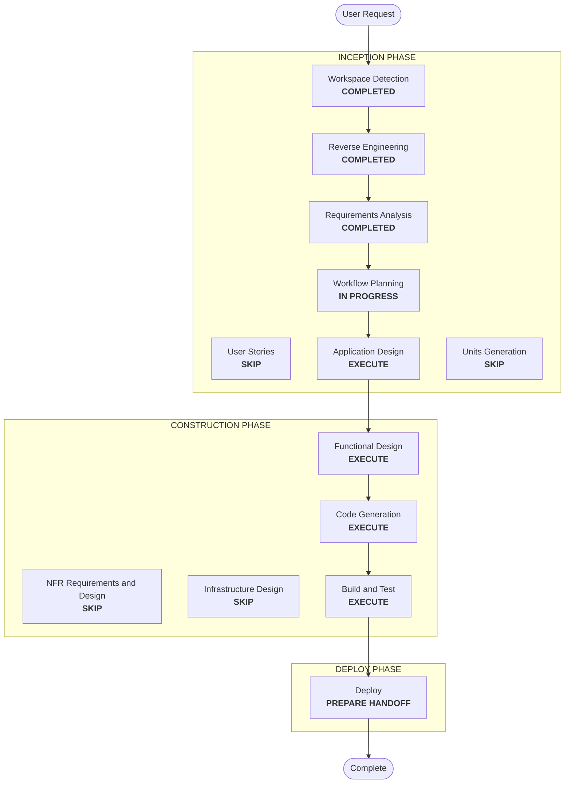

# Execution Plan — Platform DAG Factory

## Detailed Analysis Summary
- **Transformation type**: relocation and extension across two repositories, with no new service.
  - The factory moves from the workload repository into a platform package that Airflow mounts read-only.
  - DAG declarations become JSON.
  - The config check moves into the Spark container.
  - Jenkins gains a validator.
- **Change impact**:
  - **User-facing**: yes, for data engineers. They write `workflows/*.json` instead of Python, gain task arguments, retries and timeouts, and the CI gains a validation stage.
  - **Structural**: a new platform component (`lakehouse_dags`) and a new contract between the platform and product repositories.
  - **Security**: positive. No repository code runs in scheduler task callables.
- **Risk**: medium.
  - **Not yet proven**:
    - the package importing from a mount in both processes;
    - the stub passing Airflow's safe-mode discovery;
    - `exec_run` of the config check inside the Spark container (PyYAML present, `PYTHONPATH`);
    - `spark-submit` passing `--` extras to the application;
    - DAG and task IDs staying identical across the cut-over.
  - **Effect on runs**: the cut-over recreates Airflow once (bundle directories) and changes the DAG structure: `validate_environment` moves after `create_cluster`.
- **Rollback**:
  - **Platform side**: harmless while the old repository DAG still uses its own factory. Revert the mounts and `sparse_dirs`.
  - **Workload repository**: revert its commit on `main` and `uat`.
- **Testing**:
  - **Offline**: ported factory tests, plus validation and graph tests with Hypothesis properties.
  - **Live**: the old DAG still works with the platform side live; after the push, both DAGs come from JSON with the same IDs; a UAT run succeeds end to end; the CI validator passes, and refuses an invalid change on a throwaway branch only with approval.

## Workflow Visualization

Text alternative: Workspace Detection, Reverse Engineering and Requirements Analysis are completed. Workflow Planning leads to Application Design, Functional Design, Code Generation, Build and Test, and the Deploy handoff. User Stories, Units Generation, NFR and Infrastructure Design are skipped.

## Phases
- [x] Workspace Detection, focused Reverse Engineering, Requirements Analysis: COMPLETED.
- [ ] User Stories: SKIP. Data engineers and operators are the existing personas, and the requirements already state the contract.
- [ ] Application Design: **EXECUTE**.
  - **Decisions**: package layout (Airflow-dependent factory vs standard-library spec and validator), mount paths and `PYTHONPATH`, the stub's exact text, and the validator's delivery into Jenkins (mount vs image; Jenkins build context is `infra/jenkins`).
  - **Probes before code**, on the running Airflow without touching the live DAG:
    - import from a read-only mount in the dag-processor and the scheduler;
    - safe-mode discovery of the stub;
    - `exec_run` of the config check in a Spark runtime container;
    - `spark-submit ... -- extras` reaching `sys.argv`.
- [ ] Units Generation: SKIP. One unit, `dag-factory`, delivered in two repositories.
- [ ] Functional Design: **EXECUTE**. The JSON v1 rules, graph construction, bundle identity, the task option mapping, validator rules (stub template, extra `.py` files), `cli.py`'s `--` behavior, and property identification.
- [ ] NFR Requirements, NFR Design, Infrastructure Design: SKIP. Security and Resiliency are off, Hypothesis is already selected, and there is no new service.
- [ ] Code Generation: **EXECUTE**. The platform side first, then the workload change in the scratchpad clone, which is pushed only on approval.
- [ ] Build and Test: **EXECUTE**, live, with the cut-over order of FR-8.
- [ ] Deploy: **EXECUTE**, as a handoff.

## Canonical Knowledge Impact Inventory
| Canonical path | Action | Requirement and component | Reason |
|---|---|---|---|
| `aidlc-docs/knowledge/opensource-lakehouse-infra-v2/application-design.md` | UPDATE | FR-1, FR-2, FR-4, FR-5, FR-7 (Airflow and shared Spark runtime) | The DAG factory becomes a platform component; the "Workload contract" paragraph becomes the JSON contract; `sparse_dirs`; the config check in Spark; the CI validator |
| `aidlc-docs/knowledge/opensource-lakehouse-infra-v2/functional-design/airflow-workflows.md` | CREATE | FR-2 to FR-4, FR-6, FR-7 (platform DAG factory) | A new component boundary: the platform owns DAG construction, the JSON schema, the stub, and the validator. No functional-design document for Airflow workloads exists; the factory's rules lived in the workload repository |
| `aidlc-docs/knowledge/opensource-lakehouse-infra-v2/functional-design/jenkins-ci-access.md` | UPDATE | FR-7 | The validator available to product CI jobs |
| `aidlc-docs/knowledge/opensource-lakehouse-infra-v2/functional-design/lakehouse-product-access.md` | RETAIN | none | Writer selection and DAG ID rules are unchanged |
| `aidlc-docs/knowledge/opensource-lakehouse-infra-v2/functional-design/starrocks-sql-access.md` | RETAIN | none | Unaffected |

## Package Change Sequence
1. **Probes** (Application Design).
2. **Platform package**: `infra/airflow/lakehouse_dags/`, with the standard-library spec and validator, and the factory ported from `dag_factory.py`, `dag_defaults.py` and `spark_output.py` (FR-1, FR-3, FR-4).
3. **Compose**: mounts and `PYTHONPATH` for the dag-processor and the scheduler, and `sparse_dirs` in both places (FR-1, FR-5).
4. **Validator in Jenkins** (FR-7).
5. **Platform tests**, README (FR-9).
6. **Live, platform side**: recreate Airflow; the old DAG still works (FR-8 step 1).
7. **Workload repository change** in the scratchpad clone, tested; pushed after approval (FR-6, FR-8 steps 2 and 3).
8. **Live, after the push**: both DAGs from JSON, a UAT run, and CI.

## Success Criteria
- After the push, `default-main-test_environment` and `default-uat-test_environment` come from `workflows/test_environment.json`, with the same DAG and task IDs (`validate_environment` now follows `create_cluster`). A UAT run succeeds end to end with the product's writer.
- No product repository module is imported by any scheduler task callable. The config check runs in the Spark container.
- Task `args`, `retries` and timeouts appear in the generated tasks. An invalid JSON file gives a clear import error and fails `lakehouse-validate-workflows`.
- The workload repository no longer contains `dag_factory.py`, `dag_defaults.py` or `spark_output.py`. Jupyter use of `notebooks/` and `configs/` is unchanged.
- The infrastructure suite and the workload suite pass, including the new Hypothesis properties.
